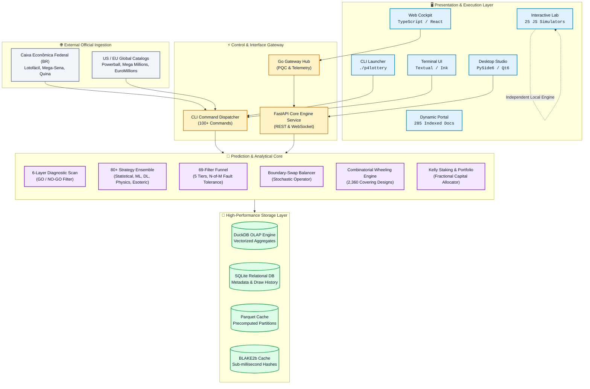
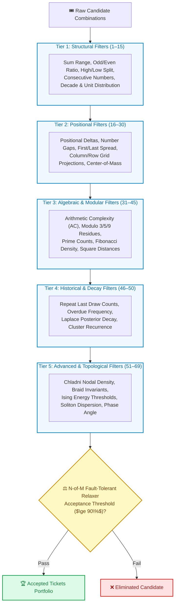

# p4lottery (Prediction Engine v11.2 — Singularity) 🚀🌌

> A high-performance **Mathematical & Cross-Disciplinary Lottery Prediction Engine** featuring 100+ CLI commands, 80+ prediction strategies, 69 structural filters, 2,360 combinatorial covering designs, a 30-document frontier architecture series spanning 90 scientific faculties, an interactive browser-based simulation laboratory, and zero-PII security guardrails.

[]()
[]()
[]()
[]()
[]()
[]()
[]()

---

## 🏛️ System Architecture



---

## 🗺️ Repository Topology & Map of Content (MOC)

### Macro Directory Layout

```
p4lottery/
├── engine/                     # Core Mathematical & Predictive Engine
│   ├── adapters/               # Official draw scrapers & data ingesters (BR Caixa, US, EU, Global)
│   ├── api/                    # High-throughput FastAPI REST & WebSocket endpoints
│   ├── cli/                    # 100+ Click-based CLI operational commands
│   ├── modules/                # 69-filter funnel, analytics, boundary balancer, hybrid synthesis
│   │   └── filters/            # 5-Tier filter implementation (structural, positional, algebraic, etc.)
│   ├── odds/                   # Hypergeometric distribution & probability calculators
│   ├── quina_unfold/           # Unfolding routines for Brazilian Quina combinations
│   ├── services/               # Background daemon, cache managers, synchronization schedulers
│   ├── strategies/             # 80+ prediction strategies (statistical, ML, deep, foundation, frontier)
│   │   ├── statistical/        # 40 statistical & mathematical strategies (Markov, Poisson, Hurst, etc.)
│   │   ├── ml/                 # 14 machine learning regressors & classifiers (XGB, LightGBM, CatBoost)
│   │   ├── deep/               # 7 deep neural network architectures (Transformer, LSTM-CRF, CNN-1D)
│   │   ├── foundation/         # Foundation zero-shot models (Google TimesFM, TabPFN)
│   │   └── fun/                # 40 complex systems & frontier physics models (Ising, Ricci, Soliton)
│   └── wheels/                 # 2,360 Combinatorial covering wheels & evolutionary optimizers
├── desktop/                    # PySide6 / Qt 6 Native Forensic Desktop Application
│   └── src/                    # Views, models, viewmodels, interactive grids & PyQtGraph charts
├── cockpit/                    # Web-based Forensic Analytics Cockpit (TypeScript / React)
│   └── src/                    # Interactive dashboards, telemetry charts & filter controls
├── tui/                        # High-Density Terminal User Interface (Textual / Ink)
│   └── src/                    # Reactive terminal views, real-time logs & keyboard navigation
├── app/                        # Cross-Platform React Native Application
├── gateway/                    # High-Performance Go Gateway (Post-Quantum Cryptography & Telemetry)
├── docs/                       # Project Knowledge Base & Theoretical Documentation
│   ├── reference/              # Master reference manuals, interactive labs, and architecture series
│   │   ├── architecture/       # 30-document architectural series (00–29) spanning 90 scientific horizons
│   │   ├── dynamic-portal.html # Interactive reference portal indexing 285 technical specifications
│   │   └── frontier-synthesis-lab.html # Browser simulation lab featuring 25 interactive scientific models
│   ├── adr/                    # Architecture Decision Records
│   └── agents/                 # Agent operational policies, issue tracker, and Zero-PII specifications
├── data/                       # Local draw storage, wheel databases, BLAKE2b cache & DuckDB files
├── scripts/                    # Forensic tools, automated backfillers, and zero-PII security guardrails
└── tests/                      # Comprehensive test suite (94+ modules: unit, integration, and compliance)
```

### Engineered Domain Map of Content (MOC)

| Domain | Subsystem / Directory | Primary Role & Key Modules | Core Reference & Docs |
|---|---|---|---|
| **Prediction Core** | [`engine/strategies/`](engine/strategies/) | 80+ Multi-modal models: Statistical (40), ML (14), Deep Learning (7), Foundation (2), Frontier (40) | [Doc 15](docs/reference/architecture/15-Multi-Modal-Prediction-Mechanics-and-Frontier-Synthesis.md) · [Doc 16](docs/reference/architecture/16-Cross-Disciplinary-Frontier-Sciences-and-Complex-Systems.md) |
| **Filter Funnel** | [`engine/modules/filters/`](engine/modules/filters/) | 69 Filters partitioned into 5 Tiers: Structural (1–15), Positional (16–30), Algebraic (31–45), Historical (46–50), Advanced (51–69) | [Doc 03](docs/reference/architecture/03-Filters-Reference.md) · [Filters CSV](docs/reference/architecture/filters-catalog.csv) |
| **Combinatorics** | [`engine/wheels/`](engine/wheels/) | 2,360 Combinatorial covering wheels $C(v, k, t, m)$, genetic wheel optimizers, key number wheels | [Doc 04](docs/reference/architecture/04-Wheeling-Systems.md) · [Wheels CSV](docs/reference/architecture/wheels-catalog.csv) |
| **Balance Operator** | [`engine/modules/hybrid_synthesis.py`](engine/modules/hybrid_synthesis.py) | Boundary-swap stochastic operator balancing sum, parity, decade spreads, and AC metrics | [Doc 15 §4](docs/reference/architecture/15-Multi-Modal-Prediction-Mechanics-and-Frontier-Synthesis.md) |
| **Data Ingestion** | [`engine/adapters/`](engine/adapters/) | Automated scraping and parsing for Caixa (BR), Powerball, Mega Millions (US), EuroMillions, and 222 global games | [Doc 09](docs/reference/architecture/09-Database-Schema.md) · [Games CSV](docs/reference/architecture/games-catalog.csv) |
| **Command Router** | [`engine/cli/`](engine/cli/) | 100+ commands covering diagnostics, forecasting, wheeling, backtesting, and autonomous copilot | [Primary Workflows](#-command-reference-100) |
| **Desktop Client** | [`desktop/`](desktop/) | Native PySide6 / Qt 6 GUI with virtualized `QTableView` tables, PyQtGraph charts, and async workers | [Doc 08](docs/reference/architecture/08-UI-Screen-Design-and-Navigation.md) |
| **Simulation Lab** | [`docs/reference/`](docs/reference/) | Browser-based interactive lab (`frontier-synthesis-lab.html`, 25 simulators) and Dynamic Portal (`dynamic-portal.html`, 285 docs) | [Interactive Lab Guide](#-interactive-laboratory--dynamic-portal) |
| **Frontier Sciences** | [`docs/reference/architecture/`](docs/reference/architecture/INDEX.md) | 30-part architecture specification series (00–29) exploring 90 cross-disciplinary scientific horizons | [Architecture Matrix](#-architectural--scientific-reference-30-specifications) |
| **API & Gateway** | [`engine/api/`](engine/api/) · [`gateway/`](gateway/) | FastAPI REST service + high-throughput Go PQC/telemetry gateway hub | [Doc 07](docs/reference/architecture/07-Architecture-and-Data-Model.md) |
| **Verification & QA** | [`tests/`](tests/) · [`scripts/`](scripts/) | 94+ unit/integration test suites, blind historical backtesting, and zero-PII security verification | [Zero-PII Policy](docs/agents/pii-policy.md) · [`scripts/check_no_pii.py`](scripts/check_no_pii.py) |

---

## 🔄 End-to-End Prediction Pipeline

```mermaid
flowchart LR
    accTitle: End-to-End Prediction and Execution Pipeline
    accDescr: Sequential dataflow from historical draw ingestion to diagnostic scan, multi-modal strategy ensemble, 69-filter funnel, boundary-swap balancer, wheeling, and staking.

    inflow(["📥 Official Draw Ingestion<br/>(JSON / HTML / CSV)"])
    scan{"🔍 6-Layer Diagnostic<br/>Chi² & Entropy Scan"}
    ensemble["🔮 80+ Multi-Modal Ensemble<br/>(Statistical, ML, DL, Physics)"]
    candidates["🎯 Candidate Pool<br/>(Weighted Numbers / Tickets)"]
    funnel["🛡️ 69-Filter Funnel<br/>(Tiers 1–5 Elimination)"]
    balance["⚖️ Boundary-Swap Balancer<br/>(Sum, Parity & Decade Equilibrium)"]
    wheel["🎡 2,360 Covering Wheels<br/>(Abbreviated C(v,k,t,m))"]
    stake["💰 Kelly Staking Engine<br/>(Fractional Capital Sizing)"]
    outflow(["✅ Validated Portfolio<br/>(+ Chi² Empirical Status Flag)"])

    inflow --> scan
    scan -->|"GO Verdict"| ensemble
    scan -->|"NO-GO Warning"| ensemble
    ensemble --> candidates
    candidates --> funnel
    funnel --> balance
    balance --> wheel
    wheel --> stake
    stake --> outflow

    classDef flowNode fill:#f8fafc,stroke:#3b82f6,stroke-width:2px,color:#0f172a;
    classDef decisionNode fill:#fef08a,stroke:#eab308,stroke-width:2px,color:#854d0e;
    classDef terminalNode fill:#dcfce7,stroke:#22c55e,stroke-width:2px,color:#14532d;

    class candidates,ensemble,funnel,balance,wheel,stake flowNode;
    class scan decisionNode;
    class inflow,outflow terminalNode;
```



---

## 🛡️ 69-Filter Funnel Architecture



### 🔍 Filter Discovery & Dynamic Inspection (`lottery docs --filter`)

Every filter in the 5-tier catalog (109 total filters) can be inspected in the terminal with its **mathematical formulation, visual ASCII diagram, Mermaid architecture graph, and live ASCII gauge evaluation**:

```bash
# Browse full catalog or filter by tier
./p4lottery docs filters
./p4lottery docs filters --tier 1

# Inspect Arithmetic Complexity (AC) with live ticket evaluation
./p4lottery docs --filter structural_ac_value --ticket 4,11,23,35,48,59

# Inspect Dual-Mode Game-Adaptive Historical AC Range
./p4lottery docs --filter historical_ac_range --ticket 4,11,23,35,48,59

# Inspect Birthday Bias Clustering
./p4lottery docs --filter structural_birthday_bias --ticket 4,11,23,35,48,59

# Inspect Quadrant Balance on Cartesian Grid
./p4lottery docs --filter positional_quadrant_balance --ticket 4,11,23,35,48,59

# Inspect Magic Square Harmonics (Lo Shu Order-3 M=15)
./p4lottery docs --filter algebraic_magic_square --ticket 4,11,23,35,48,59

# Inspect Game-Adaptive Median Range across different draw rules (e.g. Lotofácil k=15)
./p4lottery docs --filter historical_median_range --game br/lotofacil --ticket 1,2,5,8,10,12,13,14,15,17,19,20,21,23,25

# Inspect Historical Co-occurrence Pair Graph
./p4lottery docs --filter historical_common_pair --ticket 10,23,34,42,51,58

# Inspect Sequential Ball Gaps
./p4lottery docs --filter positional_gap_1_2 --ticket 3,18,22,35,41,50

# Track elimination step-by-step through a candidate pool
./p4lottery filter-funnel br/mega-sena --pool 1,2,3,4,5,6,7,8,9,10,11,12 --filters parity,spread,historical_ac_range
```

> See [`LOTTERY_FILTERS_REFERENCE.md`](docs/filters/LOTTERY_FILTERS_REFERENCE.md) for the full 1,800+ line encyclopedia detailing all 109 filters, and [`FILTER_DISCOVERY_GUIDE.md`](docs/filters/FILTER_DISCOVERY_GUIDE.md) for the discovery cheat sheet.

---

## 📦 Download & Instalação Rápida (Sem Código Fonte)

Para usar a aplicação diretamente **sem precisar clonar o repositório ou instalar Python**:

### 1. Aplicativo Desktop (Standalone GUI)
Baixe o executável pronto para o seu sistema operacional na página oficial de **[GitHub Releases](https://github.com/OAL-Logic/prediction-engine-lottery/releases)**:

| Sistema Operacional | Pacote de Download | Como Usar |
|---|---|---|
| **Windows** | `p4lottery-windows.zip` | Descompacte e clique duas vezes em `p4lottery.exe` |
| **Linux** | `p4lottery-linux.zip` | Descompacte e execute `./p4lottery` no terminal |
| **macOS** | `p4lottery-macos.zip` | Descompacte e abra o `p4lottery.app` |

*Os binários incluem todos os módulos do motor preditivo, banco de dados DuckDB local e interface gráfica PySide6 integrados.*

### 2. Pacote CLI Python (`p4lottery`)
Se preferir usar o terminal sem puxar o código fonte, instale diretamente via pipx/pip:
```bash
# Via pipx (ambiente isolado recomendado):
pipx install https://github.com/OAL-Logic/prediction-engine-lottery/releases/latest/download/lottery_engine-0.0.1-py3-none-any.whl

# Ou via pip padrão:
pip install lottery-engine
```

---

## 🚀 Quick Start

Use the unified executable launcher [`./p4lottery`](./p4lottery) (or [`./lottery`](./lottery)):

```bash
# 1. Setup environment & dependencies
./p4lottery setup

# 2. Ingest lottery results (e.g. Brazilian Lotofácil or Mega-Sena)
./p4lottery fetch br/lotofacil
./p4lottery fetch br/mega-sena

# 3. Diagnostic scan & statistical analysis
./p4lottery scan br/lotofacil        # 6-layer diagnostic scan (GO/NO-GO)
./p4lottery analyze br/lotofacil     # Full statistical dashboard

# 4. Generate optimized prediction tickets
./p4lottery suggest br/lotofacil --strategy weighted --count 3
./p4lottery forecast br/lotofacil    # Multi-strategy consensus ticket
./p4lottery next br/lotofacil        # One-line: scan + forecast + verdict

# 5. Combinatorial wheeling & portfolio optimization
./p4lottery wheel br/mega-sena -v 12 -k 6 -t 4 -m 4    # Abbreviated wheel
./p4lottery risk br/lotofacil --bankroll 500           # Kelly Criterion bet sizing

# 6. Autonomous Productivity Planner digest
./p4lottery daily br/lotofacil       # Morning pipeline digest
./p4lottery session br/lotofacil     # 5-stage pre-draw decision cycle
```

---

## 🧪 Interactive Laboratory & Dynamic Portal

The project features zero-dependency, self-contained interactive web assets designed for local research and deep exploration:

* 🧪 **[Interactive Frontier Synthesis Laboratory](docs/reference/frontier-synthesis-lab.html)**:
  - **25 interactive visual modules**: Tri-Modal Stochastic Simulator, Follower Matrix, Orbital Mod-9 Harmonics, 2,360 Covering Wheels Explorer, Takens Attractor, Ising Spin-Glass Annealer, Pari-Mutuel Optimizer, Kuramoto Oscillator Network, Poincaré Hyperbolic Disk, Chladni Cavity, Feynman Path Integral, 2D Optical Wavefront, KdV Solitons, Spacetime Braids, Discrete Ricci Flow Surgery, Hebbian STDP, RMT Marchenko-Pastur Spectral Filter, Bethe Lattice Percolation, 2D Turing Morphogenesis, Lorenz Convective Attractor, Thom Cusp Catastrophe, Waddington Epigenetic Landscape, Kahneman-Tversky Prospect Weighting, Tsallis Non-Extensive $q$-Entropy, and Zipf-Mandelbrot Log-Log Frequencies.
* 🌐 **[Master Dynamic Reference Portal](docs/reference/dynamic-portal.html)**:
  - **285 technical documents** indexed with instant fuzzy client-side search, category filters, and live markdown rendering.

---

## 📚 Architectural & Scientific Reference (30 Specifications)

The repository hosts an authoritative, mathematically rigorous **30-part architecture series** cataloging 90 cross-disciplinary scientific frontiers in [`docs/reference/architecture/`](docs/reference/architecture/INDEX.md):

| # | Specification Document | Key Theoretical & Algorithmic Horizons |
|---|---|---|
| `00`–`14` | **Core Architecture & Functional Parity** | Rebuild plan, 69-filter evaluation engine, data models, wire grammar, database schemas, validation fixtures. |
| `15` | **[Multi-Modal Prediction & Frontier Synthesis](docs/reference/architecture/15-Multi-Modal-Prediction-Mechanics-and-Frontier-Synthesis.md)** | Tri-modal convex fusion, Gaussian orbital harmonics, Laplace posterior decay, Boundary-Swap sum balancer, 2,360-wheel catalog. |
| `16` | **[Cross-Disciplinary Frontiers & Complex Systems](docs/reference/architecture/16-Cross-Disciplinary-Frontier-Sciences-and-Complex-Systems.md)** | Ising spin-glass annealing, Takens' phase space reconstructor, persistent homology TDA, continuous-time quantum walks, Kolmogorov NCD. |
| `17` | **[Universal Scientific Frontiers & Cybernetic Synthesis](docs/reference/architecture/17-Universal-Scientific-Frontiers-and-Cybernetic-Synthesis.md)** | Chladni acoustic cavity nodal lines, solar S2 barometric tides, E8 quasicrystal lattices, Poincaré hyperbolic disk, Kuramoto synchronizers. |
| `18` | **[Relativistic Spacetime, Quantum Action & Solitons](docs/reference/architecture/18-Relativistic-Spacetime-Quantum-Action-and-Soliton-Physics.md)** | Minkowski causal lightcones ($ds^2$), Feynman stationary action ($\delta\mathcal{S}=0$), 2D optical wavefront diffraction, KdV solitons, Giry monads. |
| `19` | **[Topological Braids, Ricci Curvature & Neuro-Holography](docs/reference/architecture/19-Topological-Braids-Ricci-Curvature-and-Neuro-Holographic-Mechanics.md)** | Artin braid groups $B_n$, Jones polynomial invariants, discrete Ollivier-Ricci graph flow surgery, Hebbian STDP, Kozai-Lidov secular resonance. |
| `20` | **[Master Unified Epistemology & Singularity](docs/reference/architecture/20-Master-Unified-Scientific-Epistemology-and-Singularity-Architecture.md)** | Wilsonian Renormalization Group (RG) coarse-graining, Random Matrix Theory (RMT) Marchenko-Pastur thresholds, Liouville phase invariance, Lindblad master equations. |
| `21` | **[Condensed Matter, Quantum Tensors & Langlands](docs/reference/architecture/21-Condensed-Matter-Quantum-Tensor-and-Langlands-Frontiers.md)** | Bethe percolation thresholds, BKT topological vortex unbinding, granular force chains, Parisi RSB ultrametricity, CKW entanglement monogamy, MPS/DMRG tensors, Ramanujan expanders. |
| `22` | **[Geophysical Fluids, Evolutionary Bio & Cryptography](docs/reference/architecture/22-Geophysical-Fluids-Evolutionary-Bio-and-Cryptographic-Manifolds.md)** | Kolmogorov K41 turbulent cascades, Rossby planetary waves, Rayleigh-Bénard convection, Sandpile self-organized criticality, Kimura gene diffusion, Turing morphogenesis, LLL shortest vectors. |
| `23` | **[Astrophysical Resonances, Active Inference & Catastrophes](docs/reference/architecture/23-Astrophysical-Resonances-Neuro-Active-Inference-and-Catastrophe-Singularities.md)** | KAM invariant tori & Arnold diffusion, Mukhanov-Sasaki quantum modes, Black hole Page curve, Friston variational free energy, Amari continuous neural fields, Thom's cusp catastrophe. |
| `24` | **[Noncommutative Geometry, Strings & Stochastic Thermo](docs/reference/architecture/24-Noncommutative-Geometry-String-Duality-and-Stochastic-Thermodynamics.md)** | Connes' noncommutative geometry, Moyal star-products, AdS/CFT holographic projection, Calabi-Yau mirror symmetry, T-duality, Jarzynski equality, Thermodynamic Uncertainty (TUR), Tsallis $q$-entropy. |
| `25` | **[Theoretical Biology, Epigenetics & Linguistics](docs/reference/architecture/25-Theoretical-Biology-Epigenetics-and-Linguistic-Semantics.md)** | Waddington epigenetic developmental landscapes & chreodes, bacterial quorum sensing, Kauffman $NK$-networks ($K=2$ edge of chaos), Nowak evolutionary games, Chomsky PCFG grammars, Zipf-Mandelbrot laws. |
| `26` | **[Category Theory, Metamaterials & Fracture Mechanics](docs/reference/architecture/26-Category-Theory-Metamaterials-Quantum-Finance-and-Materials-Fracture.md)** | Grothendieck topos & sheaf cohomology, adjoint functors & monads, braided string diagrams, SOFAR acoustic waveguides, Veselago negative index, Kahneman-Tversky prospect theory, Griffith fracture. |
| `27` | **[Quantum Chaos, Spectral Rigidity & Hyperbolic Geometry](docs/reference/architecture/27-Quantum-Chaos-Spectral-Rigidity-and-Hyperbolic-Curvature.md)** | Bohigas-Giannoni-Schmit (BGS) level repulsion, quantum Zeno freezing, Spectral Form Factors (SFF ramp/plateau), OTOC scrambling, Forman-Ricci cellular curvature, Gromov $\delta$-hyperbolic spaces. |
| `28` | **[Homotopy Type Theory, Cellular Automata & Plasma MHD](docs/reference/architecture/28-Homotopy-Type-Theory-Cellular-Automata-and-Plasma-MHD.md)** | Voevodsky univalence axiom ($\operatorname{Id}(A, B) \simeq (A \simeq B)$), Higher Inductive Types (HITs), Joyal quasi-categories, Wolfram Rule 110 Turing completeness, Levin $Kt$ complexity, Sweet-Parker reconnection. |
| `29` | **[Chronobiology, Quantum Darwinism & Multivariate Topology](docs/reference/architecture/29-Chronobiology-Quantum-Darwinism-and-Multivariate-Topology.md)** | FitzHugh-Nagumo relaxation oscillators & refractory periods, Phase Response Curves (PRC), stochastic resonance SNR gain, Zurek pointer states, 2D multidirectional bifiltrations, cup products & Steenrod squares. |

---

## 📐 Strategy Tiers (80+)

| Tier | Count | Description & Examples |
|------|-------|------------------------|
| 📈 **Statistical** | 40 | `weighted`, `bayesian`, `markov`, `monte_carlo`, `spectral`, `fourier_forecast`, `nash_equilibrium`, `graph_influence`, `hurst_memory` |
| 🤖 **Machine Learning** | 14 | `random_forest`, `gradient_boost`, `ml_regressor` (XGB/LGBM/CAT), `stacking_ai`, `ensemble_pro`, `synapse` |
| 🧠 **Deep Learning** | 7 | `transformer`, `lstm`, `lstm_crf`, `cnn_1d`, `gru` |
| 🔭 **Foundation** | 2 | `timesfm` (zero-shot time-series forecasting via Google TimesFM), `tabfm` (zero-shot tabular classification via TabPFN) |
| ✨ **Complex & Frontier**| 40 | `sacred_manifold`, `tda_topology`, `ising_model`, `zeno_quantum`, `lyapunov_chaos`, `chladni_nodal`, `feynman_action`, `ricci_flow` |

---

## 🎯 Command Reference (100+)

### ⭐ Primary Workflows
| Command | Description |
|---------|-------------|
| `wizard` | Interactive guided analysis & prediction wizard |
| `fetch` | Fetch & cache historical draw data from official sources |
| `suggest` | Generate optimized tickets using any strategy or ensemble |
| `analyze` | Full statistical dashboard (14+ analytical visualizer views) |
| `backtest` | Blind historical out-of-sample strategy testing & ROI audit |
| `forecast` | Multi-strategy weighted consensus ticket |
| `next` | One-line pipeline: scan → forecast → operational verdict |
| `daily` | Morning briefing & digest pipeline |
| `session` | Complete 5-stage pre-draw decision cycle |

### 🔬 Diagnostics & Physics Engines
| Command | Description |
|---------|-------------|
| `dashboard` | Rich terminal analytical cockpit |
| `scan` | 6-layer diagnostic scan (GO/NO-GO gate) |
| `signal` | Signal-to-noise rolling window analysis |
| `cluster` | Unsupervised draw clustering (K-Means/DBSCAN) |
| `stress-test` | Adversarial pattern hallucination test |
| `entropy-scan` | Shannon, Tsallis, and Kolmogorov information entropy |
| `variance-report` | 5-dimension volatility regime detector |
| `markov-table` | Transition probability matrix & follower distributions |
| `number-heat` | Full-pool hit/miss heatmap grid |

### 🎟️ Combinatorics & Staking
| Command | Description |
|---------|-------------|
| `wheel` | Combinatorial covering designs ($C(v, k, t, m)$ with 2,360 catalogs) |
| `genetic-wheel` | Evolutionary wheel optimizer with boundary balance |
| `multi-ticket` | Multi-ticket coverage and overlap minimizer |
| `suggest-swaps` | Single-number swap optimizer for sum/AC balancing |
| `ticket-grade` | Grade tickets against validated historical metrics ($A^+ \to F$) |
| `risk` | Fractional Kelly Criterion capital and staking optimizer |
| `hedge` | Combinatorial hedging portfolio generator |

---

## 🖥️ Desktop Cockpit (Prophet Dashboard)

A native PySide6/Qt 6 forensic cockpit matching standard commercial lottery studio capabilities with zero serialization latency:

```bash
pip install -e ".[desktop]"
p4lottery-desktop      # or python3 -m desktop.main
```

Features virtualized high-density grids (`QTableView`), real-time PyQtGraph histograms, harmony filter gates, interactive number grids, and asynchronous multi-threaded compute pipelines.

---

## 🛡️ Zero-PII Policy & Integrity Guardrails

1. **Strict Zero-PII Policy**: No real user Personal Identifiable Information (PII) — including birthdates (`YYYY-MM-DD`), full names, IDs, addresses, or personal accounts — is ever persisted or committed in tracked files.
2. **Automated Guardrail Enforcement**: The repository strictly enforces this policy via `python3 scripts/check_no_pii.py` (integrated into pre-commit hooks and test suites).
3. **Chi² Predictive Gate**: Every prediction surface returns `is_predictive` flags and out-of-sample validation metrics. The engine explicitly flags when empirical data cannot beat random expectations.

---

## ⚠️ Disclaimer

This tool is designed for mathematical research, complex systems analysis, and statistical exploration. Lottery draws are independent random events. The mathematical frameworks provided by the engine optimize combinatorial coverage, portfolio equity, and structural filters, but do not constitute financial advice or a guarantee of winning. Play responsibly.

## 📄 License

MIT © 2026 `p4lottery` Contributors.
