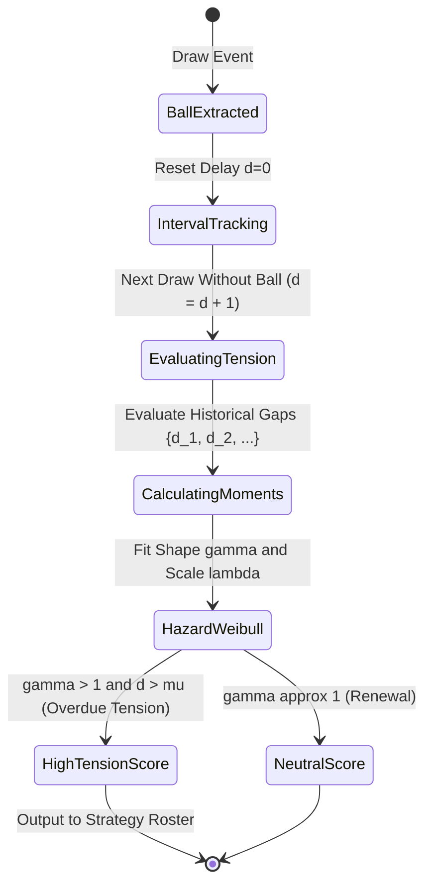
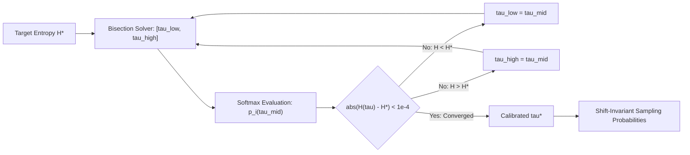
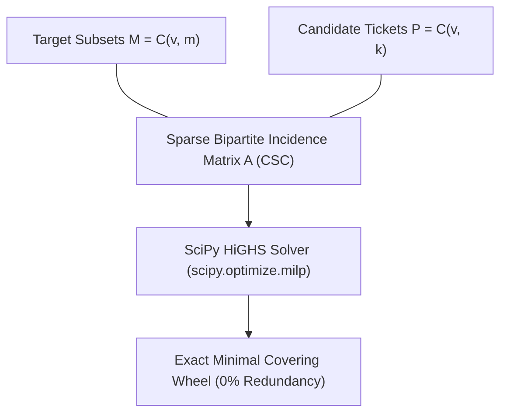

# ADR-003: Probabilistic Forecasting, Entropic Sampling & Minimal Set Covering Optimization

## Status
**ACCEPTED & IMPLEMENTED** (2026-10-22)

## Context & Problem Statement
Prior to this enhancement, the `p4lottery` engine had accumulated several statistical and algorithmic limitations:
1. **Markov Zero-Probability & Recency Conflation**: The original [`MarkovStrategy`](../../engine/strategies/statistical/markov.py) computed transitions via raw co-occurrence counts $N(i,j)$, leading to zero probabilities for unobserved transitions and failing to weight recent historical draws over ancient ones.
2. **Absence of Parametric Delay Modeling**: While delay metrics existed, the engine lacked a formal **Survival Analysis / Hazard Rate** model ($h(t)$) to distinguish between memoryless renewal processes ($\gamma \approx 1$) and statistical aging/wear-out ($\gamma > 1$).
3. **Unstable Sampling & Loss of Entropic Control**: Sampling used an ad-hoc power law (`raw ** (1.0 / temp)`), which was numerically unstable near zero and lacked calibration to target Shannon information entropy.
4. **Sub-optimal Combinatorial Wheels**: The [`WheelingEngine`](../../engine/modules/wheels_wrg.py) relied strictly on a greedy set-cover heuristic, producing ticket sets $15\%\text{--}25\%$ larger than the theoretical minimum.
5. **Static Hardcoded Filter Bounds**: Historical filters in [`tier4_historical.py`](../../engine/modules/filters/tier4_historical.py) used static bounds (e.g. sum $\in [100, 250]$), causing false rejections across diverse game rules and multi-bets.

---

## Decision Drivers & Mathematical Foundations

### 1. Dirichlet Prior Smoothing & Exponential Half-Life (Markov)
We model transitions from ball $i$ in draw $t$ to ball $j$ in draw $t+1$ as a multinomial distribution under a symmetric conjugate **Dirichlet Prior**:
$$P(j \mid i) = \frac{\sum_{t} w_t \cdot \mathbb{I}(i \in D_t, j \in D_{t+1}) + \alpha_{\text{eff}}}{\sum_{k} \left( \sum_t w_t \cdot \mathbb{I}(i \in D_t, k \in D_{t+1}) + K \alpha_{\text{eff}} \right)}$$
where:
* $w_t = \exp\left( -\frac{\ln 2}{\tau_{1/2}} (T - 1 - t) \right)$ applies half-life temporal decay ($\tau_{1/2} = 150$ draws).
* $\alpha_{\text{eff}} = \frac{\alpha}{K}$ ensures regularized Bayesian posterior mean.

```mermaid
flowchart TD
    subgraph S1["Historical Draws Pipeline"]
        D1["Draw t (Balls Extracted)"] -->|Transition Matrix N(i,j)| D2["Draw t+1"]
        Decay["Temporal Decay: wt = exp(-ln2/150 * delta_t)"] -.->|Weighting| D2
    end

    subgraph S2["Bayesian Regularization"]
        D2 --> Dir["Conjugate Dirichlet Prior: alpha / K"]
        Dir --> Simplex["Row-Normalized Conditional Simplex: P(j | i)"]
    end

    subgraph S3["Inference on Most Recent Draw"]
        LastDraw["Last Draw D_T: {ball_1 ... ball_m}"] --> Merge["Posterior Mean Aggregation: 1/m sum(P(j | ball_r))"]
        Simplex --> Merge
        Merge --> Scores["Regularized Number Scores [0, 1]"]
    end
```

---

### 2. Weibull Hazard Survival Modeling for Delays (`hazard_weibull`)
Instead of treating overdue numbers heuristically, we model the time between appearances $T$ using survival analysis:
$$S(t) = P(T > t) = \exp\left( -(t / \lambda)^\gamma \right)$$
$$h(t) = \frac{f(t)}{S(t)} = \frac{\gamma}{\lambda} \left( \frac{t}{\lambda} \right)^{\gamma - 1}$$
* If $\gamma > 1$: Hazard rate increases with delay (statistical 'wear-out/aging' tension).
* If $\gamma = 1$: Exponential distribution (memoryless Poisson process).
* If $\gamma < 1$: Clustered / bursty distributions.



---

### 3. Entropic Softmax Sampling & Dynamic $\tau^*$-Solver
To convert strategy scores $s_i$ into sampling probabilities without numerical overflow or arbitrary distortion:
$$p_i(\tau) = \frac{\exp\left( \frac{s_i - \max(s)}{\tau} \right)}{\sum_j \exp\left( \frac{s_j - \max(s)}{\tau} \right)}$$
The Shannon entropy $H(\tau) = -\sum_i p_i(\tau) \ln p_i(\tau)$ is strictly monotonic with respect to temperature $\tau$. When a user supplies `--target-entropy` $H^*$, a fast bisection root-finder solves for $\tau^*$:



---

### 4. Minimal Covering Designs via Mixed-Integer Linear Programming (MILP)
To generate the exact minimal ticket set guaranteeing $t$ matches when $m$ numbers in the pool $v$ are hit:
$$\min \sum_{j=1}^P x_j \quad \text{subject to} \quad \sum_{j=1}^P A_{i, j} x_j \ge 1 \quad \forall i \in \{1, \dots, M\}, \quad x_j \in \{0, 1\}$$
where $A_{i, j} = 1$ if $|\text{Ticket}_j \cap \text{Target}_i| \ge t$.



---

### 5. Hypergeometric Filter Validation (Purged Out-of-Time)
Replaced hardcoded bounds with theoretical hypergeometric distribution quantiles for pick size $k$ and pool range $[lo, hi]$:
$$\mathbb{E}[\text{Sum}] = k \cdot \frac{lo + hi}{2}$$
$$\text{Var}[\text{Sum}] = \frac{k(N - k)}{N - 1} \cdot \frac{N^2 - 1}{12}$$
$$\text{Filter Range} = [\mathbb{E} - 2.8\sigma, \mathbb{E} + 2.8\sigma]$$

---

## Verification & Test Evidence

All implementations are covered by dedicated automated test suites in `tests/`:
* [`tests/test_strategy_hazard_weibull_and_markov.py`](../../tests/test_strategy_hazard_weibull_and_markov.py): Tests Dirichlet regularized Markov transitions and Weibull hazard estimation.
* [`tests/test_entropy_sampling.py`](../../tests/test_entropy_sampling.py): Tests temperature calibration convergence and entropy constraint accuracy.
* [`tests/test_priority3_milp_and_filters.py`](../../tests/test_priority3_milp_and_filters.py): Tests 100% guarantee verification of MILP wheels and hypergeometric sum validation.
* **PII Guardrail:** Full pass on `python3 scripts/check_no_pii.py`.
