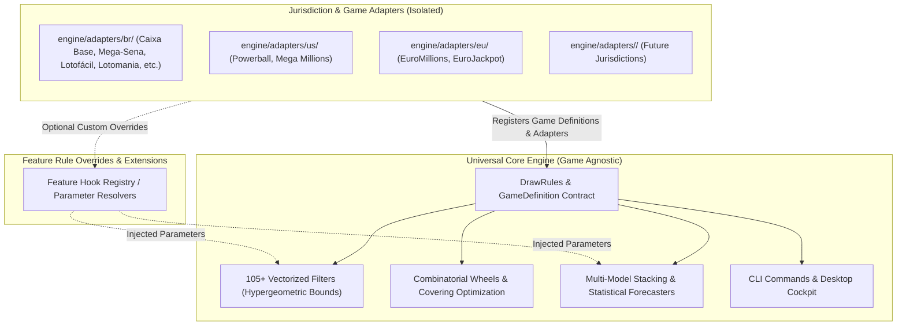

# ADR-004: Global Lottery Game Compatibility & Feature Isolation

## Status
**ACCEPTED** (2026-10-25)

## Context & Problem Statement
The Lottery Prediction Engine's initial implementations were heavily shaped by Brazilian Caixa Econômica Federal lotteries (`Mega-Sena`, `Lotofácil`, `Quina`). While Caixa lotteries provide robust real-world complexity, building features around single-game or single-jurisdiction assumptions risks creating architectural debt and preventing straightforward expansion to global lotteries (e.g. US Powerball/Mega Millions, EuroMillions, EuroJackpot, UK National Lottery, Japanese Loto 6/7, Australian Oz Lotto).

Furthermore, even within Caixa Loterias, mechanics vary considerably:
- `Lotomania`: 50 numbers selected from a 100-number pool with zero-based indexing (`00-99`), 20 winning numbers drawn per contest, and mirror betting mechanics.
- `Lotofácil`: 15 numbers picked from 25 ($60\%$ pool occupancy), where traditional low-density combinatorial filters (e.g., maximum consecutive numbers or skip intervals) produce false rejections if configured with 6/60 expectations.
- `Dupla Sena`: Two distinct winning draws conducted per contest using the same ticket selection.
- `Dia de Sorte`: 7 numbers from 31 combined with an independent categorical variable ("Mês da Sorte", 1–12).
- `+Milionária`: 6 numbers from 50 plus 2 clover/bonus numbers from a separate pool of 6.

Without a strict architectural rule, new features (filters, strategies, wheeling algorithms, backtesters, CLI commands, and UI views) could hardcode Brazilian Caixa constants, making the engine brittle and difficult to extend to other world lotteries.

---

## Decision Drivers
1. **Universal Core Architecture**: Mathematical, statistical, and combinatorial algorithms must operate against abstract rules (`DrawRules` and `GameDefinition`) rather than concrete game assumptions.
2. **Pluggable Game & Jurisdiction Rule Overrides**: When a specific game requires unique handling, workarounds, or custom parameter profiles, these must be structured into pluggable extension points rather than monolithic conditional branches in core modules.
3. **Open/Closed Principle**: The engine must be open to new lottery games across the world without requiring modifications to core analytical pipelines.
4. **Resilient Defaults (Graceful Fallback)**: If a newly introduced world lottery does not define specialized feature rules, the core engine must compute valid operational boundaries using analytical hypergeometric and probabilistic foundations.

---

## Architectural Specification

### 1. Zero-Hardcoding Mandate
- Core logic must derive pool minimum, pool maximum, and pick size strictly from `rules.number_range` and `rules.pick_count`.
- No assumptions of 1-based indexing; `rules.number_range_min` (0 or 1) must be respected across all arrays, ticket validations, and string formatters.
- Bonus pools must be decoupled: main balls and bonus balls are processed via independent rule scopes.

### 2. Jurisdiction & Adapter Isolation
- All jurisdiction-specific network scraping, API schemas, syndicate/bolão rules, and official draw schedules must reside in `engine/adapters/<country_code>/`.
- Shared jurisdictional behaviors (such as Caixa API session handling or community mirrors) reside in `<jurisdiction>_base.py`.
- Individual game adapters inherit from `LotteryAdapter` and conform strictly to the canonical DataFrame schema:
  `[draw_id (int), date (datetime UTC), numbers (list[int]), bonus (list[int])]`

### 3. Pluggable Feature Overrides (Hook Pattern)
When a feature requires specialized behavior for a game family:
- The feature defines dynamic parameter resolution based on `(N, k)` as default.
- Games can provide specialized parameter mappings or rule delegates via adapter metadata or dedicated feature override hooks.
- Code smells such as `if game_name == "lotomania":` inside universal modules (`engine/modules/filters/`, `engine/wheels/`, `engine/strategies/`) are forbidden.

---

## Consequences & Compliance

### Positive
- **Instant World Game Onboarding**: Any global lottery can be added by registering its matrix in `data/registry.yaml` and providing historical draws, instantly inheriting all 105+ filters, wheels, and prediction strategies.
- **Robustness Against Intra-Jurisdiction Divergence**: Caixa games with non-standard rules (Lotomania, Lotofácil, Dupla Sena, Dia de Sorte) work seamlessly without compromising code clarity.
- **Maintainability**: Clear separation between mathematical theory (core) and commercial lottery regulations (adapters).

### Verification & Testing Bar
All new features, filters, and strategies must pass automated validation against at least three divergent lottery archetypes:
1. **Sparse Single-Pool**: Mega-Sena (6/60) or Quina (5/80).
2. **Dense Single-Pool**: Lotofácil (15/25).
3. **Multi-Pool / Bonus Ball**: US Powerball (5/69 + 1/26) or +Milionária (6/50 + 2/6).
