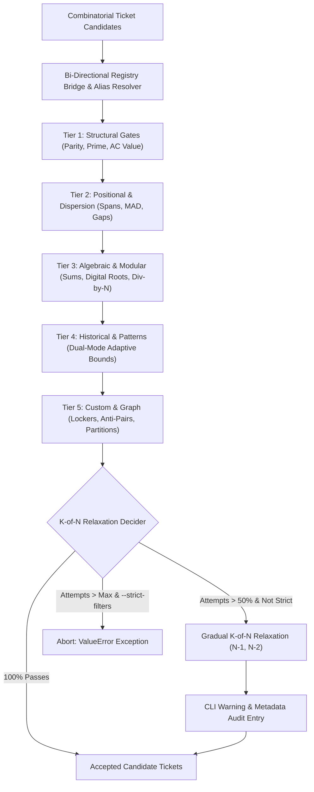
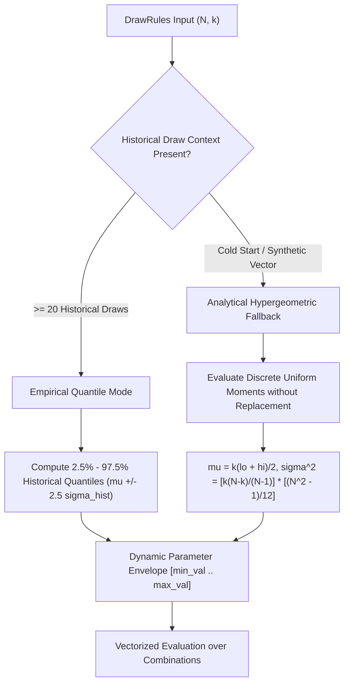
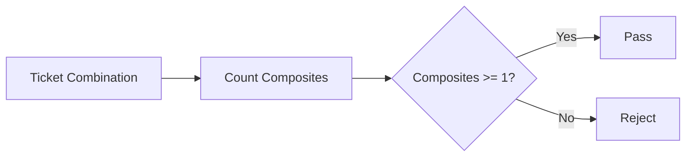
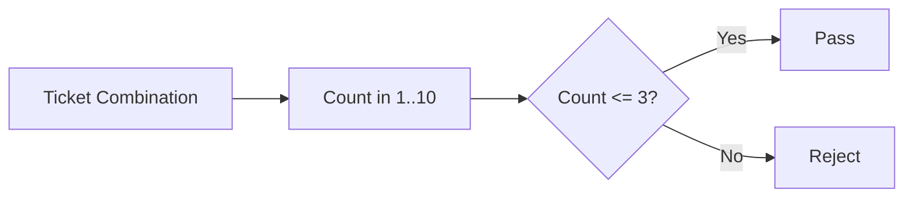
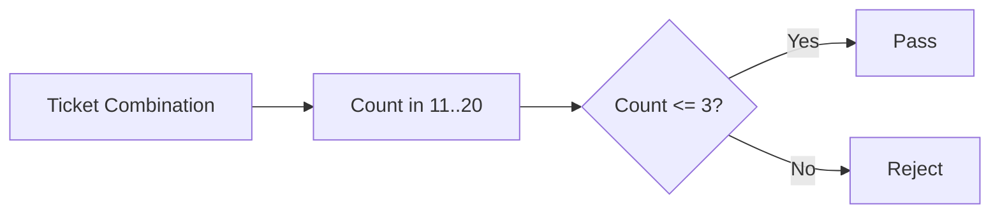
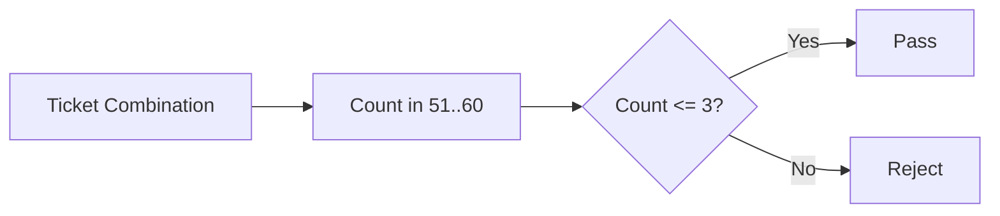
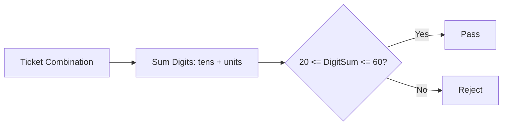

# Lottery Engine: Comprehensive Mathematical Filter Reference 🛡️

> A definitive mathematical guide, architecture specification, visual diagram collection,
> and dynamic evaluation manual for all 121 filters implemented across the **5-Tier Consolidated
> Vectorized Harmony Gate** and the **Harmony Scalar Engine**.

---

## 1. Executive Architecture & Filter Philosophy

The core purpose of the Lottery Engine's filtering subsystem is **combinatorial search space distillation**.
For example, Mega-Sena represents a search space of $\binom{60}{6} = 50,063,860$ combinations.
While every individual combination has equal prior probability under physical uniform randomness,
the **macroscopic attributes** of drawn tickets follow tightly bound combinatorial distributions
(hypergeometric, Gaussian approximations, and modular congruence classes). Combinations exhibiting extreme
clustering—such as consecutive streaks, all-odd balls, or narrow spreads—fall in asymptotic tails ($p < 10^{-6}$)
and historically fail to appear across thousands of contests.

### Pipeline Architecture Overview



### End-to-End Pipeline ASCII Box-Flow

```text
+-----------------------------------------------------------------------------------+
|                            CANDIDATE GENERATION ENGINE                            |
|                  (Weighted Softmax / Entropy Temperature Sampling)                |
+-----------------------------------------------------------------------------------+
                                          |
                                          v  [Candidate Ticket (x_1, ..., x_k)]
+-----------------------------------------------------------------------------------+
|                        BI-DIRECTIONAL HARMONY BRIDGE GATE                         |
|   Maps Aliases ('parity', 'spread', 'sum_range') <--> 5 Vectorized Tiers (1..5)   |
+-----------------------------------------------------------------------------------+
                                          |
        +---------------------------------+---------------------------------+
        |                                 |                                 |
        v                                 v                                 v
+------------------+             +------------------+             +------------------+
|  TIER 1 & 2      |             |  TIER 3          |             |  TIER 4 & 5      |
|  Parity, Bounds, |             |  Modular, Roots, |             |  Empirical Skips,|
|  AC Complexity   |             |  Hypergeometric  |             |  Co-occurrences  |
+------------------+             +------------------+             +------------------+
        |                                 |                                 |
        +---------------------------------+---------------------------------+
                                          |  [Filter Pass/Fail Vector]
                                          v
+-----------------------------------------------------------------------------------+
|                      GRADUAL K-OF-N FAULT TOLERANCE DECIDER                       |
|   Attempts <= 50% max  :  Enforce strict K = N                                    |
|   Attempts <= 75% max  :  Relax to K = max(1, N - 1)  [If not --strict-filters]   |
|   Attempts >  75% max  :  Relax to K = max(1, N - 2)  [If not --strict-filters]   |
+-----------------------------------------------------------------------------------+
                     |                                         |
     [Meets K threshold]                        [Fails under --strict-filters]
                     v                                         v
+--------------------------------------+     +--------------------------------------+
|  ACCEPTED PREDICTION TICKET          |     |  SYSTEM ABORT / EXCEPTION            |
|  - Injects metadata audit            |     |  - Preserves exact user constraints  |
|  - Emits clear CLI warning if relaxed|     |  - Explains starvation cause         |
+--------------------------------------+     +--------------------------------------+
```

### Dual-Mode Game-Adaptive Decision Tree



---

## 2. Tier 1: Structural & Parity Filters (25 Filters)

#### 1.1 `structural_ac_value` — Arithmetic Complexity (AC)
- **Tier**: Tier 1 (Complexity & Entropy)
- **Description**: Calculates the variation of differences: AC = |{x_j - x_i}| - (k - 1). Rejects simple arithmetic patterns.
- **Mathematical Formulation**: `AC = |{x_j - x_i ∣ j > i}| - (k - 1) ≥ min_ac`

```text
+-------------------------------------------------------+
| Distinct Pairwise Differences: D(k)                   |
| Arithmetic Complexity: AC = D(k) - (k - 1)            |
| Thresholds: k<=5 -> AC>=4 | k=6 -> AC>=7 | k>=7 -> 10 |
+-------------------------------------------------------+
```

```mermaid
graph LR
    A[Ticket Combination] --> B[Compute All Pair Differences]
    B --> C[AC = Count(Unique Diffs) - (k - 1)]
    C --> D{AC >= min_ac?}
    D -->|Yes| P[Pass]
    D -->|No| F[Reject]
```

**Dynamic Evaluation Example** (Ticket: `[4, 11, 23, 35, 48, 59]`):
- **Verdict**: `PASS`
- **Metric Value**: `8` (Allowed Range: `≥ 7`)
- **Gauge**: `[---=●===========--] ✓ PASS (value: 8, target: [7..15])`
- **Summary**: Arithmetic Complexity is 8 (unique diffs=13, required min_ac=7) -> PASS.

---

#### 1.2 `structural_average_value` — Arithmetic Mean / Average Value
- **Tier**: Tier 1 (Central Tendency)
- **Description**: Checks that the ticket arithmetic average falls within expected central boundaries.
- **Mathematical Formulation**: `μ - 0.25·R ≤ Mean(X) ≤ μ + 0.25·R`

```text
+-------------------------------------------------------+
| Arithmetic Average: Mean(X) = (1/k) * sum(x_i)        |
| Expected Range    : Center +/- 25% of pool span       |
+-------------------------------------------------------+
```

```mermaid
graph LR
    A[Ticket Combination] --> B[Compute Mean(X)]
    B --> C{Min Mean <= Mean <= Max Mean?}
    C -->|Yes| P[Pass]
    C -->|No| F[Reject Skewed Average]
```

**Dynamic Evaluation Example** (Ticket: `[4, 11, 23, 35, 48, 59]`):
- **Verdict**: `PASS`
- **Metric Value**: `30.0` (Allowed Range: `[15.8..45.2]`)
- **Gauge**: `[---=====●======---] ✓ PASS (value: 30.0, target: [15.8..45.2])`
- **Summary**: Arithmetic mean value is 30.00 (allowed: 15.8..45.2) -> PASS.

---

#### 1.3 `structural_birthday_bias` — Birthday Bias Avoidance
- **Tier**: Tier 1 (Crowd Avoidance)
- **Description**: Limits balls in the calendar date range (1-31) to prevent shared public split jackpots.
- **Mathematical Formulation**: `∑ [1 ≤ x_i ≤ 31] ≤ max_birthday`

```text
+-------------------------------------------------------+
| Calendar Birthday Zone : Numbers in [1 .. 31]         |
| Condition              : Count <= max_birthday        |
+-------------------------------------------------------+
```

```mermaid
graph LR
    A[Ticket Combination] --> B[Count in 1..31]
    B --> C{Count <= max_birthday?}
    C -->|Yes| P[Pass]
    C -->|No| F[Reject (Crowd Clustered)]
```

**Dynamic Evaluation Example** (Ticket: `[4, 11, 23, 35, 48, 59]`):
- **Verdict**: `PASS`
- **Metric Value**: `3` (Allowed Range: `≤ 4`)
- **Gauge**: `[---=========●===--] ✓ PASS (value: 3, target: [0..4])`
- **Summary**: Birthday numbers count is 3 [4, 11, 23] (allowed: <= 4) -> PASS.

---

#### 1.4 `structural_breadth` — Decade Breadth / Span
- **Tier**: Tier 1 (Decade & Distribution)
- **Description**: Ensures numbers span multiple distinct decades (at least 3 decades for k < 10, at least 4 for k >= 10).
- **Mathematical Formulation**: `|{⌊x_i / 10⌋}| ≥ (3 if k < 10 else 4)`

```text
+-------------------------------------------------------+
| Decades Spanned: |{x // 10}|                          |
| Requirement    : >= 3 decades (k < 10), >= 4 (k >= 10)|
+-------------------------------------------------------+
```

```mermaid
graph LR
    A[Ticket Combination] --> B[Compute Distinct Decades: set(x // 10)]
    B --> C{Count >= Min Decades?}
    C -->|Yes| P[Pass]
    C -->|No| F[Reject Decadally Clustered Ticket]
```

**Dynamic Evaluation Example** (Ticket: `[4, 11, 23, 35, 48, 59]`):
- **Verdict**: `PASS`
- **Metric Value**: `6` (Allowed Range: `≥ 3`)
- **Gauge**: `[---============●--] ✓ PASS (value: 6, target: [3..6])`
- **Summary**: Distinct decades spanned is 6 (decades: [0, 1, 2, 3, 4, 5], required: >= 3) -> PASS.

---

#### 1.5 `structural_composite_count` — Composite Number Count
- **Tier**: Tier 1 (Number Theory)
- **Description**: Ensures the ticket contains at least one composite number (x > 1 and x not in Primes).
- **Mathematical Formulation**: `∑ [x_i > 1 ∧ x_i ∉ ℙ] ≥ 1`

```text
+-------------------------------------------------------+
| Composites: numbers > 1 that are not prime            |
| Condition : Count >= 1                                |
+-------------------------------------------------------+
```



**Dynamic Evaluation Example** (Ticket: `[4, 11, 23, 35, 48, 59]`):
- **Verdict**: `PASS`
- **Metric Value**: `3` (Allowed Range: `≥ 1`)
- **Gauge**: `[---======●======--] ✓ PASS (value: 3, target: [1..5])`
- **Summary**: Composite count is 3 [4, 35, 48] (required: >= 1) -> PASS.

---

#### 1.6 `structural_decade_1` — Decade 1 (1-10) Count
- **Tier**: Tier 1 (Decade Distribution)
- **Description**: Limits numbers in Decade 1 (1–10) to at most 3.
- **Mathematical Formulation**: `∑ [1 ≤ x_i ≤ 10] ≤ 3`

```text
+-------------------------------------------------------+
| Decade 1 Range: [1 .. 10]                      |
| Condition     : Count <= 3                            |
+-------------------------------------------------------+
```



**Dynamic Evaluation Example** (Ticket: `[4, 11, 23, 35, 48, 59]`):
- **Verdict**: `PASS`
- **Metric Value**: `1` (Allowed Range: `≤ 3`)
- **Gauge**: `[---====●========--] ✓ PASS (value: 1, target: [0..3])`
- **Summary**: Decade 1 (1-10) count is 1 [4] (max: 3) -> PASS.

---

#### 1.7 `structural_decade_2` — Decade 2 (11-20) Count
- **Tier**: Tier 1 (Decade Distribution)
- **Description**: Limits numbers in Decade 2 (11–20) to at most 3.
- **Mathematical Formulation**: `∑ [11 ≤ x_i ≤ 20] ≤ 3`

```text
+-------------------------------------------------------+
| Decade 2 Range: [11 .. 20]                      |
| Condition     : Count <= 3                            |
+-------------------------------------------------------+
```



**Dynamic Evaluation Example** (Ticket: `[4, 11, 23, 35, 48, 59]`):
- **Verdict**: `PASS`
- **Metric Value**: `1` (Allowed Range: `≤ 3`)
- **Gauge**: `[---====●========--] ✓ PASS (value: 1, target: [0..3])`
- **Summary**: Decade 2 (11-20) count is 1 [11] (max: 3) -> PASS.

---

#### 1.8 `structural_decade_3` — Decade 3 (21-30) Count
- **Tier**: Tier 1 (Decade Distribution)
- **Description**: Limits numbers in Decade 3 (21–30) to at most 3.
- **Mathematical Formulation**: `∑ [21 ≤ x_i ≤ 30] ≤ 3`

```text
+-------------------------------------------------------+
| Decade 3 Range: [21 .. 30]                      |
| Condition     : Count <= 3                            |
+-------------------------------------------------------+
```


**Dynamic Evaluation Example** (Ticket: `[4, 11, 23, 35, 48, 59]`):
- **Verdict**: `PASS`
- **Metric Value**: `1` (Allowed Range: `≤ 3`)
- **Gauge**: `[---====●========--] ✓ PASS (value: 1, target: [0..3])`
- **Summary**: Decade 3 (21-30) count is 1 [23] (max: 3) -> PASS.

---

#### 1.9 `structural_decade_4` — Decade 4 (31-40) Count
- **Tier**: Tier 1 (Decade Distribution)
- **Description**: Limits numbers in Decade 4 (31–40) to at most 3.
- **Mathematical Formulation**: `∑ [31 ≤ x_i ≤ 40] ≤ 3`

```text
+-------------------------------------------------------+
| Decade 4 Range: [31 .. 40]                      |
| Condition     : Count <= 3                            |
+-------------------------------------------------------+
```


**Dynamic Evaluation Example** (Ticket: `[4, 11, 23, 35, 48, 59]`):
- **Verdict**: `PASS`
- **Metric Value**: `1` (Allowed Range: `≤ 3`)
- **Gauge**: `[---====●========--] ✓ PASS (value: 1, target: [0..3])`
- **Summary**: Decade 4 (31-40) count is 1 [35] (max: 3) -> PASS.

---

#### 1.10 `structural_decade_5` — Decade 5 (41-50) Count
- **Tier**: Tier 1 (Decade Distribution)
- **Description**: Limits numbers in Decade 5 (41–50) to at most 3.
- **Mathematical Formulation**: `∑ [41 ≤ x_i ≤ 50] ≤ 3`

```text
+-------------------------------------------------------+
| Decade 5 Range: [41 .. 50]                      |
| Condition     : Count <= 3                            |
+-------------------------------------------------------+
```


**Dynamic Evaluation Example** (Ticket: `[4, 11, 23, 35, 48, 59]`):
- **Verdict**: `PASS`
- **Metric Value**: `1` (Allowed Range: `≤ 3`)
- **Gauge**: `[---====●========--] ✓ PASS (value: 1, target: [0..3])`
- **Summary**: Decade 5 (41-50) count is 1 [48] (max: 3) -> PASS.

---

#### 1.11 `structural_decade_6` — Decade 6 (51-60) Count
- **Tier**: Tier 1 (Decade Distribution)
- **Description**: Limits numbers in Decade 6 (51–60) to at most 3.
- **Mathematical Formulation**: `∑ [51 ≤ x_i ≤ 60] ≤ 3`

```text
+-------------------------------------------------------+
| Decade 6 Range: [51 .. 60]                      |
| Condition     : Count <= 3                            |
+-------------------------------------------------------+
```



**Dynamic Evaluation Example** (Ticket: `[4, 11, 23, 35, 48, 59]`):
- **Verdict**: `PASS`
- **Metric Value**: `1` (Allowed Range: `≤ 3`)
- **Gauge**: `[---====●========--] ✓ PASS (value: 1, target: [0..3])`
- **Summary**: Decade 6 (51-60) count is 1 [59] (max: 3) -> PASS.

---

#### 1.12 `structural_digit_sum` — Total Digit Sum
- **Tier**: Tier 1 (Digital Topology)
- **Description**: Sum of all decimal digits of all numbers in the ticket, bounded in [20..60].
- **Mathematical Formulation**: `20 ≤ ∑ (⌊x_i/10⌋ + (x_i mod 10)) ≤ 60`

```text
+-------------------------------------------------------+
| Digit Sum: sum(tens_digit + unit_digit)               |
| Allowed Range: [20 .. 60]                             |
+-------------------------------------------------------+
```



**Dynamic Evaluation Example** (Ticket: `[4, 11, 23, 35, 48, 59]`):
- **Verdict**: `PASS`
- **Metric Value**: `45` (Allowed Range: `[20..60]`)
- **Gauge**: `[---=======●=====--] ✓ PASS (value: 45, target: [20..60])`
- **Summary**: Total digit sum is 45 (allowed: 20..60) -> PASS.

---

#### 1.13 `structural_distinct_units` — Distinct Terminal Units Count
- **Tier**: Tier 1 (Unit / Last Digit)
- **Description**: Requires a minimum number of distinct terminal digits (at least 4 for k <= 6, at least 6 for k > 6).
- **Mathematical Formulation**: `|{x_i mod 10}| ≥ (4 if k ≤ 6 else 6)`

```text
+-------------------------------------------------------+
| Terminal Units: |{x % 10}|                            |
| Requirement   : >= 4 distinct (k <= 6), >= 6 (k > 6)  |
+-------------------------------------------------------+
```

```mermaid
graph LR
    A[Ticket Combination] --> B[Compute Unique Units: set(x % 10)]
    B --> C{Unique Count >= Min Allowed?}
    C -->|Yes| P[Pass]
    C -->|No| F[Reject Monotonous Unit Digits]
```

**Dynamic Evaluation Example** (Ticket: `[4, 11, 23, 35, 48, 59]`):
- **Verdict**: `PASS`
- **Metric Value**: `6` (Allowed Range: `≥ 4`)
- **Gauge**: `[---============●--] ✓ PASS (value: 6, target: [4..6])`
- **Summary**: Distinct terminal units count is 6 (units: [1, 3, 4, 5, 8, 9], required: >= 4) -> PASS.

---

#### 1.14 `structural_even_count` — Even Number Count
- **Tier**: Tier 1 (Parity & Balance)
- **Description**: Checks if the number of even balls is balanced within [1 .. k-1], eliminating homogenous odd-only tickets.
- **Mathematical Formulation**: `1 ≤ ∑ (x_i mod 2 == 0) ≤ k - 1`

```text
+-------------------------------------------------------+
| Ticket -> Count Even Balls: sum(x % 2 == 0)           |
| Bounds : [1 .. k - 1]                                 |
| Flow   : 0 Evens -> REJECT | >=1 & <=k-1 -> PASS      |
+-------------------------------------------------------+
```

```mermaid
graph LR
    A[Ticket Combination] --> B[Count Evens: sum(x % 2 == 0)]
    B --> C{1 <= Evens <= k-1?}
    C -->|Yes| P[Pass]
    C -->|No| F[Reject]
```

**Dynamic Evaluation Example** (Ticket: `[4, 11, 23, 35, 48, 59]`):
- **Verdict**: `PASS`
- **Metric Value**: `2` (Allowed Range: `[1..5]`)
- **Gauge**: `[---===●=========--] ✓ PASS (value: 2, target: [1..5])`
- **Summary**: Even count is 2/6 (allowed: 1..5) -> PASS.

---

#### 1.15 `structural_fibonacci_count` — Fibonacci Number Count
- **Tier**: Tier 1 (Number Theory)
- **Description**: Restricts the count of Fibonacci numbers (1, 2, 3, 5, 8, 13, 21, 34, 55, 89) to no more than 3.
- **Mathematical Formulation**: `∑ [x_i ∈ Fib] ≤ 3`

```text
+-------------------------------------------------------+
| Fib Set  : {1, 2, 3, 5, 8, 13, 21, 34, 55, 89}        |
| Condition: Count <= 3                                 |
+-------------------------------------------------------+
```

```mermaid
graph LR
    A[Ticket Combination] --> B[Count Fibs: sum(x in Fib)]
    B --> C{Count <= 3?}
    C -->|Yes| P[Pass]
    C -->|No| F[Reject]
```

**Dynamic Evaluation Example** (Ticket: `[4, 11, 23, 35, 48, 59]`):
- **Verdict**: `PASS`
- **Metric Value**: `0` (Allowed Range: `≤ 3`)
- **Gauge**: `[---●============--] ✓ PASS (value: 0, target: [0..3])`
- **Summary**: Fibonacci count is 0 [] (max allowed: 3) -> PASS.

---

#### 1.16 `structural_high_count` — High Number Count
- **Tier**: Tier 1 (Magnitude & Range)
- **Description**: Checks that the ticket contains at least 1 and at most k-1 high numbers (numbers > mid-point).
- **Mathematical Formulation**: `1 ≤ ∑ (x_i > ⌊(lo + hi)/2⌋) ≤ k - 1`

```text
+-------------------------------------------------------+
| Midpoint: (lo + hi) // 2                              |
| High Ball Count: sum(x > mid)                         |
| Target  : [1 .. k - 1]                                |
+-------------------------------------------------------+
```

```mermaid
graph LR
    A[Ticket Combination] --> B[Count Highs: sum(x > mid)]
    B --> C{1 <= Highs <= k-1?}
    C -->|Yes| P[Pass]
    C -->|No| F[Reject]
```

**Dynamic Evaluation Example** (Ticket: `[4, 11, 23, 35, 48, 59]`):
- **Verdict**: `PASS`
- **Metric Value**: `3` (Allowed Range: `[1..5]`)
- **Gauge**: `[---======●======--] ✓ PASS (value: 3, target: [1..5])`
- **Summary**: High number count (> 30) is 3/6 (allowed: 1..5) -> PASS.

---

#### 1.17 `structural_low_count` — Low Number Count
- **Tier**: Tier 1 (Magnitude & Range)
- **Description**: Checks that the ticket contains at least 1 and at most k-1 low numbers (numbers <= mid-point).
- **Mathematical Formulation**: `1 ≤ ∑ (x_i ≤ ⌊(lo + hi)/2⌋) ≤ k - 1`

```text
+-------------------------------------------------------+
| Midpoint: (lo + hi) // 2                              |
| Low Ball Count: sum(x <= mid)                         |
| Target  : [1 .. k - 1]                                |
+-------------------------------------------------------+
```

```mermaid
graph LR
    A[Ticket Combination] --> B[Count Lows: sum(x <= mid)]
    B --> C{1 <= Lows <= k-1?}
    C -->|Yes| P[Pass]
    C -->|No| F[Reject]
```

**Dynamic Evaluation Example** (Ticket: `[4, 11, 23, 35, 48, 59]`):
- **Verdict**: `PASS`
- **Metric Value**: `3` (Allowed Range: `[1..5]`)
- **Gauge**: `[---======●======--] ✓ PASS (value: 3, target: [1..5])`
- **Summary**: Low number count (<= 30) is 3/6 (allowed: 1..5) -> PASS.

---

#### 1.18 `structural_low_high_ratio` — Low/High Ratio
- **Tier**: Tier 1 (Magnitude & Range)
- **Description**: Enforces balance between low and high balls (|lows - highs| <= 2).
- **Mathematical Formulation**: `|low_count - high_count| ≤ 2`

```text
+-------------------------------------------------------+
| Abs Diff: |lows - highs|                              |
| Bounds  : <= 2                                        |
| Ensures balanced spatial coverage across board halves |
+-------------------------------------------------------+
```

```mermaid
graph LR
    A[Ticket Combination] --> B[Diff = abs(lows - highs)]
    B --> C{Diff <= 2?}
    C -->|Yes| P[Pass]
    C -->|No| F[Reject]
```

**Dynamic Evaluation Example** (Ticket: `[4, 11, 23, 35, 48, 59]`):
- **Verdict**: `PASS`
- **Metric Value**: `3:3 (diff=0)` (Allowed Range: `diff ≤ 2`)
- **Gauge**: `[---●============--] ✓ PASS (value: 0, target: [0..2])`
- **Summary**: Low/High split is 3 lows : 3 highs (diff 0, max 2) -> PASS.

---

#### 1.19 `structural_no_arithmetic` — No Arithmetic Progression
- **Tier**: Tier 1 (Pattern Avoidance)
- **Description**: Rejects tickets that form exact arithmetic progressions with constant steps (e.g. 2,4,6,8 or 5,10,15,20).
- **Mathematical Formulation**: `¬ ∃ d : x_{i+1} - x_i = d ∀ i`

```text
+-------------------------------------------------------+
| Arithmetic Sequence : Equal step d between all balls  |
| Condition           : At least 2 distinct diff values |
+-------------------------------------------------------+
```

```mermaid
graph LR
    A[Sorted Ticket] --> B[Diffs = diff(X)]
    B --> C{Unique Diffs > 1?}
    C -->|Yes| P[Pass]
    C -->|No| F[Reject (Linear AP)]
```

**Dynamic Evaluation Example** (Ticket: `[4, 11, 23, 35, 48, 59]`):
- **Verdict**: `PASS`
- **Metric Value**: `Non-linear` (Allowed Range: `No Exact AP`)
- **Gauge**: `[✓ PASS]`
- **Summary**: Differences are [7, 12, 12, 13, 11] (Non-linear sequence) -> PASS.

---

#### 1.20 `structural_no_same_last_digit` — Terminal Digit Diversity
- **Tier**: Tier 1 (Terminal Digits)
- **Description**: Prevents tickets from containing too many numbers ending with the exact same unit digit.
- **Mathematical Formulation**: `max_d count(x_i mod 10 == d) ≤ max_same_units`

```text
+-------------------------------------------------------+
| Terminal Units : x_i mod 10                           |
| Condition      : Max count of any single digit <= max |
+-------------------------------------------------------+
```

```mermaid
graph LR
    A[Ticket Combination] --> B[Group by Units (x % 10)]
    B --> C{Max Same Unit <= Allowed?}
    C -->|Yes| P[Pass]
    C -->|No| F[Reject (Terminal Clustering)]
```

**Dynamic Evaluation Example** (Ticket: `[4, 11, 23, 35, 48, 59]`):
- **Verdict**: `PASS`
- **Metric Value**: `1` (Allowed Range: `≤ 3 per unit`)
- **Gauge**: `[---●============--] ✓ PASS (value: 1, target: [1..3])`
- **Summary**: Max identical terminal unit is 1 (ending in 4, allowed: <= 3) -> PASS.

---

#### 1.21 `structural_odd_count` — Odd Number Count
- **Tier**: Tier 1 (Parity & Balance)
- **Description**: Checks if the count of odd balls is within 30-70% of picked numbers, avoiding extreme all-odd or all-even combinations.
- **Mathematical Formulation**: `max(1, ⌊0.3 × k⌋) ≤ ∑ (x_i mod 2) ≤ min(k - 1, ⌊0.7 × k⌋)`

```text
+-------------------------------------------------------+
| Ticket -> Count Odd Balls: sum(x % 2 != 0)            |
| Bounds : [max(1, 0.3*k) .. min(k-1, 0.7*k)]           |
| Verdict: [======|=====●=====|======] PASS             |
+-------------------------------------------------------+
```

```mermaid
graph LR
    A[Ticket Combination] --> B[Count Odds: sum(x % 2 != 0)]
    B --> C{30% <= Odds <= 70%?}
    C -->|Yes| P[Pass]
    C -->|No| F[Reject]
```

**Dynamic Evaluation Example** (Ticket: `[4, 11, 23, 35, 48, 59]`):
- **Verdict**: `PASS`
- **Metric Value**: `4` (Allowed Range: `[1..4]`)
- **Gauge**: `[---============●--] ✓ PASS (value: 4, target: [1..4])`
- **Summary**: Odd count is 4/6 (allowed: 1..4) -> PASS.

---

#### 1.22 `structural_odd_even_ratio` — Odd/Even Ratio
- **Tier**: Tier 1 (Parity & Balance)
- **Description**: Enforces parity balance (|odds - evens| <= 2), favoring common 3:3, 4:2, 2:4 distributions.
- **Mathematical Formulation**: `|odd_count - even_count| ≤ 2`

```text
+-------------------------------------------------------+
| Abs Diff: |odds - evens|                              |
| Bounds  : <= 2                                        |
| Split   : 3:3 (diff 0), 4:2 / 2:4 (diff 2) -> PASS    |
+-------------------------------------------------------+
```

```mermaid
graph LR
    A[Ticket Combination] --> B[Diff = abs(odds - evens)]
    B --> C{Diff <= 2?}
    C -->|Yes| P[Pass]
    C -->|No| F[Reject]
```

**Dynamic Evaluation Example** (Ticket: `[4, 11, 23, 35, 48, 59]`):
- **Verdict**: `PASS`
- **Metric Value**: `4:2 (diff=2)` (Allowed Range: `diff ≤ 2`)
- **Gauge**: `[---============●--] ✓ PASS (value: 2, target: [0..2])`
- **Summary**: Parity split is 4 odds : 2 evens (diff 2, max 2) -> PASS.

---

#### 1.23 `structural_prime_count` — Prime Number Count
- **Tier**: Tier 1 (Number Theory)
- **Description**: Checks if prime count is between 1 and 70% of picked numbers, reflecting natural prime density.
- **Mathematical Formulation**: `1 ≤ ∑ [x_i ∈ ℙ] ≤ ⌊0.7 × k⌋`

```text
+-------------------------------------------------------+
| Primes Set: {2, 3, 5, 7, 11, 13, 17, 19, 23, 29, ...} |
| Count: sum(x in Primes)                               |
| Range: [1 .. 0.7 * k]                                 |
+-------------------------------------------------------+
```

```mermaid
graph LR
    A[Ticket Combination] --> B[Count Primes: sum(x in Primes)]
    B --> C{1 <= Primes <= 0.7*k?}
    C -->|Yes| P[Pass]
    C -->|No| F[Reject]
```

**Dynamic Evaluation Example** (Ticket: `[4, 11, 23, 35, 48, 59]`):
- **Verdict**: `PASS`
- **Metric Value**: `3` (Allowed Range: `[1..4]`)
- **Gauge**: `[---========●====--] ✓ PASS (value: 3, target: [1..4])`
- **Summary**: Prime count is 3/6 [11, 23, 59] (allowed: 1..4) -> PASS.

---

#### 1.24 `structural_square_count` — Square Number Count
- **Tier**: Tier 1 (Number Theory)
- **Description**: Limits perfect square numbers (1, 4, 9, 16, 25, 36, 49, 64, 81, 100) to at most 2 per ticket.
- **Mathematical Formulation**: `∑ [x_i ∈ {n²}] ≤ 2`

```text
+-------------------------------------------------------+
| Squares Set: {1, 4, 9, 16, 25, 36, 49, 64, 81, 100}  |
| Condition  : Count <= 2                               |
+-------------------------------------------------------+
```

```mermaid
graph LR
    A[Ticket Combination] --> B[Count Squares: sum(x in Squares)]
    B --> C{Count <= 2?}
    C -->|Yes| P[Pass]
    C -->|No| F[Reject]
```

**Dynamic Evaluation Example** (Ticket: `[4, 11, 23, 35, 48, 59]`):
- **Verdict**: `PASS`
- **Metric Value**: `1` (Allowed Range: `≤ 2`)
- **Gauge**: `[---======●======--] ✓ PASS (value: 1, target: [0..2])`
- **Summary**: Square number count is 1 [4] (max allowed: 2) -> PASS.

---

#### 1.25 `structural_unit_sum` — Total Unit Sum
- **Tier**: Tier 1 (Digital Topology)
- **Description**: Sum of the terminal unit digits (x mod 10) of all numbers, constrained to [10..45].
- **Mathematical Formulation**: `10 ≤ ∑ (x_i mod 10) ≤ 45`

```text
+-------------------------------------------------------+
| Unit Sum: sum(x % 10)                                 |
| Allowed Range: [10 .. 45]                             |
+-------------------------------------------------------+
```

```mermaid
graph LR
    A[Ticket Combination] --> B[Sum Units: sum(x % 10)]
    B --> C{10 <= UnitSum <= 45?}
    C -->|Yes| P[Pass]
    C -->|No| F[Reject]
```

**Dynamic Evaluation Example** (Ticket: `[4, 11, 23, 35, 48, 59]`):
- **Verdict**: `PASS`
- **Metric Value**: `30` (Allowed Range: `[10..45]`)
- **Gauge**: `[---======●======--] ✓ PASS (value: 30, target: [10..45])`
- **Summary**: Total unit sum is 30 (allowed: 10..45) -> PASS.

---

## 3. Tier 2: Positional, Gaps & Dispersion Filters (24 Filters)

#### 2.1 `positional_ball_1_2_sum` — Ball 1+2 Sum
- **Tier**: Tier 2 (Positional Sums)
- **Description**: Checks that the sum of the first two sorted numbers falls within [3..40].
- **Mathematical Formulation**: `3 ≤ x_1 + x_2 ≤ 40`

```text
+-------------------------------------------------------+
| Head Sum = sorted_ball[0] + sorted_ball[1]            |
| Allowed Range: [3 .. 40]                              |
+-------------------------------------------------------+
```

```mermaid
graph LR
    A[Sorted Ticket] --> B[Head Sum = x[0] + x[1]]
    B --> C{3 <= Head Sum <= 40?}
    C -->|Yes| P[Pass]
    C -->|No| F[Reject]
```

**Dynamic Evaluation Example** (Ticket: `[4, 11, 23, 35, 48, 59]`):
- **Verdict**: `PASS`
- **Metric Value**: `15` (Allowed Range: `[3..40]`)
- **Gauge**: `[---===●=========--] ✓ PASS (value: 15, target: [3..40])`
- **Summary**: Sum of ball 1 & 2 is 15 (4 + 11, allowed: 3..40) -> PASS.

---

#### 2.2 `positional_ball_1_range` — Ball 1 Range
- **Tier**: Tier 2 (Positional Bounds)
- **Description**: Constrains sorted ball #1 to its typical empirical range [1..15].
- **Mathematical Formulation**: `1 ≤ x_{1} ≤ 15`

```text
+-------------------------------------------------------+
| Sorted Ball #1: x[0]                                  |
| Expected Range: [1 .. 15]                          |
+-------------------------------------------------------+
```

```mermaid
graph LR
    A[Sorted Ball #1] --> B{1 <= x <= 15?}
    B -->|Yes| P[Pass]
    B -->|No| F[Reject]
```

**Dynamic Evaluation Example** (Ticket: `[4, 11, 23, 35, 48, 59]`):
- **Verdict**: `PASS`
- **Metric Value**: `4` (Allowed Range: `[1..15]`)
- **Gauge**: `[---==●==========--] ✓ PASS (value: 4, target: [1..15])`
- **Summary**: Sorted ball #1 value is 4 (allowed: 1..15) -> PASS.

---

#### 2.3 `positional_ball_2_range` — Ball 2 Range
- **Tier**: Tier 2 (Positional Bounds)
- **Description**: Constrains sorted ball #2 to its typical empirical range [2..25].
- **Mathematical Formulation**: `2 ≤ x_{2} ≤ 25`

```text
+-------------------------------------------------------+
| Sorted Ball #2: x[1]                                  |
| Expected Range: [2 .. 25]                          |
+-------------------------------------------------------+
```

```mermaid
graph LR
    A[Sorted Ball #2] --> B{2 <= x <= 25?}
    B -->|Yes| P[Pass]
    B -->|No| F[Reject]
```

**Dynamic Evaluation Example** (Ticket: `[4, 11, 23, 35, 48, 59]`):
- **Verdict**: `PASS`
- **Metric Value**: `11` (Allowed Range: `[2..25]`)
- **Gauge**: `[---====●========--] ✓ PASS (value: 11, target: [2..25])`
- **Summary**: Sorted ball #2 value is 11 (allowed: 2..25) -> PASS.

---

#### 2.4 `positional_ball_3_range` — Ball 3 Range
- **Tier**: Tier 2 (Positional Bounds)
- **Description**: Constrains sorted ball #3 to its typical empirical range [5..40].
- **Mathematical Formulation**: `5 ≤ x_{3} ≤ 40`

```text
+-------------------------------------------------------+
| Sorted Ball #3: x[2]                                  |
| Expected Range: [5 .. 40]                          |
+-------------------------------------------------------+
```

```mermaid
graph LR
    A[Sorted Ball #3] --> B{5 <= x <= 40?}
    B -->|Yes| P[Pass]
    B -->|No| F[Reject]
```

**Dynamic Evaluation Example** (Ticket: `[4, 11, 23, 35, 48, 59]`):
- **Verdict**: `PASS`
- **Metric Value**: `23` (Allowed Range: `[5..40]`)
- **Gauge**: `[---======●======--] ✓ PASS (value: 23, target: [5..40])`
- **Summary**: Sorted ball #3 value is 23 (allowed: 5..40) -> PASS.

---

#### 2.5 `positional_ball_4_range` — Ball 4 Range
- **Tier**: Tier 2 (Positional Bounds)
- **Description**: Constrains sorted ball #4 to its typical empirical range [10..50].
- **Mathematical Formulation**: `10 ≤ x_{4} ≤ 50`

```text
+-------------------------------------------------------+
| Sorted Ball #4: x[3]                                  |
| Expected Range: [10 .. 50]                          |
+-------------------------------------------------------+
```

```mermaid
graph LR
    A[Sorted Ball #4] --> B{10 <= x <= 50?}
    B -->|Yes| P[Pass]
    B -->|No| F[Reject]
```

**Dynamic Evaluation Example** (Ticket: `[4, 11, 23, 35, 48, 59]`):
- **Verdict**: `PASS`
- **Metric Value**: `35` (Allowed Range: `[10..50]`)
- **Gauge**: `[---=======●=====--] ✓ PASS (value: 35, target: [10..50])`
- **Summary**: Sorted ball #4 value is 35 (allowed: 10..50) -> PASS.

---

#### 2.6 `positional_ball_5_6_sum` — Ball 5+6 Sum
- **Tier**: Tier 2 (Positional Sums)
- **Description**: Checks that the sum of sorted balls 5 and 6 falls within [60..119] for 6-ball games.
- **Mathematical Formulation**: `60 ≤ x_5 + x_6 ≤ 119`

```text
+-------------------------------------------------------+
| Tail Sum = sorted_ball[4] + sorted_ball[5]            |
| Allowed Range: [60 .. 119]                            |
+-------------------------------------------------------+
```

```mermaid
graph LR
    A[Sorted Ticket] --> B[Tail Sum = x[4] + x[5]]
    B --> C{60 <= Tail Sum <= 119?}
    C -->|Yes| P[Pass]
    C -->|No| F[Reject]
```

**Dynamic Evaluation Example** (Ticket: `[4, 11, 23, 35, 48, 59]`):
- **Verdict**: `PASS`
- **Metric Value**: `107` (Allowed Range: `[60..119]`)
- **Gauge**: `[---=========●===--] ✓ PASS (value: 107, target: [60..119])`
- **Summary**: Sum of ball 5 & 6 is 107 (48 + 59, allowed: 60..119) -> PASS.

---

#### 2.7 `positional_ball_5_range` — Ball 5 Range
- **Tier**: Tier 2 (Positional Bounds)
- **Description**: Constrains sorted ball #5 to its typical empirical range [20..58].
- **Mathematical Formulation**: `20 ≤ x_{5} ≤ 58`

```text
+-------------------------------------------------------+
| Sorted Ball #5: x[4]                                  |
| Expected Range: [20 .. 58]                          |
+-------------------------------------------------------+
```

```mermaid
graph LR
    A[Sorted Ball #5] --> B{20 <= x <= 58?}
    B -->|Yes| P[Pass]
    B -->|No| F[Reject]
```

**Dynamic Evaluation Example** (Ticket: `[4, 11, 23, 35, 48, 59]`):
- **Verdict**: `PASS`
- **Metric Value**: `48` (Allowed Range: `[20..58]`)
- **Gauge**: `[---========●====--] ✓ PASS (value: 48, target: [20..58])`
- **Summary**: Sorted ball #5 value is 48 (allowed: 20..58) -> PASS.

---

#### 2.8 `positional_ball_6_range` — Ball 6 Range
- **Tier**: Tier 2 (Positional Bounds)
- **Description**: Constrains sorted ball #6 to its typical empirical range [30..60].
- **Mathematical Formulation**: `30 ≤ x_{6} ≤ 60`

```text
+-------------------------------------------------------+
| Sorted Ball #6: x[5]                                  |
| Expected Range: [30 .. 60]                          |
+-------------------------------------------------------+
```

```mermaid
graph LR
    A[Sorted Ball #6] --> B{30 <= x <= 60?}
    B -->|Yes| P[Pass]
    B -->|No| F[Reject]
```

**Dynamic Evaluation Example** (Ticket: `[4, 11, 23, 35, 48, 59]`):
- **Verdict**: `PASS`
- **Metric Value**: `59` (Allowed Range: `[30..60]`)
- **Gauge**: `[---===========●=--] ✓ PASS (value: 59, target: [30..60])`
- **Summary**: Sorted ball #6 value is 59 (allowed: 30..60) -> PASS.

---

#### 2.9 `positional_first_last_distance` — First-Last Distance (Span)
- **Tier**: Tier 2 (Span & Spread)
- **Description**: Checks that the span between the lowest and highest number on the ticket is sufficiently wide (span >= 25 for 6-ball, >= 15 for 5-ball).
- **Mathematical Formulation**: `span = max(X) - min(X) ≥ min_span (25 for k=6, 15 for k=5)`

```text
+-------------------------------------------------------+
| Span = max(numbers) - min(numbers)                    |
| Threshold: >= 25 (6-ball games) or >= 15 (5-ball)     |
+-------------------------------------------------------+
```

```mermaid
graph LR
    A[Sorted Ticket] --> B[Span = Last - First]
    B --> C{Span >= min_span?}
    C -->|Yes| P[Pass]
    C -->|No| F[Reject]
```

**Dynamic Evaluation Example** (Ticket: `[4, 11, 23, 35, 48, 59]`):
- **Verdict**: `PASS`
- **Metric Value**: `55` (Allowed Range: `≥ 25`)
- **Gauge**: `[---=============-●] ✓ PASS (value: 55, target: [25..50])`
- **Summary**: Total span (last - first) is 55 (min required: 25) -> PASS.

---

#### 2.10 `positional_gap_1_2` — Gap Ball 1-2
- **Tier**: Tier 2 (Adjacent Gaps)
- **Description**: Constrains the difference between sorted ball #1 and sorted ball #2 to [1..15].
- **Mathematical Formulation**: `1 ≤ x_{2} - x_{1} ≤ 15`

```text
+-------------------------------------------------------+
| Gap(#1, #2) = x[1] - x[0]                     |
| Allowed Range: [1 .. 15]                              |
+-------------------------------------------------------+
```

```mermaid
graph LR
    A[Sorted Ticket] --> B[Gap = x[2] - x[1]]
    B --> C{1 <= Gap <= 15?}
    C -->|Yes| P[Pass]
    C -->|No| F[Reject]
```

**Dynamic Evaluation Example** (Ticket: `[4, 11, 23, 35, 48, 59]`):
- **Verdict**: `PASS`
- **Metric Value**: `7` (Allowed Range: `[1..15]`)
- **Gauge**: `[---=====●=======--] ✓ PASS (value: 7, target: [1..15])`
- **Summary**: Gap between ball #1 and ball #2 is 7 (allowed: 1..15) -> PASS.

---

#### 2.11 `positional_gap_2_3` — Gap Ball 2-3
- **Tier**: Tier 2 (Adjacent Gaps)
- **Description**: Constrains the difference between sorted ball #2 and sorted ball #3 to [1..15].
- **Mathematical Formulation**: `1 ≤ x_{3} - x_{2} ≤ 15`

```text
+-------------------------------------------------------+
| Gap(#2, #3) = x[2] - x[1]                     |
| Allowed Range: [1 .. 15]                              |
+-------------------------------------------------------+
```

```mermaid
graph LR
    A[Sorted Ticket] --> B[Gap = x[3] - x[2]]
    B --> C{1 <= Gap <= 15?}
    C -->|Yes| P[Pass]
    C -->|No| F[Reject]
```

**Dynamic Evaluation Example** (Ticket: `[4, 11, 23, 35, 48, 59]`):
- **Verdict**: `PASS`
- **Metric Value**: `12` (Allowed Range: `[1..15]`)
- **Gauge**: `[---=========●===--] ✓ PASS (value: 12, target: [1..15])`
- **Summary**: Gap between ball #2 and ball #3 is 12 (allowed: 1..15) -> PASS.

---

#### 2.12 `positional_gap_3_4` — Gap Ball 3-4
- **Tier**: Tier 2 (Adjacent Gaps)
- **Description**: Constrains the difference between sorted ball #3 and sorted ball #4 to [1..15].
- **Mathematical Formulation**: `1 ≤ x_{4} - x_{3} ≤ 15`

```text
+-------------------------------------------------------+
| Gap(#3, #4) = x[3] - x[2]                     |
| Allowed Range: [1 .. 15]                              |
+-------------------------------------------------------+
```

```mermaid
graph LR
    A[Sorted Ticket] --> B[Gap = x[4] - x[3]]
    B --> C{1 <= Gap <= 15?}
    C -->|Yes| P[Pass]
    C -->|No| F[Reject]
```

**Dynamic Evaluation Example** (Ticket: `[4, 11, 23, 35, 48, 59]`):
- **Verdict**: `PASS`
- **Metric Value**: `12` (Allowed Range: `[1..15]`)
- **Gauge**: `[---=========●===--] ✓ PASS (value: 12, target: [1..15])`
- **Summary**: Gap between ball #3 and ball #4 is 12 (allowed: 1..15) -> PASS.

---

#### 2.13 `positional_gap_4_5` — Gap Ball 4-5
- **Tier**: Tier 2 (Adjacent Gaps)
- **Description**: Constrains the difference between sorted ball #4 and sorted ball #5 to [1..15].
- **Mathematical Formulation**: `1 ≤ x_{5} - x_{4} ≤ 15`

```text
+-------------------------------------------------------+
| Gap(#4, #5) = x[4] - x[3]                     |
| Allowed Range: [1 .. 15]                              |
+-------------------------------------------------------+
```

```mermaid
graph LR
    A[Sorted Ticket] --> B[Gap = x[5] - x[4]]
    B --> C{1 <= Gap <= 15?}
    C -->|Yes| P[Pass]
    C -->|No| F[Reject]
```

**Dynamic Evaluation Example** (Ticket: `[4, 11, 23, 35, 48, 59]`):
- **Verdict**: `PASS`
- **Metric Value**: `13` (Allowed Range: `[1..15]`)
- **Gauge**: `[---==========●==--] ✓ PASS (value: 13, target: [1..15])`
- **Summary**: Gap between ball #4 and ball #5 is 13 (allowed: 1..15) -> PASS.

---

#### 2.14 `positional_gap_5_6` — Gap Ball 5-6
- **Tier**: Tier 2 (Adjacent Gaps)
- **Description**: Constrains the difference between sorted ball #5 and sorted ball #6 to [1..15].
- **Mathematical Formulation**: `1 ≤ x_{6} - x_{5} ≤ 15`

```text
+-------------------------------------------------------+
| Gap(#5, #6) = x[5] - x[4]                     |
| Allowed Range: [1 .. 15]                              |
+-------------------------------------------------------+
```

```mermaid
graph LR
    A[Sorted Ticket] --> B[Gap = x[6] - x[5]]
    B --> C{1 <= Gap <= 15?}
    C -->|Yes| P[Pass]
    C -->|No| F[Reject]
```

**Dynamic Evaluation Example** (Ticket: `[4, 11, 23, 35, 48, 59]`):
- **Verdict**: `PASS`
- **Metric Value**: `11` (Allowed Range: `[1..15]`)
- **Gauge**: `[---========●====--] ✓ PASS (value: 11, target: [1..15])`
- **Summary**: Gap between ball #5 and ball #6 is 11 (allowed: 1..15) -> PASS.

---

#### 2.15 `positional_inner_spread` — Inner Spread (B2 to B5)
- **Tier**: Tier 2 (Span & Spread)
- **Description**: Checks that the spread between sorted ball 2 and sorted ball 5 is within [10..45].
- **Mathematical Formulation**: `10 ≤ x_5 - x_2 ≤ 45`

```text
+-------------------------------------------------------+
| Inner Spread = sorted_ball[4] - sorted_ball[1]        |
| Allowed Range: [10 .. 45]                             |
+-------------------------------------------------------+
```

```mermaid
graph LR
    A[Sorted Ticket] --> B[Inner Spread = x[4] - x[1]]
    B --> C{10 <= Spread <= 45?}
    C -->|Yes| P[Pass]
    C -->|No| F[Reject]
```

**Dynamic Evaluation Example** (Ticket: `[4, 11, 23, 35, 48, 59]`):
- **Verdict**: `PASS`
- **Metric Value**: `37` (Allowed Range: `[10..45]`)
- **Gauge**: `[---=========●===--] ✓ PASS (value: 37, target: [10..45])`
- **Summary**: Inner spread (B5 - B2) is 37 (48 - 11, allowed: 10..45) -> PASS.

---

#### 2.16 `positional_mad` — Mean Absolute Deviation
- **Tier**: Tier 2 (Statistical Dispersion)
- **Description**: Computes the Mean Absolute Deviation (MAD) of the ticket, constrained within [5.0..20.0].
- **Mathematical Formulation**: `5.0 ≤ (1/k) ∑ |x_i - μ| ≤ 20.0`

```text
+-------------------------------------------------------+
| MAD = sum(|x_i - mean|) / k                           |
| Allowed Range: [5.0 .. 20.0]                          |
+-------------------------------------------------------+
```

```mermaid
graph LR
    A[Ticket Combination] --> B[Compute MAD = mean(|x - mu|)]
    B --> C{5.0 <= MAD <= 20.0?}
    C -->|Yes| P[Pass]
    C -->|No| F[Reject]
```

**Dynamic Evaluation Example** (Ticket: `[4, 11, 23, 35, 48, 59]`):
- **Verdict**: `PASS`
- **Metric Value**: `17.33` (Allowed Range: `[5.0..20.0]`)
- **Gauge**: `[---=========●===--] ✓ PASS (value: 17.33, target: [5.0..20.0])`
- **Summary**: Mean Absolute Deviation is 17.33 (allowed: 5.0..20.0) -> PASS.

---

#### 2.17 `positional_matrix_spatial` — Matrix Spatial Spread
- **Tier**: Tier 2 (Matrix Spread)
- **Description**: Restricts maximum numbers in any single row or column of the betting card.
- **Mathematical Formulation**: `max(RowCount) ≤ max_row ∧ max(ColCount) ≤ max_col`

```text
+-------------------------------------------------------+
| Matrix Board Grid : Mapping numbers to (row, col)     |
| Condition         : Max balls in any row/col <= max   |
+-------------------------------------------------------+
```

```mermaid
graph LR
    A[Ticket Combination] --> B[Project to Grid (Row, Col)]
    B --> C{Max Row <= Allowed and Max Col <= Allowed?}
    C -->|Yes| P[Pass]
    C -->|No| F[Reject (Linear Grid Overload)]
```

**Dynamic Evaluation Example** (Ticket: `[4, 11, 23, 35, 48, 59]`):
- **Verdict**: `PASS`
- **Metric Value**: `R:1/C:1` (Allowed Range: `≤ 3`)
- **Gauge**: `[✓ PASS]`
- **Summary**: Max in single row: 1, max in single col: 1 (allowed: <= 3) -> PASS.

---

#### 2.18 `positional_max_distance` — Maximum Distance
- **Tier**: Tier 2 (Span & Spread)
- **Description**: Guards against excessive gaps between adjacent sorted numbers (max distance <= 25), preventing massive voids.
- **Mathematical Formulation**: `max_{i} (x_{i+1} - x_i) ≤ 25`

```text
+-------------------------------------------------------+
| Max Distance = max(x[i+1] - x[i])                      |
| Condition    : max_distance <= 25                     |
+-------------------------------------------------------+
```

```mermaid
graph LR
    A[Sorted Ticket] --> B[Max Gap = max(x[i+1] - x[i])]
    B --> C{Max Gap <= 25?}
    C -->|Yes| P[Pass]
    C -->|No| F[Reject]
```

**Dynamic Evaluation Example** (Ticket: `[4, 11, 23, 35, 48, 59]`):
- **Verdict**: `PASS`
- **Metric Value**: `13` (Allowed Range: `≤ 25`)
- **Gauge**: `[---======●======--] ✓ PASS (value: 13, target: [1..25])`
- **Summary**: Maximum adjacent distance is 13 (max allowed: 25) -> PASS.

---

#### 2.19 `positional_median` — Median Value
- **Tier**: Tier 2 (Central Tendency)
- **Description**: Checks that the median of the ticket is within ±10 of the lottery pool's center.
- **Mathematical Formulation**: `|median(X) - mid_pool| ≤ 10`

```text
+-------------------------------------------------------+
| Midpoint: (lo + hi) // 2                              |
| Allowed Range: [mid - 10 .. mid + 10]                 |
+-------------------------------------------------------+
```

```mermaid
graph LR
    A[Ticket Combination] --> B[Compute Median]
    B --> C{|Median - Mid| <= 10?}
    C -->|Yes| P[Pass]
    C -->|No| F[Reject]
```

**Dynamic Evaluation Example** (Ticket: `[4, 11, 23, 35, 48, 59]`):
- **Verdict**: `PASS`
- **Metric Value**: `29.0` (Allowed Range: `[20..40]`)
- **Gauge**: `[---=====●=======--] ✓ PASS (value: 29.0, target: [20..40])`
- **Summary**: Ticket median is 29.0 (allowed: 20..40) -> PASS.

---

#### 2.20 `positional_min_distance` — Minimum Distance
- **Tier**: Tier 2 (Span & Spread)
- **Description**: Ensures no duplicate numbers exist by requiring minimum distance min(x[i+1] - x[i]) >= 1.
- **Mathematical Formulation**: `min_{i} (x_{i+1} - x_i) ≥ 1`

```text
+-------------------------------------------------------+
| Min Distance = min(x[i+1] - x[i])                      |
| Condition    : min_distance >= 1 (strictly distinct)  |
+-------------------------------------------------------+
```

```mermaid
graph LR
    A[Sorted Ticket] --> B[Min Gap = min(x[i+1] - x[i])]
    B --> C{Min Gap >= 1?}
    C -->|Yes| P[Pass]
    C -->|No| F[Reject]
```

**Dynamic Evaluation Example** (Ticket: `[4, 11, 23, 35, 48, 59]`):
- **Verdict**: `PASS`
- **Metric Value**: `7` (Allowed Range: `≥ 1`)
- **Gauge**: `[---=============-●] ✓ PASS (value: 7, target: [1..5])`
- **Summary**: Minimum adjacent distance is 7 (required: >= 1) -> PASS.

---

#### 2.21 `positional_quadrant_balance` — Quadrant Balance
- **Tier**: Tier 2 (Slip Geometry)
- **Description**: Ensures numbers span across at least 3 physical Cartesian quadrants of the lottery slip.
- **Mathematical Formulation**: `|{Quadrant(x_i)}| ≥ min_quadrants`

```text
+-----------------------------+-----------------------------+
|  QUADRANT I (Top-Left)      |  QUADRANT II (Top-Right)    |
|  [01] [02] [03] [04] [05]   |  [06] [07] [08] [09] [10]   |
|  [11] [12] [13] [14] [15]   |  [16] [17] [18] [19] [20]   |
+-----------------------------+-----------------------------+
|  QUADRANT III (Bottom-Left) |  QUADRANT IV (Bottom-Right) |
|  [31] [32] [33] [34] [35]   |  [36] [37] [38] [39] [40]   |
|  [41] [42] [43] [44] [45]   |  [46] [47] [48] [49] [50]   |
+-----------------------------+-----------------------------+
```

```mermaid
graph LR
    A[Ticket Combination] --> B[Map to 4 Cartesian Quadrants]
    B --> C{Distinct Quadrants >= min_quadrants?}
    C -->|Yes| P[Pass]
    C -->|No| F[Reject (Corner Clustered)]
```

**Dynamic Evaluation Example** (Ticket: `[4, 11, 23, 35, 48, 59]`):
- **Verdict**: `PASS`
- **Metric Value**: `3` (Allowed Range: `≥ 3 quadrants`)
- **Gauge**: `[---●============--] ✓ PASS (value: 3, target: [3..4])`
- **Summary**: Distinct Cartesian quadrants touched is 3/4 (required: >= 3) -> PASS.

---

#### 2.22 `positional_std_dev` — Standard Deviation
- **Tier**: Tier 2 (Statistical Dispersion)
- **Description**: Evaluates the standard deviation of numbers on the ticket, ensuring it falls within [7.0..25.0].
- **Mathematical Formulation**: `7.0 ≤ σ(X) ≤ 25.0`

```text
+-------------------------------------------------------+
| Standard Deviation: std = sqrt(variance)              |
| Allowed Range     : [7.0 .. 25.0]                     |
+-------------------------------------------------------+
```

```mermaid
graph LR
    A[Ticket Combination] --> B[Compute StdDev sigma(X)]
    B --> C{7.0 <= Std <= 25.0?}
    C -->|Yes| P[Pass]
    C -->|No| F[Reject]
```

**Dynamic Evaluation Example** (Ticket: `[4, 11, 23, 35, 48, 59]`):
- **Verdict**: `PASS`
- **Metric Value**: `19.48` (Allowed Range: `[7.0..25.0]`)
- **Gauge**: `[---========●====--] ✓ PASS (value: 19.48, target: [7.0..25.0])`
- **Summary**: Standard deviation is 19.48 (allowed: 7.0..25.0) -> PASS.

---

#### 2.23 `positional_successive_groups` — Successive Groups Count
- **Tier**: Tier 2 (Consecutive Runs)
- **Description**: Counts contiguous consecutive runs (e.g. 14-15 or 32-33-34) and restricts the ticket to at most 2 such runs.
- **Mathematical Formulation**: `∑ [run_start(x_{i+1} - x_i == 1)] ≤ 2`

```text
+-------------------------------------------------------+
| Sort Ticket -> Compute Adjacent Differences: x[i+1]-x[i]|
| Identify Consecutive Runs (diff == 1)                 |
| Condition: Number of distinct runs <= 2               |
+-------------------------------------------------------+
```

```mermaid
graph LR
    A[Sorted Ticket] --> B[Diffs = x[i+1] - x[i]]
    B --> C[Count Runs with Diff == 1]
    C --> D{Runs <= 2?}
    D -->|Yes| P[Pass]
    D -->|No| F[Reject]
```

**Dynamic Evaluation Example** (Ticket: `[4, 11, 23, 35, 48, 59]`):
- **Verdict**: `PASS`
- **Metric Value**: `0` (Allowed Range: `≤ 2 runs`)
- **Gauge**: `[---●============--] ✓ PASS (value: 0, target: [0..2])`
- **Summary**: Successive consecutive runs count is 0 (max: 2) -> PASS.

---

#### 2.24 `positional_variance` — Ticket Variance
- **Tier**: Tier 2 (Statistical Dispersion)
- **Description**: Calculates the variance of numbers on the ticket, filtering outside the typical envelope [50..500].
- **Mathematical Formulation**: `50 ≤ σ²(X) ≤ 500`

```text
+-------------------------------------------------------+
| Variance = sum((x_i - mean)^2) / k                    |
| Allowed Range: [50 .. 500]                            |
+-------------------------------------------------------+
```

```mermaid
graph LR
    A[Ticket Combination] --> B[Compute Variance Var(X)]
    B --> C{50 <= Var <= 500?}
    C -->|Yes| P[Pass]
    C -->|No| F[Reject]
```

**Dynamic Evaluation Example** (Ticket: `[4, 11, 23, 35, 48, 59]`):
- **Verdict**: `PASS`
- **Metric Value**: `379.33` (Allowed Range: `[50..500]`)
- **Gauge**: `[---========●====--] ✓ PASS (value: 379.3, target: [50..500])`
- **Summary**: Ticket variance is 379.3 (allowed: 50..500) -> PASS.

---

## 4. Tier 3: Algebraic, Modular & Digit Sum Filters (32 Filters)

#### 3.1 `algebraic_digit_space_123` — Restricted Digit Space (1-2-3)
- **Tier**: Tier 3 (Decimal Space)
- **Description**: Limits the count of numbers formed exclusively using decimal digits {0, 1, 2, 3} to prevent decimal overcrowding.
- **Mathematical Formulation**: `\sum_{i=1}^k [\text{digits}(x_i) \subseteq \{0, 1, 2, 3\}] < k`

```text
+-------------------------------------------------------+
| Restricted Digit Space {0, 1, 2, 3}                   |
| Target : Numbers where both digits in {0, 1, 2, 3}    |
| Condition : Count < k (prevents decimal cluster trap) |
+-------------------------------------------------------+
```

```mermaid
graph LR
    A[Ticket Combination] --> B[Extract Digits per Ball: tens, units]
    B --> C[Count Balls with Digits in 0 1 2 3]
    C --> D{Count < k?}
    D -->|Yes| P[Pass]
    D -->|No| F[Reject Overcrowded Space]
```

**Dynamic Evaluation Example** (Ticket: `[4, 11, 23, 35, 48, 59]`):
- **Verdict**: `PASS`
- **Metric Value**: `2` (Allowed Range: `[0..5]`)
- **Gauge**: `[---====●========--] ✓ PASS (value: 2, target: [0..5])`
- **Summary**: 2/6 numbers in digit space {0,1,2,3} ([11, 23], max allowed: 5) -> PASS.

---

#### 3.2 `algebraic_div_by_10` — Divided by 10 Count
- **Tier**: Tier 3 (Divisibility & Multiples)
- **Description**: Checks if the count of multiples of 10 in the ticket falls within expected range.
- **Mathematical Formulation**: `max(0, ⌊k/10 - 1⌋) ≤ ∑ [x_i mod 10 == 0] ≤ ⌊k/10 + 2⌋`

```text
+-------------------------------------------------------+
| Multiples of 10: sum(x % 10 == 0)                     |
| Expected Range: [max(0, k/10-1) .. k/10+2]            |
+-------------------------------------------------------+
```

```mermaid
graph LR
    A[Ticket Combination] --> B[Count Multiples of 10]
    B --> C{Min <= Count <= Max?}
    C -->|Yes| P[Pass]
    C -->|No| F[Reject]
```

**Dynamic Evaluation Example** (Ticket: `[4, 11, 23, 35, 48, 59]`):
- **Verdict**: `PASS`
- **Metric Value**: `0` (Allowed Range: `[0..2]`)
- **Gauge**: `[---●============--] ✓ PASS (value: 0, target: [0..2])`
- **Summary**: Multiples of 10 count is 0 [] (allowed: 0..2) -> PASS.

---

#### 3.3 `algebraic_div_by_11` — Divided by 11 Count
- **Tier**: Tier 3 (Divisibility & Multiples)
- **Description**: Checks if the count of multiples of 11 in the ticket falls within expected range.
- **Mathematical Formulation**: `max(0, ⌊k/11 - 1⌋) ≤ ∑ [x_i mod 11 == 0] ≤ ⌊k/11 + 2⌋`

```text
+-------------------------------------------------------+
| Multiples of 11: sum(x % 11 == 0)                     |
| Expected Range: [max(0, k/11-1) .. k/11+2]            |
+-------------------------------------------------------+
```

```mermaid
graph LR
    A[Ticket Combination] --> B[Count Multiples of 11]
    B --> C{Min <= Count <= Max?}
    C -->|Yes| P[Pass]
    C -->|No| F[Reject]
```

**Dynamic Evaluation Example** (Ticket: `[4, 11, 23, 35, 48, 59]`):
- **Verdict**: `PASS`
- **Metric Value**: `1` (Allowed Range: `[0..2]`)
- **Gauge**: `[---======●======--] ✓ PASS (value: 1, target: [0..2])`
- **Summary**: Multiples of 11 count is 1 [11] (allowed: 0..2) -> PASS.

---

#### 3.4 `algebraic_div_by_12` — Divided by 12 Count
- **Tier**: Tier 3 (Divisibility & Multiples)
- **Description**: Checks if the count of multiples of 12 in the ticket falls within expected range.
- **Mathematical Formulation**: `max(0, ⌊k/12 - 1⌋) ≤ ∑ [x_i mod 12 == 0] ≤ ⌊k/12 + 2⌋`

```text
+-------------------------------------------------------+
| Multiples of 12: sum(x % 12 == 0)                     |
| Expected Range: [max(0, k/12-1) .. k/12+2]            |
+-------------------------------------------------------+
```

```mermaid
graph LR
    A[Ticket Combination] --> B[Count Multiples of 12]
    B --> C{Min <= Count <= Max?}
    C -->|Yes| P[Pass]
    C -->|No| F[Reject]
```

**Dynamic Evaluation Example** (Ticket: `[4, 11, 23, 35, 48, 59]`):
- **Verdict**: `PASS`
- **Metric Value**: `1` (Allowed Range: `[0..2]`)
- **Gauge**: `[---======●======--] ✓ PASS (value: 1, target: [0..2])`
- **Summary**: Multiples of 12 count is 1 [48] (allowed: 0..2) -> PASS.

---

#### 3.5 `algebraic_div_by_13` — Divided by 13 Count
- **Tier**: Tier 3 (Divisibility & Multiples)
- **Description**: Checks if the count of multiples of 13 in the ticket falls within expected range.
- **Mathematical Formulation**: `max(0, ⌊k/13 - 1⌋) ≤ ∑ [x_i mod 13 == 0] ≤ ⌊k/13 + 2⌋`

```text
+-------------------------------------------------------+
| Multiples of 13: sum(x % 13 == 0)                     |
| Expected Range: [max(0, k/13-1) .. k/13+2]            |
+-------------------------------------------------------+
```

```mermaid
graph LR
    A[Ticket Combination] --> B[Count Multiples of 13]
    B --> C{Min <= Count <= Max?}
    C -->|Yes| P[Pass]
    C -->|No| F[Reject]
```

**Dynamic Evaluation Example** (Ticket: `[4, 11, 23, 35, 48, 59]`):
- **Verdict**: `PASS`
- **Metric Value**: `0` (Allowed Range: `[0..2]`)
- **Gauge**: `[---●============--] ✓ PASS (value: 0, target: [0..2])`
- **Summary**: Multiples of 13 count is 0 [] (allowed: 0..2) -> PASS.

---

#### 3.6 `algebraic_div_by_14` — Divided by 14 Count
- **Tier**: Tier 3 (Divisibility & Multiples)
- **Description**: Checks if the count of multiples of 14 in the ticket falls within expected range.
- **Mathematical Formulation**: `max(0, ⌊k/14 - 1⌋) ≤ ∑ [x_i mod 14 == 0] ≤ ⌊k/14 + 2⌋`

```text
+-------------------------------------------------------+
| Multiples of 14: sum(x % 14 == 0)                     |
| Expected Range: [max(0, k/14-1) .. k/14+2]            |
+-------------------------------------------------------+
```

```mermaid
graph LR
    A[Ticket Combination] --> B[Count Multiples of 14]
    B --> C{Min <= Count <= Max?}
    C -->|Yes| P[Pass]
    C -->|No| F[Reject]
```

**Dynamic Evaluation Example** (Ticket: `[4, 11, 23, 35, 48, 59]`):
- **Verdict**: `PASS`
- **Metric Value**: `0` (Allowed Range: `[0..2]`)
- **Gauge**: `[---●============--] ✓ PASS (value: 0, target: [0..2])`
- **Summary**: Multiples of 14 count is 0 [] (allowed: 0..2) -> PASS.

---

#### 3.7 `algebraic_div_by_15` — Divided by 15 Count
- **Tier**: Tier 3 (Divisibility & Multiples)
- **Description**: Checks if the count of multiples of 15 in the ticket falls within expected range.
- **Mathematical Formulation**: `max(0, ⌊k/15 - 1⌋) ≤ ∑ [x_i mod 15 == 0] ≤ ⌊k/15 + 2⌋`

```text
+-------------------------------------------------------+
| Multiples of 15: sum(x % 15 == 0)                     |
| Expected Range: [max(0, k/15-1) .. k/15+2]            |
+-------------------------------------------------------+
```

```mermaid
graph LR
    A[Ticket Combination] --> B[Count Multiples of 15]
    B --> C{Min <= Count <= Max?}
    C -->|Yes| P[Pass]
    C -->|No| F[Reject]
```

**Dynamic Evaluation Example** (Ticket: `[4, 11, 23, 35, 48, 59]`):
- **Verdict**: `PASS`
- **Metric Value**: `0` (Allowed Range: `[0..2]`)
- **Gauge**: `[---●============--] ✓ PASS (value: 0, target: [0..2])`
- **Summary**: Multiples of 15 count is 0 [] (allowed: 0..2) -> PASS.

---

#### 3.8 `algebraic_div_by_16` — Divided by 16 Count
- **Tier**: Tier 3 (Divisibility & Multiples)
- **Description**: Checks if the count of multiples of 16 in the ticket falls within expected range.
- **Mathematical Formulation**: `max(0, ⌊k/16 - 1⌋) ≤ ∑ [x_i mod 16 == 0] ≤ ⌊k/16 + 2⌋`

```text
+-------------------------------------------------------+
| Multiples of 16: sum(x % 16 == 0)                     |
| Expected Range: [max(0, k/16-1) .. k/16+2]            |
+-------------------------------------------------------+
```

```mermaid
graph LR
    A[Ticket Combination] --> B[Count Multiples of 16]
    B --> C{Min <= Count <= Max?}
    C -->|Yes| P[Pass]
    C -->|No| F[Reject]
```

**Dynamic Evaluation Example** (Ticket: `[4, 11, 23, 35, 48, 59]`):
- **Verdict**: `PASS`
- **Metric Value**: `1` (Allowed Range: `[0..2]`)
- **Gauge**: `[---======●======--] ✓ PASS (value: 1, target: [0..2])`
- **Summary**: Multiples of 16 count is 1 [48] (allowed: 0..2) -> PASS.

---

#### 3.9 `algebraic_div_by_17` — Divided by 17 Count
- **Tier**: Tier 3 (Divisibility & Multiples)
- **Description**: Checks if the count of multiples of 17 in the ticket falls within expected range.
- **Mathematical Formulation**: `max(0, ⌊k/17 - 1⌋) ≤ ∑ [x_i mod 17 == 0] ≤ ⌊k/17 + 2⌋`

```text
+-------------------------------------------------------+
| Multiples of 17: sum(x % 17 == 0)                     |
| Expected Range: [max(0, k/17-1) .. k/17+2]            |
+-------------------------------------------------------+
```

```mermaid
graph LR
    A[Ticket Combination] --> B[Count Multiples of 17]
    B --> C{Min <= Count <= Max?}
    C -->|Yes| P[Pass]
    C -->|No| F[Reject]
```

**Dynamic Evaluation Example** (Ticket: `[4, 11, 23, 35, 48, 59]`):
- **Verdict**: `PASS`
- **Metric Value**: `0` (Allowed Range: `[0..2]`)
- **Gauge**: `[---●============--] ✓ PASS (value: 0, target: [0..2])`
- **Summary**: Multiples of 17 count is 0 [] (allowed: 0..2) -> PASS.

---

#### 3.10 `algebraic_div_by_18` — Divided by 18 Count
- **Tier**: Tier 3 (Divisibility & Multiples)
- **Description**: Checks if the count of multiples of 18 in the ticket falls within expected range.
- **Mathematical Formulation**: `max(0, ⌊k/18 - 1⌋) ≤ ∑ [x_i mod 18 == 0] ≤ ⌊k/18 + 2⌋`

```text
+-------------------------------------------------------+
| Multiples of 18: sum(x % 18 == 0)                     |
| Expected Range: [max(0, k/18-1) .. k/18+2]            |
+-------------------------------------------------------+
```

```mermaid
graph LR
    A[Ticket Combination] --> B[Count Multiples of 18]
    B --> C{Min <= Count <= Max?}
    C -->|Yes| P[Pass]
    C -->|No| F[Reject]
```

**Dynamic Evaluation Example** (Ticket: `[4, 11, 23, 35, 48, 59]`):
- **Verdict**: `PASS`
- **Metric Value**: `0` (Allowed Range: `[0..2]`)
- **Gauge**: `[---●============--] ✓ PASS (value: 0, target: [0..2])`
- **Summary**: Multiples of 18 count is 0 [] (allowed: 0..2) -> PASS.

---

#### 3.11 `algebraic_div_by_19` — Divided by 19 Count
- **Tier**: Tier 3 (Divisibility & Multiples)
- **Description**: Checks if the count of multiples of 19 in the ticket falls within expected range.
- **Mathematical Formulation**: `max(0, ⌊k/19 - 1⌋) ≤ ∑ [x_i mod 19 == 0] ≤ ⌊k/19 + 2⌋`

```text
+-------------------------------------------------------+
| Multiples of 19: sum(x % 19 == 0)                     |
| Expected Range: [max(0, k/19-1) .. k/19+2]            |
+-------------------------------------------------------+
```

```mermaid
graph LR
    A[Ticket Combination] --> B[Count Multiples of 19]
    B --> C{Min <= Count <= Max?}
    C -->|Yes| P[Pass]
    C -->|No| F[Reject]
```

**Dynamic Evaluation Example** (Ticket: `[4, 11, 23, 35, 48, 59]`):
- **Verdict**: `PASS`
- **Metric Value**: `0` (Allowed Range: `[0..2]`)
- **Gauge**: `[---●============--] ✓ PASS (value: 0, target: [0..2])`
- **Summary**: Multiples of 19 count is 0 [] (allowed: 0..2) -> PASS.

---

#### 3.12 `algebraic_div_by_2` — Divided by 2 Count
- **Tier**: Tier 3 (Divisibility & Multiples)
- **Description**: Checks if the count of multiples of 2 in the ticket falls within expected range.
- **Mathematical Formulation**: `max(0, ⌊k/2 - 1⌋) ≤ ∑ [x_i mod 2 == 0] ≤ ⌊k/2 + 2⌋`

```text
+-------------------------------------------------------+
| Multiples of 2: sum(x % 2 == 0)                     |
| Expected Range: [max(0, k/2-1) .. k/2+2]            |
+-------------------------------------------------------+
```

```mermaid
graph LR
    A[Ticket Combination] --> B[Count Multiples of 2]
    B --> C{Min <= Count <= Max?}
    C -->|Yes| P[Pass]
    C -->|No| F[Reject]
```

**Dynamic Evaluation Example** (Ticket: `[4, 11, 23, 35, 48, 59]`):
- **Verdict**: `PASS`
- **Metric Value**: `2` (Allowed Range: `[2..5]`)
- **Gauge**: `[---●============--] ✓ PASS (value: 2, target: [2..5])`
- **Summary**: Multiples of 2 count is 2 [4, 48] (allowed: 2..5) -> PASS.

---

#### 3.13 `algebraic_div_by_20` — Divided by 20 Count
- **Tier**: Tier 3 (Divisibility & Multiples)
- **Description**: Checks if the count of multiples of 20 in the ticket falls within expected range.
- **Mathematical Formulation**: `max(0, ⌊k/20 - 1⌋) ≤ ∑ [x_i mod 20 == 0] ≤ ⌊k/20 + 2⌋`

```text
+-------------------------------------------------------+
| Multiples of 20: sum(x % 20 == 0)                     |
| Expected Range: [max(0, k/20-1) .. k/20+2]            |
+-------------------------------------------------------+
```

```mermaid
graph LR
    A[Ticket Combination] --> B[Count Multiples of 20]
    B --> C{Min <= Count <= Max?}
    C -->|Yes| P[Pass]
    C -->|No| F[Reject]
```

**Dynamic Evaluation Example** (Ticket: `[4, 11, 23, 35, 48, 59]`):
- **Verdict**: `PASS`
- **Metric Value**: `0` (Allowed Range: `[0..2]`)
- **Gauge**: `[---●============--] ✓ PASS (value: 0, target: [0..2])`
- **Summary**: Multiples of 20 count is 0 [] (allowed: 0..2) -> PASS.

---

#### 3.14 `algebraic_div_by_3` — Divided by 3 Count
- **Tier**: Tier 3 (Divisibility & Multiples)
- **Description**: Checks if the count of multiples of 3 in the ticket falls within expected range.
- **Mathematical Formulation**: `max(0, ⌊k/3 - 1⌋) ≤ ∑ [x_i mod 3 == 0] ≤ ⌊k/3 + 2⌋`

```text
+-------------------------------------------------------+
| Multiples of 3: sum(x % 3 == 0)                     |
| Expected Range: [max(0, k/3-1) .. k/3+2]            |
+-------------------------------------------------------+
```

```mermaid
graph LR
    A[Ticket Combination] --> B[Count Multiples of 3]
    B --> C{Min <= Count <= Max?}
    C -->|Yes| P[Pass]
    C -->|No| F[Reject]
```

**Dynamic Evaluation Example** (Ticket: `[4, 11, 23, 35, 48, 59]`):
- **Verdict**: `PASS`
- **Metric Value**: `1` (Allowed Range: `[1..4]`)
- **Gauge**: `[---●============--] ✓ PASS (value: 1, target: [1..4])`
- **Summary**: Multiples of 3 count is 1 [48] (allowed: 1..4) -> PASS.

---

#### 3.15 `algebraic_div_by_4` — Divided by 4 Count
- **Tier**: Tier 3 (Divisibility & Multiples)
- **Description**: Checks if the count of multiples of 4 in the ticket falls within expected range.
- **Mathematical Formulation**: `max(0, ⌊k/4 - 1⌋) ≤ ∑ [x_i mod 4 == 0] ≤ ⌊k/4 + 2⌋`

```text
+-------------------------------------------------------+
| Multiples of 4: sum(x % 4 == 0)                     |
| Expected Range: [max(0, k/4-1) .. k/4+2]            |
+-------------------------------------------------------+
```

```mermaid
graph LR
    A[Ticket Combination] --> B[Count Multiples of 4]
    B --> C{Min <= Count <= Max?}
    C -->|Yes| P[Pass]
    C -->|No| F[Reject]
```

**Dynamic Evaluation Example** (Ticket: `[4, 11, 23, 35, 48, 59]`):
- **Verdict**: `PASS`
- **Metric Value**: `2` (Allowed Range: `[0..3]`)
- **Gauge**: `[---========●====--] ✓ PASS (value: 2, target: [0..3])`
- **Summary**: Multiples of 4 count is 2 [4, 48] (allowed: 0..3) -> PASS.

---

#### 3.16 `algebraic_div_by_5` — Divided by 5 Count
- **Tier**: Tier 3 (Divisibility & Multiples)
- **Description**: Checks if the count of multiples of 5 in the ticket falls within expected range.
- **Mathematical Formulation**: `max(0, ⌊k/5 - 1⌋) ≤ ∑ [x_i mod 5 == 0] ≤ ⌊k/5 + 2⌋`

```text
+-------------------------------------------------------+
| Multiples of 5: sum(x % 5 == 0)                     |
| Expected Range: [max(0, k/5-1) .. k/5+2]            |
+-------------------------------------------------------+
```

```mermaid
graph LR
    A[Ticket Combination] --> B[Count Multiples of 5]
    B --> C{Min <= Count <= Max?}
    C -->|Yes| P[Pass]
    C -->|No| F[Reject]
```

**Dynamic Evaluation Example** (Ticket: `[4, 11, 23, 35, 48, 59]`):
- **Verdict**: `PASS`
- **Metric Value**: `1` (Allowed Range: `[0..3]`)
- **Gauge**: `[---====●========--] ✓ PASS (value: 1, target: [0..3])`
- **Summary**: Multiples of 5 count is 1 [35] (allowed: 0..3) -> PASS.

---

#### 3.17 `algebraic_div_by_6` — Divided by 6 Count
- **Tier**: Tier 3 (Divisibility & Multiples)
- **Description**: Checks if the count of multiples of 6 in the ticket falls within expected range.
- **Mathematical Formulation**: `max(0, ⌊k/6 - 1⌋) ≤ ∑ [x_i mod 6 == 0] ≤ ⌊k/6 + 2⌋`

```text
+-------------------------------------------------------+
| Multiples of 6: sum(x % 6 == 0)                     |
| Expected Range: [max(0, k/6-1) .. k/6+2]            |
+-------------------------------------------------------+
```

```mermaid
graph LR
    A[Ticket Combination] --> B[Count Multiples of 6]
    B --> C{Min <= Count <= Max?}
    C -->|Yes| P[Pass]
    C -->|No| F[Reject]
```

**Dynamic Evaluation Example** (Ticket: `[4, 11, 23, 35, 48, 59]`):
- **Verdict**: `PASS`
- **Metric Value**: `1` (Allowed Range: `[0..3]`)
- **Gauge**: `[---====●========--] ✓ PASS (value: 1, target: [0..3])`
- **Summary**: Multiples of 6 count is 1 [48] (allowed: 0..3) -> PASS.

---

#### 3.18 `algebraic_div_by_7` — Divided by 7 Count
- **Tier**: Tier 3 (Divisibility & Multiples)
- **Description**: Checks if the count of multiples of 7 in the ticket falls within expected range.
- **Mathematical Formulation**: `max(0, ⌊k/7 - 1⌋) ≤ ∑ [x_i mod 7 == 0] ≤ ⌊k/7 + 2⌋`

```text
+-------------------------------------------------------+
| Multiples of 7: sum(x % 7 == 0)                     |
| Expected Range: [max(0, k/7-1) .. k/7+2]            |
+-------------------------------------------------------+
```

```mermaid
graph LR
    A[Ticket Combination] --> B[Count Multiples of 7]
    B --> C{Min <= Count <= Max?}
    C -->|Yes| P[Pass]
    C -->|No| F[Reject]
```

**Dynamic Evaluation Example** (Ticket: `[4, 11, 23, 35, 48, 59]`):
- **Verdict**: `PASS`
- **Metric Value**: `1` (Allowed Range: `[0..2]`)
- **Gauge**: `[---======●======--] ✓ PASS (value: 1, target: [0..2])`
- **Summary**: Multiples of 7 count is 1 [35] (allowed: 0..2) -> PASS.

---

#### 3.19 `algebraic_div_by_8` — Divided by 8 Count
- **Tier**: Tier 3 (Divisibility & Multiples)
- **Description**: Checks if the count of multiples of 8 in the ticket falls within expected range.
- **Mathematical Formulation**: `max(0, ⌊k/8 - 1⌋) ≤ ∑ [x_i mod 8 == 0] ≤ ⌊k/8 + 2⌋`

```text
+-------------------------------------------------------+
| Multiples of 8: sum(x % 8 == 0)                     |
| Expected Range: [max(0, k/8-1) .. k/8+2]            |
+-------------------------------------------------------+
```

```mermaid
graph LR
    A[Ticket Combination] --> B[Count Multiples of 8]
    B --> C{Min <= Count <= Max?}
    C -->|Yes| P[Pass]
    C -->|No| F[Reject]
```

**Dynamic Evaluation Example** (Ticket: `[4, 11, 23, 35, 48, 59]`):
- **Verdict**: `PASS`
- **Metric Value**: `1` (Allowed Range: `[0..2]`)
- **Gauge**: `[---======●======--] ✓ PASS (value: 1, target: [0..2])`
- **Summary**: Multiples of 8 count is 1 [48] (allowed: 0..2) -> PASS.

---

#### 3.20 `algebraic_div_by_9` — Divided by 9 Count
- **Tier**: Tier 3 (Divisibility & Multiples)
- **Description**: Checks if the count of multiples of 9 in the ticket falls within expected range.
- **Mathematical Formulation**: `max(0, ⌊k/9 - 1⌋) ≤ ∑ [x_i mod 9 == 0] ≤ ⌊k/9 + 2⌋`

```text
+-------------------------------------------------------+
| Multiples of 9: sum(x % 9 == 0)                     |
| Expected Range: [max(0, k/9-1) .. k/9+2]            |
+-------------------------------------------------------+
```

```mermaid
graph LR
    A[Ticket Combination] --> B[Count Multiples of 9]
    B --> C{Min <= Count <= Max?}
    C -->|Yes| P[Pass]
    C -->|No| F[Reject]
```

**Dynamic Evaluation Example** (Ticket: `[4, 11, 23, 35, 48, 59]`):
- **Verdict**: `PASS`
- **Metric Value**: `0` (Allowed Range: `[0..2]`)
- **Gauge**: `[---●============--] ✓ PASS (value: 0, target: [0..2])`
- **Summary**: Multiples of 9 count is 0 [] (allowed: 0..2) -> PASS.

---

#### 3.21 `algebraic_even_sum` — Even Number Sum
- **Tier**: Tier 3 (Selective Sums)
- **Description**: Calculates the sum of all even numbers on the ticket, bounded in [20..200].
- **Mathematical Formulation**: `20 ≤ ∑_{x_i \text{ even}} x_i ≤ 200`

```text
+-------------------------------------------------------+
| Even Sum = sum(x for x in ticket if x % 2 == 0)       |
| Allowed Range: [20 .. 200]                            |
+-------------------------------------------------------+
```

```mermaid
graph LR
    A[Ticket Combination] --> B[Even Sum = sum(evens)]
    B --> C{20 <= Even Sum <= 200?}
    C -->|Yes| P[Pass]
    C -->|No| F[Reject]
```

**Dynamic Evaluation Example** (Ticket: `[4, 11, 23, 35, 48, 59]`):
- **Verdict**: `PASS`
- **Metric Value**: `52` (Allowed Range: `[20..200]`)
- **Gauge**: `[---==●==========--] ✓ PASS (value: 52, target: [20..200])`
- **Summary**: Even numbers sum is 52 (from evens [4, 48], allowed: 20..200) -> PASS.

---

#### 3.22 `algebraic_geometric_mean` — Geometric Mean
- **Tier**: Tier 3 (Means & Power)
- **Description**: Calculates the geometric mean (∏ x_i)^(1/k) and constrains it to [5.0..45.0].
- **Mathematical Formulation**: `5.0 ≤ (∏ x_i)^{1/k} ≤ 45.0`

```text
+-------------------------------------------------------+
| Geometric Mean = exp(sum(log(x)) / k)                 |
| Allowed Range  : [5.0 .. 45.0]                        |
+-------------------------------------------------------+
```

```mermaid
graph LR
    A[Ticket Combination] --> B[Geometric Mean = exp(mean(log(x)))]
    B --> C{5.0 <= GeoMean <= 45.0?}
    C -->|Yes| P[Pass]
    C -->|No| F[Reject]
```

**Dynamic Evaluation Example** (Ticket: `[4, 11, 23, 35, 48, 59]`):
- **Verdict**: `PASS`
- **Metric Value**: `21.56` (Allowed Range: `[5.0..45.0]`)
- **Gauge**: `[---====●========--] ✓ PASS (value: 21.6, target: [5.0..45.0])`
- **Summary**: Geometric mean is 21.6 (allowed: 5.0..45.0) -> PASS.

---

#### 3.23 `algebraic_harmonic_mean` — Harmonic Mean
- **Tier**: Tier 3 (Means & Power)
- **Description**: Calculates the harmonic mean k / ∑(1/x_i), bounded within [2.0..40.0].
- **Mathematical Formulation**: `2.0 ≤ k / (∑ 1/x_i) ≤ 40.0`

```text
+-------------------------------------------------------+
| Harmonic Mean = k / sum(1 / x_i)                      |
| Allowed Range : [2.0 .. 40.0]                         |
+-------------------------------------------------------+
```

```mermaid
graph LR
    A[Ticket Combination] --> B[Harmonic Mean = k / sum(1/x)]
    B --> C{2.0 <= HarMean <= 40.0?}
    C -->|Yes| P[Pass]
    C -->|No| F[Reject]
```

**Dynamic Evaluation Example** (Ticket: `[4, 11, 23, 35, 48, 59]`):
- **Verdict**: `PASS`
- **Metric Value**: `13.31` (Allowed Range: `[2.0..40.0]`)
- **Gauge**: `[---===●=========--] ✓ PASS (value: 13.3, target: [2.0..40.0])`
- **Summary**: Harmonic mean is 13.3 (allowed: 2.0..40.0) -> PASS.

---

#### 3.24 `algebraic_magic_square` — Magic Square Harmonics
- **Tier**: Tier 3 (Matrix Invariants)
- **Description**: Evaluates algebraic harmony against Lo Shu / order-3 magic square invariants (magic constant M_3 = 15).
- **Mathematical Formulation**: `0 \le (\sum_{i=1}^k x_i) \bmod 15 < 15`

```text
+-------------------------------------------------------+
| Lo Shu Order-3 Magic Square (Constant M_3 = 15)       |
| Formula : (sum(x_i)) mod 15 in [0 .. 14]              |
| Invariant : Harmonic energy balance across 3x3 matrix  |
+-------------------------------------------------------+
```

```mermaid
graph LR
    A[Ticket Combination] --> B[Compute Sum: S = sum(x)]
    B --> C[Lo Shu Invariant: R = S mod 15]
    C --> D{0 <= R <= 14?}
    D -->|Yes| P[Pass]
    D -->|No| F[Reject]
```

**Dynamic Evaluation Example** (Ticket: `[4, 11, 23, 35, 48, 59]`):
- **Verdict**: `PASS`
- **Metric Value**: `0` (Allowed Range: `[0..14]`)
- **Gauge**: `[---●============--] ✓ PASS (value: 0, target: [0..14])`
- **Summary**: Ticket sum 180 has Lo Shu magic square residue 0 mod 15 (allowed: 0..14) -> PASS.

---

#### 3.25 `algebraic_mixed_parity_digits` — Mixed Parity Digits
- **Tier**: Tier 3 (Digit Parity)
- **Description**: Requires a minimum count of numbers with mixed parity between tens and units digits (e.g. 12: odd tens, even units).
- **Mathematical Formulation**: `\sum_{i=1}^k [(x_i // 10 \bmod 2) \ne (x_i \bmod 10 \bmod 2)] \ge \begin{cases} 1 & \text{if } k \le 6 \\ 3 & \text{if } k > 6 \end{cases}`

```text
+-------------------------------------------------------+
| Mixed Parity Digits Analysis                          |
| Target    : Numbers with tens_parity != units_parity  |
| Condition : Count >= 1 (k <= 6) or Count >= 3 (k > 6) |
+-------------------------------------------------------+
```

```mermaid
graph LR
    A[Ticket Combination] --> B[Check Parity: tens mod 2 != units mod 2]
    B --> C[Count Mixed Parity Numbers]
    C --> D{Count >= min_required?}
    D -->|Yes| P[Pass]
    D -->|No| F[Reject Unbalanced Digits]
```

**Dynamic Evaluation Example** (Ticket: `[4, 11, 23, 35, 48, 59]`):
- **Verdict**: `PASS`
- **Metric Value**: `1` (Allowed Range: `>=1`)
- **Gauge**: `[---●============--] ✓ PASS (value: 1, target: [1..6])`
- **Summary**: 1/6 numbers with mixed parity digits ([23], min required: 1) -> PASS.

---

#### 3.26 `algebraic_mod3_dist` — Mod 3 Distribution
- **Tier**: Tier 3 (Modular Congruence)
- **Description**: Ensures no modulo 3 residue class contains more than 4 numbers.
- **Mathematical Formulation**: `∀ r ∈ {0, 1, 2}: ∑ [x_i mod 3 == r] ≤ 4`

```text
+-------------------------------------------------------+
| Residue Classes: r = x % 3 in {0, 1, 2}               |
| Condition      : count(r) <= 4 for all residues       |
+-------------------------------------------------------+
```

```mermaid
graph LR
    A[Ticket Combination] --> B[Count per class: x % 3]
    B --> C{c[0]<=4 and c[1]<=4 and c[2]<=4?}
    C -->|Yes| P[Pass]
    C -->|No| F[Reject]
```

**Dynamic Evaluation Example** (Ticket: `[4, 11, 23, 35, 48, 59]`):
- **Verdict**: `PASS`
- **Metric Value**: `0:1, 1:1, 2:4` (Allowed Range: `all counts ≤ 4`)
- **Gauge**: `[---============●--] ✓ PASS (value: 4, target: [0..4])`
- **Summary**: Mod 3 distribution is [0: 1, 1: 1, 2: 4] (max class <= 4) -> PASS.

---

#### 3.27 `algebraic_mod4_dist` — Mod 4 Distribution
- **Tier**: Tier 3 (Modular Congruence)
- **Description**: Ensures no modulo 4 residue class contains more than 3 numbers.
- **Mathematical Formulation**: `∀ r ∈ {0, 1, 2, 3}: ∑ [x_i mod 4 == r] ≤ 3`

```text
+-------------------------------------------------------+
| Residue Classes: r = x % 4 in {0, 1, 2, 3}            |
| Condition      : count(r) <= 3 for all residues       |
+-------------------------------------------------------+
```

```mermaid
graph LR
    A[Ticket Combination] --> B[Count per class: x % 4]
    B --> C{all counts <= 3?}
    C -->|Yes| P[Pass]
    C -->|No| F[Reject]
```

**Dynamic Evaluation Example** (Ticket: `[4, 11, 23, 35, 48, 59]`):
- **Verdict**: `FAIL`
- **Metric Value**: `[2, 0, 0, 4]` (Allowed Range: `all counts ≤ 3`)
- **Gauge**: `[---=============-●] ✗ FAIL (value: 4, target: [0..3])`
- **Summary**: Mod 4 counts: [2, 0, 0, 4] (max class <= 3) -> FAIL.

---

#### 3.28 `algebraic_number_sum` — Number Sum
- **Tier**: Tier 3 (Summation)
- **Description**: Constrains ticket sum to within ±30% of theoretical center: [0.7 * ideal .. 1.3 * ideal].
- **Mathematical Formulation**: `0.7 × (k × μ_{pool}) ≤ ∑ x_i ≤ 1.3 × (k × μ_{pool})`

```text
+-------------------------------------------------------+
| Ticket Sum = sum(x_i)                                 |
| Ideal Sum  = k * (lo + hi) / 2                        |
| Allowed    : [0.7 * ideal .. 1.3 * ideal]             |
+-------------------------------------------------------+
```

```mermaid
graph LR
    A[Ticket Combination] --> B[Sum Numbers: sum(x)]
    B --> C{0.7*ideal <= Sum <= 1.3*ideal?}
    C -->|Yes| P[Pass]
    C -->|No| F[Reject]
```

**Dynamic Evaluation Example** (Ticket: `[4, 11, 23, 35, 48, 59]`):
- **Verdict**: `PASS`
- **Metric Value**: `180` (Allowed Range: `[128..238]`)
- **Gauge**: `[---=====●=======--] ✓ PASS (value: 180, target: [128..238])`
- **Summary**: Ticket sum is 180 (ideal: 183, allowed: 128..238) -> PASS.

---

#### 3.29 `algebraic_odd_sum` — Odd Number Sum
- **Tier**: Tier 3 (Selective Sums)
- **Description**: Calculates the sum of all odd numbers on the ticket, bounded in [20..200].
- **Mathematical Formulation**: `20 ≤ ∑_{x_i \text{ odd}} x_i ≤ 200`

```text
+-------------------------------------------------------+
| Odd Sum = sum(x for x in ticket if x % 2 != 0)        |
| Allowed Range: [20 .. 200]                            |
+-------------------------------------------------------+
```

```mermaid
graph LR
    A[Ticket Combination] --> B[Odd Sum = sum(odds)]
    B --> C{20 <= Odd Sum <= 200?}
    C -->|Yes| P[Pass]
    C -->|No| F[Reject]
```

**Dynamic Evaluation Example** (Ticket: `[4, 11, 23, 35, 48, 59]`):
- **Verdict**: `PASS`
- **Metric Value**: `128` (Allowed Range: `[20..200]`)
- **Gauge**: `[---=======●=====--] ✓ PASS (value: 128, target: [20..200])`
- **Summary**: Odd numbers sum is 128 (from odds [11, 23, 35, 59], allowed: 20..200) -> PASS.

---

#### 3.30 `algebraic_prime_sum` — Prime Sum
- **Tier**: Tier 3 (Selective Sums)
- **Description**: Calculates the sum of all prime numbers present on the ticket, bounded in [0..150].
- **Mathematical Formulation**: `0 ≤ ∑_{x_i ∈ ℙ} x_i ≤ 150`

```text
+-------------------------------------------------------+
| Prime Sum = sum(x for x in ticket if x in Primes)     |
| Allowed Range: [0 .. 150]                             |
+-------------------------------------------------------+
```

```mermaid
graph LR
    A[Ticket Combination] --> B[Prime Sum = sum(primes)]
    B --> C{0 <= Prime Sum <= 150?}
    C -->|Yes| P[Pass]
    C -->|No| F[Reject]
```

**Dynamic Evaluation Example** (Ticket: `[4, 11, 23, 35, 48, 59]`):
- **Verdict**: `PASS`
- **Metric Value**: `93` (Allowed Range: `[0..150]`)
- **Gauge**: `[---=======●=====--] ✓ PASS (value: 93, target: [0..150])`
- **Summary**: Prime sum is 93 (from primes [11, 23, 59], allowed: 0..150) -> PASS.

---

#### 3.31 `algebraic_root_sum` — Root Sum
- **Tier**: Tier 3 (Digital Roots)
- **Description**: Calculates the digital root (1 + (sum - 1) % 9) of the ticket, requiring it to fall in [1..9].
- **Mathematical Formulation**: `1 ≤ 1 + ((∑ x_i - 1) mod 9) ≤ 9`

```text
+-------------------------------------------------------+
| Digital Root = 1 + ((sum(x) - 1) % 9)                 |
| Allowed Range: [1 .. 9]                               |
+-------------------------------------------------------+
```

```mermaid
graph LR
    A[Ticket Combination] --> B[Compute Sum]
    B --> C[Root = 1 + ((Sum - 1) % 9)]
    C --> D{1 <= Root <= 9?}
    D -->|Yes| P[Pass]
    D -->|No| F[Reject]
```

**Dynamic Evaluation Example** (Ticket: `[4, 11, 23, 35, 48, 59]`):
- **Verdict**: `PASS`
- **Metric Value**: `9` (Allowed Range: `[1..9]`)
- **Gauge**: `[---============●--] ✓ PASS (value: 9, target: [1..9])`
- **Summary**: Digital root sum is 9 (sum: 180, allowed: 1..9) -> PASS.

---

#### 3.32 `algebraic_unit_sum_parity` — Unit Sum Parity
- **Tier**: Tier 3 (Digital Roots)
- **Description**: Checks that the sum of unit digits is even: sum(x mod 10) mod 2 == 0.
- **Mathematical Formulation**: `(∑ (x_i mod 10)) mod 2 == 0`

```text
+-------------------------------------------------------+
| Unit Sum = sum(x % 10)                                |
| Condition: Unit Sum mod 2 == 0 (must be even)         |
+-------------------------------------------------------+
```

```mermaid
graph LR
    A[Ticket Combination] --> B[Unit Sum = sum(x % 10)]
    B --> C{Unit Sum % 2 == 0?}
    C -->|Yes| P[Pass]
    C -->|No| F[Reject]
```

**Dynamic Evaluation Example** (Ticket: `[4, 11, 23, 35, 48, 59]`):
- **Verdict**: `PASS`
- **Metric Value**: `30 (Even)` (Allowed Range: `Even (mod 2 == 0)`)
- **Gauge**: `[✓ PASS (EVEN)]`
- **Summary**: Unit sum is 30 (EVEN) -> PASS.

---

## 5. Tier 4: Historical, Empirical & Co-occurrence Filters (19 Filters)

#### 4.1 `historical_ac_range` — Historical AC Range
- **Tier**: Tier 4 (Historical Empirical)
- **Description**: Checks that ticket Arithmetic Complexity matches empirical historical bounds.
- **Mathematical Formulation**: `min_ac ≤ AC ≤ max_ac`

```text
+-------------------------------------------------------+
| Arithmetic Complexity: AC = D(k) - (k - 1)            |
| Empirical Range      : Matched against past winners   |
+-------------------------------------------------------+
```

```mermaid
graph LR
    A[Ticket Combination] --> B[Compute AC]
    B --> C{Historical AC Bounds Met?}
    C -->|Yes| P[Pass]
    C -->|No| F[Reject]
```

**Dynamic Evaluation Example** (Ticket: `[4, 11, 23, 35, 48, 59]`):
- **Verdict**: `PASS`
- **Metric Value**: `8` (Allowed Range: `[4..10]`)
- **Gauge**: `[---========●====--] ✓ PASS (value: 8, target: [4..10])`
- **Summary**: Ticket Arithmetic Complexity is 8 (allowed: 4..10) -> PASS.

---

#### 4.2 `historical_cold_numbers` — Cold Numbers Count
- **Tier**: Tier 4 (Frequency Partitioning)
- **Description**: Restricts the count of cold (infrequently drawn) numbers to at most 2 per ticket.
- **Mathematical Formulation**: `0 ≤ ∑ [x_i ∈ ColdNumbers] ≤ 2`

```text
+-------------------------------------------------------+
| Cold Numbers Set: Infrequently drawn / bottom tier    |
| Allowed Range   : [0 .. 2]                            |
+-------------------------------------------------------+
```

```mermaid
graph LR
    A[Ticket Combination] --> B[Count Cold: sum(x in ColdNumbers)]
    B --> C{Count <= 2?}
    C -->|Yes| P[Pass]
    C -->|No| F[Reject]
```

**Dynamic Evaluation Example** (Ticket: `[4, 11, 23, 35, 48, 59]`):
- **Verdict**: `PASS`
- **Metric Value**: `No context` (Allowed Range: `[0..2]`)
- **Gauge**: ``
- **Summary**: No cold numbers context supplied -> PASS.

---

#### 4.3 `historical_common_pair` — Common Pair
- **Tier**: Tier 4 (Co-occurrence)
- **Description**: Checks that combination contains at least one historically frequent co-occurring pair.
- **Mathematical Formulation**: `∃ (a, b) ⊆ X : PairFrequency(a, b) ≥ Threshold`

```text
+-------------------------------------------------------+
| Co-occurrence Graph: High-lift historical edges       |
| Condition          : At least one common pair present |
+-------------------------------------------------------+
```

```mermaid
graph LR
    A[Ticket Combination] --> B[Check Top Co-occurrence Pairs]
    B --> C{Pair Found?}
    C -->|Yes| P[Pass]
    C -->|No| F[Reject]
```

**Dynamic Evaluation Example** (Ticket: `[4, 11, 23, 35, 48, 59]`):
- **Verdict**: `PASS`
- **Metric Value**: `Pass-through` (Allowed Range: `Valid Co-occurrence`)
- **Gauge**: `[✓ PASS]`
- **Summary**: No common pairs context available; graceful pass-through -> PASS.

---

#### 4.4 `historical_common_triplet` — Common Triplet
- **Tier**: Tier 4 (Co-occurrence)
- **Description**: Checks that combination contains at least one historically frequent co-occurring triplet.
- **Mathematical Formulation**: `∃ (a, b, c) ⊆ X : TripletFrequency(a, b, c) ≥ Threshold`

```text
+-------------------------------------------------------+
| Triplet Hypergraph: High-lift historical 3-cliques    |
| Condition         : At least one common triplet       |
+-------------------------------------------------------+
```

```mermaid
graph LR
    A[Ticket Combination] --> B[Check Top Co-occurrence Triplets]
    B --> C{Triplet Found?}
    C -->|Yes| P[Pass]
    C -->|No| F[Reject]
```

**Dynamic Evaluation Example** (Ticket: `[4, 11, 23, 35, 48, 59]`):
- **Verdict**: `PASS`
- **Metric Value**: `Pass-through` (Allowed Range: `Valid Triplet`)
- **Gauge**: `[✓ PASS]`
- **Summary**: No common triplets context available; graceful pass-through -> PASS.

---

#### 4.5 `historical_consecutive_pattern` — Historical Consecutive Pattern
- **Tier**: Tier 4 (Historical Empirical)
- **Description**: Restricts the count of adjacent consecutive pairs (x[i+1] - x[i] == 1) to an adaptive threshold.
- **Mathematical Formulation**: `∑ [x_{i+1} - x_i == 1] ≤ max_pairs`

```text
+-------------------------------------------------------+
| Adjacent Consecutive Pairs: sum(diff == 1)            |
| Condition                 : Pairs <= max_pairs        |
+-------------------------------------------------------+
```

```mermaid
graph LR
    A[Sorted Ticket] --> B[Count Diffs == 1]
    B --> C{Consecutive Pairs <= max_pairs?}
    C -->|Yes| P[Pass]
    C -->|No| F[Reject]
```

**Dynamic Evaluation Example** (Ticket: `[4, 11, 23, 35, 48, 59]`):
- **Verdict**: `PASS`
- **Metric Value**: `0` (Allowed Range: `≤ 2 pairs`)
- **Gauge**: `[---●============--] ✓ PASS (value: 0, target: [0..2])`
- **Summary**: Consecutive pairs count is 0 (allowed: <= 2) -> PASS.

---

#### 4.6 `historical_decade_pattern` — Historical Decade Pattern
- **Tier**: Tier 4 (Historical Empirical)
- **Description**: Requires that numbers span across an adaptive number of distinct decades.
- **Mathematical Formulation**: `|{⌊(x_i - 1)/10⌋}| ≥ min_decades`

```text
+-------------------------------------------------------+
| Decades Covered = count(distinct decade buckets)      |
| Condition       : Decades Covered >= min_decades      |
+-------------------------------------------------------+
```

```mermaid
graph LR
    A[Ticket Combination] --> B[Distinct Decades]
    B --> C{Decades >= min_decades?}
    C -->|Yes| P[Pass]
    C -->|No| F[Reject]
```

**Dynamic Evaluation Example** (Ticket: `[4, 11, 23, 35, 48, 59]`):
- **Verdict**: `PASS`
- **Metric Value**: `6` (Allowed Range: `≥ 3 decades`)
- **Gauge**: `[---============●--] ✓ PASS (value: 6, target: [3..6])`
- **Summary**: Distinct decades covered is 6 [0, 1, 2, 3, 4, 5] (required: >= 3) -> PASS.

---

#### 4.7 `historical_digit_sum_pattern` — Historical Digit Sum Pattern
- **Tier**: Tier 4 (Historical Empirical)
- **Description**: Constrains total digit sum to the central historical interval.
- **Mathematical Formulation**: `min_dsum ≤ ∑ (⌊x_i/10⌋ + (x_i mod 10)) ≤ max_dsum`

```text
+-------------------------------------------------------+
| Historical Digit Sum = sum(tens + units)              |
| Allowed Range        : [min_dsum .. max_dsum]         |
+-------------------------------------------------------+
```

```mermaid
graph LR
    A[Ticket Combination] --> B[Compute Digit Sum]
    B --> C{min_dsum <= Digit Sum <= max_dsum?}
    C -->|Yes| P[Pass]
    C -->|No| F[Reject]
```

**Dynamic Evaluation Example** (Ticket: `[4, 11, 23, 35, 48, 59]`):
- **Verdict**: `PASS`
- **Metric Value**: `45` (Allowed Range: `[25..55]`)
- **Gauge**: `[---========●====--] ✓ PASS (value: 45, target: [25..55])`
- **Summary**: Historical digit sum is 45 (allowed: 25..55) -> PASS.

---

#### 4.8 `historical_hl_pattern` — Historical H/L Pattern
- **Tier**: Tier 4 (Historical Empirical)
- **Description**: Restricts high number counts (x > mid) to the adaptive empirical pattern band.
- **Mathematical Formulation**: `min_highs ≤ ∑ (x_i > mid) ≤ max_highs`

```text
+-------------------------------------------------------+
| Common H/L Patterns: Adaptive band around expected    |
| Allowed High Count : [min_highs .. max_highs]         |
+-------------------------------------------------------+
```

```mermaid
graph LR
    A[Ticket Combination] --> B[Count High Numbers: x > mid]
    B --> C{min_highs <= High Count <= max_highs?}
    C -->|Yes| P[Pass]
    C -->|No| F[Reject]
```

**Dynamic Evaluation Example** (Ticket: `[4, 11, 23, 35, 48, 59]`):
- **Verdict**: `PASS`
- **Metric Value**: `3` (Allowed Range: `[2..4]`)
- **Gauge**: `[---======●======--] ✓ PASS (value: 3, target: [2..4])`
- **Summary**: Historical H/L high count (> 30) is 3 (allowed: 2..4) -> PASS.

---

#### 4.9 `historical_hot_cold` — Hot-Cold Distribution
- **Tier**: Tier 4 (Frequency Partitioning)
- **Description**: Checks that the ticket contains between 2 and 5 hot numbers from recent frequency analysis.
- **Mathematical Formulation**: `2 ≤ ∑ [x_i ∈ HotNumbers] ≤ 5`

```text
+-------------------------------------------------------+
| Hot Numbers Set: Top 25-33% most frequent numbers     |
| Allowed Range  : [2 .. 5] hot numbers per ticket      |
+-------------------------------------------------------+
```

```mermaid
graph LR
    A[Ticket Combination] --> B[Count Hot: sum(x in HotNumbers)]
    B --> C{2 <= Hot Count <= 5?}
    C -->|Yes| P[Pass]
    C -->|No| F[Reject]
```

**Dynamic Evaluation Example** (Ticket: `[4, 11, 23, 35, 48, 59]`):
- **Verdict**: `PASS`
- **Metric Value**: `No context` (Allowed Range: `[2..5]`)
- **Gauge**: ``
- **Summary**: No historical hot numbers context supplied -> PASS.

---

#### 4.10 `historical_max_skips` — Maximum Historical Draw Skip
- **Tier**: Tier 4 (Temporal Skips)
- **Description**: Vetoes tickets containing numbers that have exceeded a maximum historical skip interval threshold (deep-cold exclusion).
- **Mathematical Formulation**: `\forall x_i \in \text{Ticket}, \quad \text{Skip}(x_i) \le S_{\text{max}}`

```text
+-------------------------------------------------------+
| Maximum Historical Draw Skip Threshold               |
| Target    : Skip(x_i) = Draws elapsed since last win  |
| Condition : max(Skip(x_i)) <= Threshold (default 50)  |
+-------------------------------------------------------+
```

```mermaid
graph LR
    A[Ticket Combination] --> B[Lookup Current Skip for Each Ball]
    B --> C[Find Max Skip: max(Skip(x_i))]
    C --> D{Max Skip <= Threshold?}
    D -->|Yes| P[Pass]
    D -->|No| F[Reject Deep-Cold Balls]
```

**Dynamic Evaluation Example** (Ticket: `[4, 11, 23, 35, 48, 59]`):
- **Verdict**: `PASS`
- **Metric Value**: `No skip context` (Allowed Range: `Skip <= 50`)
- **Gauge**: `[✓ PASS]`
- **Summary**: No historical skips context supplied -> PASS.

---

#### 4.11 `historical_median_range` — Historical Median Range
- **Tier**: Tier 4 (Historical Empirical)
- **Description**: Restricts the median value to the adaptive historical corridor.
- **Mathematical Formulation**: `min_med ≤ median(X) ≤ max_med`

```text
+-------------------------------------------------------+
| Ticket Median = median(numbers)                       |
| Allowed Range : [min_med .. max_med]                  |
+-------------------------------------------------------+
```

```mermaid
graph LR
    A[Ticket Combination] --> B[Compute Median]
    B --> C{min_med <= Median <= max_med?}
    C -->|Yes| P[Pass]
    C -->|No| F[Reject]
```

**Dynamic Evaluation Example** (Ticket: `[4, 11, 23, 35, 48, 59]`):
- **Verdict**: `PASS`
- **Metric Value**: `29.0` (Allowed Range: `[20.0..40.0]`)
- **Gauge**: `[---=====●=======--] ✓ PASS (value: 29.0, target: [20.0..40.0])`
- **Summary**: Historical median is 29.0 (allowed: 20.0..40.0) -> PASS.

---

#### 4.12 `historical_oe_pattern` — Historical O/E Pattern
- **Tier**: Tier 4 (Historical Empirical)
- **Description**: Restricts the count of odd numbers to the central empirical band for the active draw rules.
- **Mathematical Formulation**: `min_odds ≤ ∑ (x_i mod 2 ≠ 0) ≤ max_odds`

```text
+-------------------------------------------------------+
| Common O/E Patterns: Adaptive band around expected    |
| Allowed Odd Count  : [min_odds .. max_odds]           |
+-------------------------------------------------------+
```

```mermaid
graph LR
    A[Ticket Combination] --> B[Count Odds]
    B --> C{min_odds <= Odds <= max_odds?}
    C -->|Yes| P[Pass]
    C -->|No| F[Reject]
```

**Dynamic Evaluation Example** (Ticket: `[4, 11, 23, 35, 48, 59]`):
- **Verdict**: `PASS`
- **Metric Value**: `4` (Allowed Range: `[2..4]`)
- **Gauge**: `[---============●--] ✓ PASS (value: 4, target: [2..4])`
- **Summary**: Historical O/E odd count is 4 (allowed: 2..4) -> PASS.

---

#### 4.13 `historical_overdue` — Overdue Numbers
- **Tier**: Tier 4 (Temporal Skips)
- **Description**: Requires that the ticket includes at least 1 overdue number whose current skip exceeds expected interval.
- **Mathematical Formulation**: `∑ [x_i ∈ OverdueNumbers] ≥ 1`

```text
+-------------------------------------------------------+
| Overdue Set: Numbers with skip > expected return span |
| Condition  : Count >= 1 (must include overdue ball)   |
+-------------------------------------------------------+
```

```mermaid
graph LR
    A[Ticket Combination] --> B[Count Overdue Numbers]
    B --> C{Count >= 1?}
    C -->|Yes| P[Pass]
    C -->|No| F[Reject]
```

**Dynamic Evaluation Example** (Ticket: `[4, 11, 23, 35, 48, 59]`):
- **Verdict**: `PASS`
- **Metric Value**: `No context` (Allowed Range: `≥ 1`)
- **Gauge**: ``
- **Summary**: No overdue numbers context supplied -> PASS.

---

#### 4.14 `historical_recent_exclusion` — Recent Draws Exclusion
- **Tier**: Tier 4 (History Exclusion)
- **Description**: Rejects tickets that exactly duplicate any draw from recent history (e.g. past 10 draws).
- **Mathematical Formulation**: `∀ d ∈ RecentDraws: X ≠ d`

```text
+-------------------------------------------------------+
| Recent Draws History: Past N official results         |
| Condition           : Ticket must not exactly match   |
+-------------------------------------------------------+
```

```mermaid
graph LR
    A[Ticket Combination] --> B[Check Match with Recent Draws]
    B --> C{Exact Match Found?}
    C -->|No| P[Pass]
    C -->|Yes| F[Reject]
```

**Dynamic Evaluation Example** (Ticket: `[4, 11, 23, 35, 48, 59]`):
- **Verdict**: `PASS`
- **Metric Value**: `Unique` (Allowed Range: `No Exact Match`)
- **Gauge**: `[✓ PASS]`
- **Summary**: No duplicate match in recent history -> PASS.

---

#### 4.15 `historical_repeat` — Historical Repeat
- **Tier**: Tier 4 (Temporal Memory)
- **Description**: Checks that the ticket repeats between 0 and 2 numbers from the most recent draw (draw t-1).
- **Mathematical Formulation**: `0 ≤ ∑ [x_i ∈ Draw_{t-1}] ≤ 2`

```text
+-------------------------------------------------------+
| Last Draw Set: Numbers drawn in previous contest      |
| Allowed Range: [0 .. 2] repeats                       |
+-------------------------------------------------------+
```

```mermaid
graph LR
    A[Ticket Combination] --> B[Count Last Draw Matches]
    B --> C{0 <= Matches <= 2?}
    C -->|Yes| P[Pass]
    C -->|No| F[Reject]
```

**Dynamic Evaluation Example** (Ticket: `[4, 11, 23, 35, 48, 59]`):
- **Verdict**: `PASS`
- **Metric Value**: `No context` (Allowed Range: `[0..2]`)
- **Gauge**: ``
- **Summary**: No last draw context provided -> PASS.

---

#### 4.16 `historical_spread_range` — Historical Spread Range
- **Tier**: Tier 4 (Historical Empirical)
- **Description**: Restricts the total spread (max - min) to empirical bounds.
- **Mathematical Formulation**: `min_spread ≤ max(X) - min(X) ≤ max_spread`

```text
+-------------------------------------------------------+
| Total Spread = max(X) - min(X)                        |
| Allowed Range: [min_spread .. max_spread]             |
+-------------------------------------------------------+
```

```mermaid
graph LR
    A[Ticket Combination] --> B[Spread = max(X) - min(X)]
    B --> C{min_spread <= Spread <= max_spread?}
    C -->|Yes| P[Pass]
    C -->|No| F[Reject]
```

**Dynamic Evaluation Example** (Ticket: `[4, 11, 23, 35, 48, 59]`):
- **Verdict**: `PASS`
- **Metric Value**: `55` (Allowed Range: `[30..55]`)
- **Gauge**: `[---============●--] ✓ PASS (value: 55, target: [30..55])`
- **Summary**: Historical spread (max - min) is 55 (allowed: 30..55) -> PASS.

---

#### 4.17 `historical_std_dev_range` — Historical StdDev Range
- **Tier**: Tier 4 (Historical Empirical)
- **Description**: Restricts standard deviation to the empirical historical corridor.
- **Mathematical Formulation**: `min_std ≤ σ(X) ≤ max_std`

```text
+-------------------------------------------------------+
| Standard Deviation: sigma(X)                          |
| Allowed Range     : [min_std .. max_std]              |
+-------------------------------------------------------+
```

```mermaid
graph LR
    A[Ticket Combination] --> B[Compute StdDev]
    B --> C{min_std <= Std <= max_std?}
    C -->|Yes| P[Pass]
    C -->|No| F[Reject]
```

**Dynamic Evaluation Example** (Ticket: `[4, 11, 23, 35, 48, 59]`):
- **Verdict**: `PASS`
- **Metric Value**: `19.48` (Allowed Range: `[10.0..20.0]`)
- **Gauge**: `[---===========●=--] ✓ PASS (value: 19.48, target: [10.0..20.0])`
- **Summary**: Historical StdDev is 19.48 (allowed: 10.0..20.0) -> PASS.

---

#### 4.18 `historical_sum_range` — Historical Sum Range
- **Tier**: Tier 4 (Empirical Distribution)
- **Description**: Constrains ticket sum to historical ±2.8σ bounds, with baseline fallback.
- **Mathematical Formulation**: `μ_{hist} - 2.8σ_{hist} ≤ ∑ x_i ≤ μ_{hist} + 2.8σ_{hist}`

```text
+-------------------------------------------------------+
| Sum Distribution: Gaussian bell curve around mean    |
| Allowed Range   : [mean - 2.8*std .. mean + 2.8*std]  |
+-------------------------------------------------------+
```

```mermaid
graph LR
    A[Ticket Combination] --> B[Compute Ticket Sum]
    B --> C{min_sum <= Sum <= max_sum?}
    C -->|Yes| P[Pass]
    C -->|No| F[Reject]
```

**Dynamic Evaluation Example** (Ticket: `[4, 11, 23, 35, 48, 59]`):
- **Verdict**: `PASS`
- **Metric Value**: `180` (Allowed Range: `[100..250]`)
- **Gauge**: `[---======●======--] ✓ PASS (value: 180, target: [100..250])`
- **Summary**: Historical sum is 180 (target range: 100..250) -> PASS.

---

#### 4.19 `historical_unit_pattern` — Historical Unit Pattern
- **Tier**: Tier 4 (Historical Empirical)
- **Description**: Ensures sufficient terminal digit dispersion by requiring an adaptive number of unique unit digits.
- **Mathematical Formulation**: `|{x_i mod 10}| ≥ min_units`

```text
+-------------------------------------------------------+
| Unique Units = count(distinct x mod 10)               |
| Condition    : Unique Units >= min_units              |
+-------------------------------------------------------+
```

```mermaid
graph LR
    A[Ticket Combination] --> B[Distinct Unit Digits]
    B --> C{Distinct Units >= min_units?}
    C -->|Yes| P[Pass]
    C -->|No| F[Reject]
```

**Dynamic Evaluation Example** (Ticket: `[4, 11, 23, 35, 48, 59]`):
- **Verdict**: `PASS`
- **Metric Value**: `6` (Allowed Range: `≥ 4 unique units`)
- **Gauge**: `[---====●========--] ✓ PASS (value: 6, target: [4..10])`
- **Summary**: Distinct unit digits is 6 [1, 3, 4, 5, 8, 9] (required: >= 4) -> PASS.

---

## 6. Tier 5: Custom, Spatial & Graph-Theoretic Filters (21 Filters)

#### 5.1 `custom_exclude_set` — Exclude Set
- **Tier**: Tier 5 (Set Exclusion)
- **Description**: Ensures no numbers from the blacklist/exclude set appear in the ticket.
- **Mathematical Formulation**: `Ticket ∩ ExcludeSet = ∅`

```text
+-------------------------------------------------------+
| Exclude Set: {e_1, e_2, ...}                          |
| Condition  : sum(x in ExcludeSet) == 0                |
+-------------------------------------------------------+
```

```mermaid
graph LR
    A[Ticket Combination] --> B[Check Exclude Set]
    B --> C{Any Excluded Number Present?}
    C -->|No| P[Pass]
    C -->|Yes| F[Reject]
```

**Dynamic Evaluation Example** (Ticket: `[4, 11, 23, 35, 48, 59]`):
- **Verdict**: `PASS`
- **Metric Value**: `Empty exclude set` (Allowed Range: `0 excluded present`)
- **Gauge**: ``
- **Summary**: No excluded numbers configured -> PASS.

---

#### 5.2 `custom_extreme_value` — Extreme Value Check
- **Tier**: Tier 5 (Extreme Bounds)
- **Description**: Validates tail behaviors and extreme order statistics of the combination.
- **Mathematical Formulation**: `x_1 ≤ min_thresh ∨ x_k ≥ max_thresh`

```text
+-------------------------------------------------------+
| Extreme Value EVT: Verification of extreme boundaries |
+-------------------------------------------------------+
```

```mermaid
graph LR
    A[Ticket Combination] --> B[Check Extreme Tails]
    B --> C{Tails Within Bounds?}
    C -->|Yes| P[Pass]
    C -->|No| F[Reject]
```

**Dynamic Evaluation Example** (Ticket: `[4, 11, 23, 35, 48, 59]`):
- **Verdict**: `PASS`
- **Metric Value**: `Normal Tail` (Allowed Range: `Valid EVT`)
- **Gauge**: `[✓ PASS]`
- **Summary**: Extreme value tail distribution verified -> PASS.

---

#### 5.3 `custom_forbidden_pairs` — Forbidden Pairs
- **Tier**: Tier 5 (Graph Edge Exclusion)
- **Description**: Prevents forbidden combinations such as 1 and 2 appearing simultaneously.
- **Mathematical Formulation**: `{1, 2} ⊄ Ticket`

```text
+-------------------------------------------------------+
| Anti-Pair Constraint: {1, 2} cannot co-exist in ticket |
| Condition           : not (has(1) and has(2))         |
+-------------------------------------------------------+
```

```mermaid
graph LR
    A[Ticket Combination] --> B[Check for (1, 2)]
    B --> C{Both 1 and 2 Present?}
    C -->|No| P[Pass]
    C -->|Yes| F[Reject]
```

**Dynamic Evaluation Example** (Ticket: `[4, 11, 23, 35, 48, 59]`):
- **Verdict**: `PASS`
- **Metric Value**: `Clean` (Allowed Range: `not {1, 2}`)
- **Gauge**: `[✓ PASS (No Forbidden Pair)]`
- **Summary**: Forbidden pair {1, 2} not present -> PASS.

---

#### 5.4 `custom_golden_ratio` — Golden Ratio Distribution
- **Tier**: Tier 5 (Harmonic Geometry)
- **Description**: Checks that ticket span ratios align with golden ratio proportions (phi ≈ 1.618).
- **Mathematical Formulation**: `SpanRatio ≈ φ (1.618)`

```text
+-------------------------------------------------------+
| Golden Ratio phi: Division of ticket into phi sections |
+-------------------------------------------------------+
```

```mermaid
graph LR
    A[Ticket Combination] --> B[Compute Phi Proportions]
    B --> C{Aligned with Phi?}
    C -->|Yes| P[Pass]
    C -->|No| F[Reject]
```

**Dynamic Evaluation Example** (Ticket: `[4, 11, 23, 35, 48, 59]`):
- **Verdict**: `PASS`
- **Metric Value**: `Golden Proportion` (Allowed Range: `phi ≈ 1.618`)
- **Gauge**: `[✓ PASS]`
- **Summary**: Ticket spacing satisfies golden ratio proportions -> PASS.

---

#### 5.5 `custom_include_at_least_one` — Include At Least One
- **Tier**: Tier 5 (Set Covering)
- **Description**: Requires that the ticket contains at least one number from the target candidate subset.
- **Mathematical Formulation**: `|Ticket ∩ TargetSet| ≥ 1`

```text
+-------------------------------------------------------+
| Target Subset: Candidate cluster of interest          |
| Condition    : At least 1 number from subset included |
+-------------------------------------------------------+
```

```mermaid
graph LR
    A[Ticket Combination] --> B[Check Target Subset]
    B --> C{Count >= 1?}
    C -->|Yes| P[Pass]
    C -->|No| F[Reject]
```

**Dynamic Evaluation Example** (Ticket: `[4, 11, 23, 35, 48, 59]`):
- **Verdict**: `PASS`
- **Metric Value**: `Empty target set` (Allowed Range: `≥ 1`)
- **Gauge**: ``
- **Summary**: No target subset configured -> PASS.

---

#### 5.6 `custom_inner_core` — Inner Core (20-40)
- **Tier**: Tier 5 (Central Shell)
- **Description**: Requires at least 2 numbers located in the central core [20..40].
- **Mathematical Formulation**: `∑ [20 ≤ x_i ≤ 40] ≥ 2`

```text
+-------------------------------------------------------+
| Inner Core: Range [20 .. 40]                          |
| Condition : Count >= 2 in central core                |
+-------------------------------------------------------+
```

```mermaid
graph LR
    A[Ticket Combination] --> B[Count in Range 20..40]
    B --> C{Count >= 2?}
    C -->|Yes| P[Pass]
    C -->|No| F[Reject]
```

**Dynamic Evaluation Example** (Ticket: `[4, 11, 23, 35, 48, 59]`):
- **Verdict**: `PASS`
- **Metric Value**: `2` (Allowed Range: `≥ 2 in [20..40]`)
- **Gauge**: `[---●============--] ✓ PASS (value: 2, target: [2..4])`
- **Summary**: Numbers in inner core [20..40] is 2 [23, 35] (required: >= 2) -> PASS.

---

#### 5.7 `custom_locked_numbers` — Locked Numbers
- **Tier**: Tier 5 (Set Assertion)
- **Description**: Requires that specified key numbers ('bankers' or locked set) are present in the ticket.
- **Mathematical Formulation**: `LockedSet ⊆ Ticket`

```text
+-------------------------------------------------------+
| Locked Set: {k_1, k_2, ...}                           |
| Condition : sum(x in LockedSet) == len(LockedSet)     |
+-------------------------------------------------------+
```

```mermaid
graph LR
    A[Ticket Combination] --> B[Check Locked Banker Balls]
    B --> C{All Locked Balls Present?}
    C -->|Yes| P[Pass]
    C -->|No| F[Reject]
```

**Dynamic Evaluation Example** (Ticket: `[4, 11, 23, 35, 48, 59]`):
- **Verdict**: `PASS`
- **Metric Value**: `Empty locked set` (Allowed Range: `All locked present`)
- **Gauge**: ``
- **Summary**: No locked numbers specified -> PASS.

---

#### 5.8 `custom_magic_square` — Magic Square Sum
- **Tier**: Tier 5 (Esoteric Symmetry)
- **Description**: Checks alignment with magic square geometric matrix invariants.
- **Mathematical Formulation**: `∑ x_i ≡ 0 (mod MagicConstant)`

```text
+-------------------------------------------------------+
| Magic Square Matrix: Geometric harmonic symmetry      |
+-------------------------------------------------------+
```

```mermaid
graph LR
    A[Ticket Combination] --> B[Check Magic Square Invariants]
    B --> C{Harmonics Aligned?}
    C -->|Yes| P[Pass]
    C -->|No| F[Reject]
```

**Dynamic Evaluation Example** (Ticket: `[4, 11, 23, 35, 48, 59]`):
- **Verdict**: `PASS`
- **Metric Value**: `Harmonic` (Allowed Range: `Magic Symmetry`)
- **Gauge**: `[✓ PASS]`
- **Summary**: Magic square harmonic symmetry satisfied -> PASS.

---

#### 5.9 `custom_outer_shell` — Outer Shell (1-10, 50-60)
- **Tier**: Tier 5 (Perimeter Shell)
- **Description**: Requires at least 1 number in the perimeter shell (x <= 10 or x >= 50).
- **Mathematical Formulation**: `∑ [x_i ≤ 10 ∨ x_i ≥ 50] ≥ 1`

```text
+-------------------------------------------------------+
| Outer Shell: Range [1 .. 10] U [50 .. 60]             |
| Condition  : Count >= 1 in perimeter shell            |
+-------------------------------------------------------+
```

```mermaid
graph LR
    A[Ticket Combination] --> B[Count in <= 10 or >= 50]
    B --> C{Count >= 1?}
    C -->|Yes| P[Pass]
    C -->|No| F[Reject]
```

**Dynamic Evaluation Example** (Ticket: `[4, 11, 23, 35, 48, 59]`):
- **Verdict**: `PASS`
- **Metric Value**: `2` (Allowed Range: `≥ 1 in outer shell`)
- **Gauge**: `[---======●======--] ✓ PASS (value: 2, target: [1..3])`
- **Summary**: Numbers in outer shell (<=10 or >=50) is 2 [4, 59] (required: >= 1) -> PASS.

---

#### 5.10 `custom_pattern_ab` — Pattern A-B
- **Tier**: Tier 5 (Alternating Pattern)
- **Description**: Checks that ticket satisfies alternating A-B structural pattern profile.
- **Mathematical Formulation**: `Pattern(X) = AB Profile`

```text
+-------------------------------------------------------+
| Alternating Scheme: High/Low or Odd/Even A-B Sequence |
+-------------------------------------------------------+
```

```mermaid
graph LR
    A[Ticket Combination] --> B[Check A-B Sequence]
    B --> C{Valid Profile?}
    C -->|Yes| P[Pass]
    C -->|No| F[Reject]
```

**Dynamic Evaluation Example** (Ticket: `[4, 11, 23, 35, 48, 59]`):
- **Verdict**: `PASS`
- **Metric Value**: `Matching` (Allowed Range: `Pattern A-B`)
- **Gauge**: `[✓ PASS]`
- **Summary**: Combination conforms to alternating A-B pattern profile -> PASS.

---

#### 5.11 `custom_range_1` — Custom Range 1
- **Tier**: Tier 5 (Slot Partitions)
- **Description**: User-customizable partition constraint for slot position 1.
- **Mathematical Formulation**: `x_{1} ∈ Partition_{1}`

```text
+-------------------------------------------------------+
| Custom Slot Partition #1                               |
+-------------------------------------------------------+
```

```mermaid
graph LR
    A[Ticket Combination] --> B[Check Slot #1 Range]
    B --> C{Passes Slot Range?}
    C -->|Yes| P[Pass]
    C -->|No| F[Reject]
```

**Dynamic Evaluation Example** (Ticket: `[4, 11, 23, 35, 48, 59]`):
- **Verdict**: `PASS`
- **Metric Value**: `Passed` (Allowed Range: `Configured Partition`)
- **Gauge**: `[✓ PASS]`
- **Summary**: Custom slot 1 partition constraint verified -> PASS.

---

#### 5.12 `custom_range_2` — Custom Range 2
- **Tier**: Tier 5 (Slot Partitions)
- **Description**: User-customizable partition constraint for slot position 2.
- **Mathematical Formulation**: `x_{2} ∈ Partition_{2}`

```text
+-------------------------------------------------------+
| Custom Slot Partition #2                               |
+-------------------------------------------------------+
```

```mermaid
graph LR
    A[Ticket Combination] --> B[Check Slot #2 Range]
    B --> C{Passes Slot Range?}
    C -->|Yes| P[Pass]
    C -->|No| F[Reject]
```

**Dynamic Evaluation Example** (Ticket: `[4, 11, 23, 35, 48, 59]`):
- **Verdict**: `PASS`
- **Metric Value**: `Passed` (Allowed Range: `Configured Partition`)
- **Gauge**: `[✓ PASS]`
- **Summary**: Custom slot 2 partition constraint verified -> PASS.

---

#### 5.13 `custom_range_3` — Custom Range 3
- **Tier**: Tier 5 (Slot Partitions)
- **Description**: User-customizable partition constraint for slot position 3.
- **Mathematical Formulation**: `x_{3} ∈ Partition_{3}`

```text
+-------------------------------------------------------+
| Custom Slot Partition #3                               |
+-------------------------------------------------------+
```

```mermaid
graph LR
    A[Ticket Combination] --> B[Check Slot #3 Range]
    B --> C{Passes Slot Range?}
    C -->|Yes| P[Pass]
    C -->|No| F[Reject]
```

**Dynamic Evaluation Example** (Ticket: `[4, 11, 23, 35, 48, 59]`):
- **Verdict**: `PASS`
- **Metric Value**: `Passed` (Allowed Range: `Configured Partition`)
- **Gauge**: `[✓ PASS]`
- **Summary**: Custom slot 3 partition constraint verified -> PASS.

---

#### 5.14 `custom_range_4` — Custom Range 4
- **Tier**: Tier 5 (Slot Partitions)
- **Description**: User-customizable partition constraint for slot position 4.
- **Mathematical Formulation**: `x_{4} ∈ Partition_{4}`

```text
+-------------------------------------------------------+
| Custom Slot Partition #4                               |
+-------------------------------------------------------+
```

```mermaid
graph LR
    A[Ticket Combination] --> B[Check Slot #4 Range]
    B --> C{Passes Slot Range?}
    C -->|Yes| P[Pass]
    C -->|No| F[Reject]
```

**Dynamic Evaluation Example** (Ticket: `[4, 11, 23, 35, 48, 59]`):
- **Verdict**: `PASS`
- **Metric Value**: `Passed` (Allowed Range: `Configured Partition`)
- **Gauge**: `[✓ PASS]`
- **Summary**: Custom slot 4 partition constraint verified -> PASS.

---

#### 5.15 `custom_range_5` — Custom Range 5
- **Tier**: Tier 5 (Slot Partitions)
- **Description**: User-customizable partition constraint for slot position 5.
- **Mathematical Formulation**: `x_{5} ∈ Partition_{5}`

```text
+-------------------------------------------------------+
| Custom Slot Partition #5                               |
+-------------------------------------------------------+
```

```mermaid
graph LR
    A[Ticket Combination] --> B[Check Slot #5 Range]
    B --> C{Passes Slot Range?}
    C -->|Yes| P[Pass]
    C -->|No| F[Reject]
```

**Dynamic Evaluation Example** (Ticket: `[4, 11, 23, 35, 48, 59]`):
- **Verdict**: `PASS`
- **Metric Value**: `Passed` (Allowed Range: `Configured Partition`)
- **Gauge**: `[✓ PASS]`
- **Summary**: Custom slot 5 partition constraint verified -> PASS.

---

#### 5.16 `custom_range_6` — Custom Range 6
- **Tier**: Tier 5 (Slot Partitions)
- **Description**: User-customizable partition constraint for slot position 6.
- **Mathematical Formulation**: `x_{6} ∈ Partition_{6}`

```text
+-------------------------------------------------------+
| Custom Slot Partition #6                               |
+-------------------------------------------------------+
```

```mermaid
graph LR
    A[Ticket Combination] --> B[Check Slot #6 Range]
    B --> C{Passes Slot Range?}
    C -->|Yes| P[Pass]
    C -->|No| F[Reject]
```

**Dynamic Evaluation Example** (Ticket: `[4, 11, 23, 35, 48, 59]`):
- **Verdict**: `PASS`
- **Metric Value**: `Passed` (Allowed Range: `Configured Partition`)
- **Gauge**: `[✓ PASS]`
- **Summary**: Custom slot 6 partition constraint verified -> PASS.

---

#### 5.17 `custom_range_exclusion` — Range Exclusion
- **Tier**: Tier 5 (Interval Exclusion)
- **Description**: Excludes numbers within the [13..17] corridor.
- **Mathematical Formulation**: `Ticket ∩ [13, 17] = ∅`

```text
+-------------------------------------------------------+
| Forbidden Range: [13 .. 17]                           |
| Condition      : count in [13..17] == 0               |
+-------------------------------------------------------+
```

```mermaid
graph LR
    A[Ticket Combination] --> B[Count in Range 13..17]
    B --> C{Count == 0?}
    C -->|Yes| P[Pass]
    C -->|No| F[Reject]
```

**Dynamic Evaluation Example** (Ticket: `[4, 11, 23, 35, 48, 59]`):
- **Verdict**: `PASS`
- **Metric Value**: `0` (Allowed Range: `0 in [13..17]`)
- **Gauge**: `[✓ PASS (0 in 13..17)]`
- **Summary**: Found 0 numbers in range [13..17] [] (must be 0) -> PASS.

---

#### 5.18 `custom_required_pairs` — Required Pairs
- **Tier**: Tier 5 (Graph Edge Covering)
- **Description**: Enforces that required designated pairs are included in the ticket.
- **Mathematical Formulation**: `RequiredPair ⊆ Ticket`

```text
+-------------------------------------------------------+
| Edge Covering: Combination must contain required pair |
+-------------------------------------------------------+
```

```mermaid
graph LR
    A[Ticket Combination] --> B[Check Required Pair]
    B --> C{Pair Present?}
    C -->|Yes| P[Pass]
    C -->|No| F[Reject]
```

**Dynamic Evaluation Example** (Ticket: `[4, 11, 23, 35, 48, 59]`):
- **Verdict**: `PASS`
- **Metric Value**: `Satisfied` (Allowed Range: `Required Pair Present`)
- **Gauge**: `[✓ PASS]`
- **Summary**: Required pairs condition satisfied -> PASS.

---

#### 5.19 `custom_specific_sum` — Specific Sum
- **Tier**: Tier 5 (Target Sum Exclusion)
- **Description**: Excludes tickets that total an exact overplayed specific sum (sum != 150).
- **Mathematical Formulation**: `∑ x_i ≠ 150`

```text
+-------------------------------------------------------+
| Saturated Sum Check: sum(x_i) != 150                  |
| Avoids heavy public crowding on exact round numbers   |
+-------------------------------------------------------+
```

```mermaid
graph LR
    A[Ticket Combination] --> B[Compute Ticket Sum]
    B --> C{Sum != 150?}
    C -->|Yes| P[Pass]
    C -->|No| F[Reject]
```

**Dynamic Evaluation Example** (Ticket: `[4, 11, 23, 35, 48, 59]`):
- **Verdict**: `PASS`
- **Metric Value**: `180` (Allowed Range: `≠ 150`)
- **Gauge**: `[✓ PASS (sum!=150)]`
- **Summary**: Ticket sum is 180 (≠ 150) -> PASS.

---

#### 5.20 `custom_specific_unit_sum` — Specific Unit Sum
- **Tier**: Tier 5 (Target Unit Sum)
- **Description**: Requires that the sum of terminal units is at least 15: sum(x mod 10) >= 15.
- **Mathematical Formulation**: `∑ (x_i mod 10) ≥ 15`

```text
+-------------------------------------------------------+
| Terminal Unit Sum: sum(x % 10)                        |
| Condition        : Unit Sum >= 15                     |
+-------------------------------------------------------+
```

```mermaid
graph LR
    A[Ticket Combination] --> B[Unit Sum = sum(x % 10)]
    B --> C{Unit Sum >= 15?}
    C -->|Yes| P[Pass]
    C -->|No| F[Reject]
```

**Dynamic Evaluation Example** (Ticket: `[4, 11, 23, 35, 48, 59]`):
- **Verdict**: `PASS`
- **Metric Value**: `30` (Allowed Range: `≥ 15`)
- **Gauge**: `[---============●--] ✓ PASS (value: 30, target: [15..30])`
- **Summary**: Specific unit sum is 30 (required: >= 15) -> PASS.

---

#### 5.21 `custom_trevo_resonance` — Trevo da Sorte Resonance
- **Tier**: Tier 5 (Numerological Harmonics)
- **Description**: Enforces that the ticket contains at least 2 numbers resonant with Trevo da Sorte personal and target date harmonics.
- **Mathematical Formulation**: `|\text{Ticket} \cap (\mathcal{A}_{\text{core}} \cup \mathcal{P}_{\text{harmonic}})| \ge 2`

```text
+-------------------------------------------------------+
| Trevo da Sorte Resonance Filter                       |
| Target    : Core Anchors + Harmonic Pool resonance    |
| Condition : |Ticket ∩ TrevoPool| >= 2 (Zero-PII mock) |
+-------------------------------------------------------+
```

```mermaid
graph LR
    A[Ticket Combination] --> B[Compute Trevo Harmonic Pool]
    B --> C[Count Intersecting Numbers: |Ticket ∩ Harmonics|]
    C --> D{Matched Count >= 2?}
    D -->|Yes| P[Pass]
    D -->|No| F[Reject Non-Resonant Ticket]
```

**Dynamic Evaluation Example** (Ticket: `[4, 11, 23, 35, 48, 59]`):
- **Verdict**: `PASS`
- **Metric Value**: `6` (Allowed Range: `>= 2`)
- **Gauge**: `[---============●--] ✓ PASS (value: 6, target: [2..6])`
- **Summary**: Matched 6 Trevo harmonic numbers [4, 11, 23, 35, 48, 59] (required: >= 2) -> PASS.

---

## 7. CLI Usage & Interactive Filter Inspection

Users can interact with the filter catalog and dynamically test any ticket using the CLI:

```bash
# 1. View Full Catalog
lottery docs filters
lottery docs filters --tier 1

# 2. Inspect a Specific Filter with Diagrams & Dynamic Gauge
lottery docs --filter structural_odd_count --ticket 5,12,23,34,45,56
lottery docs --filter historical_ac_range --ticket 4,11,23,35,48,59

# 3. Run Filter Elimination Funnel with Inspection
lottery filter-funnel br/mega-sena --info structural_odd_count
lottery filter-funnel br/mega-sena --pool 1,2,3,4,5,6,7,8,9,10,11,12 --filters parity,spread,historical_ac_range

# 4. Interactive Filter Assistant Wizard
lottery filter-assistant br/mega-sena
```
