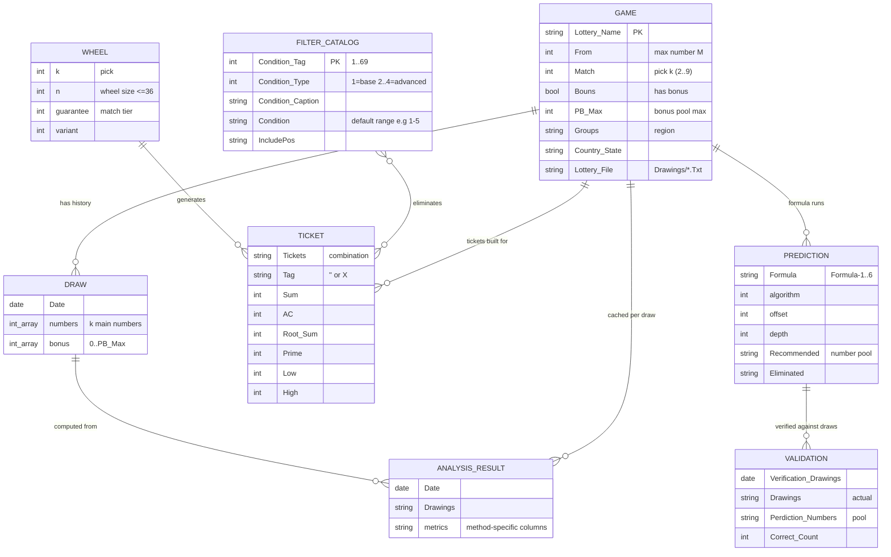
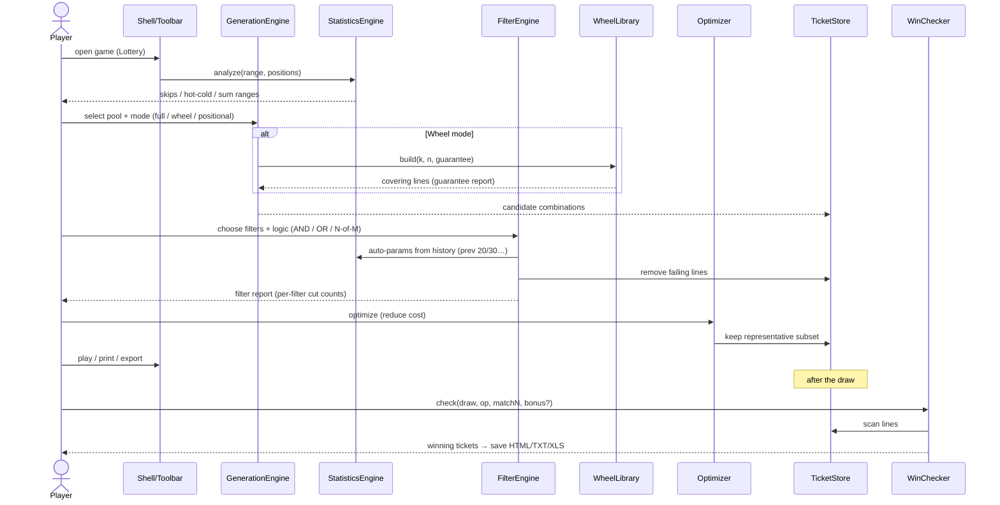
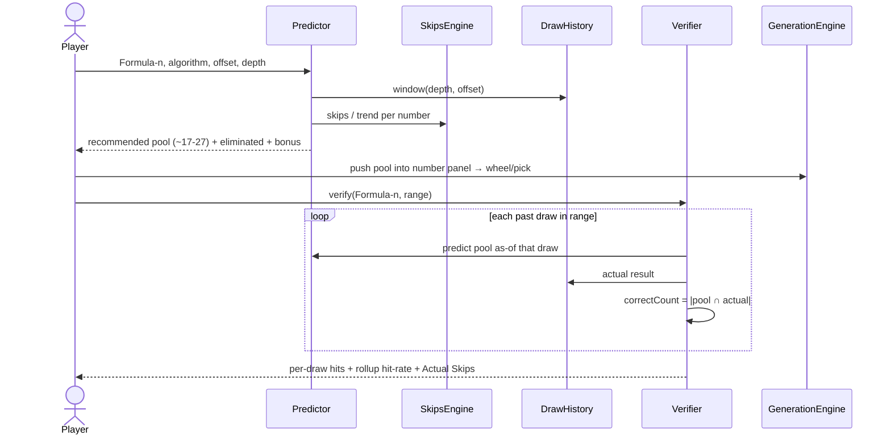
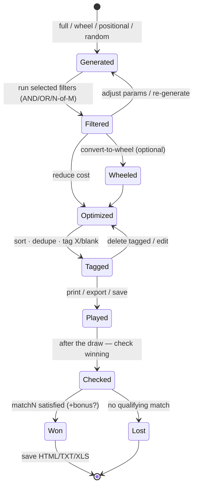

# 12 — Diagrams (ER · sequence · state)

> **Navigation**: [🏠 Reference Hub](../INDEX.md) · [📂 01. Architecture & Data Structures](INDEX.md) · [🌐 Dynamic Portal](../dynamic-portal.html) · [⬅️ 11 — Acceptance Criteria (black-box, per subsystem)](11-Acceptance-Criteria.md) · [13 — Distilled Algorithmic Specifications & Clean-Room Python Boilerplate ➡️](13-Distilled-Algorithms-and-Boilerplate.md)

<!-- TOC_BLOCK_START -->

<strong>📑 On This Page (Table of Contents)</strong>

- [1. Entity-relationship — the data model](#1-entity-relationship-the-data-model)
- [2. Sequence — the play pipeline (generate → … → check)](#2-sequence-the-play-pipeline-generate-check)
- [3. Sequence — predict & verify (pool-based)](#3-sequence-predict-verify-pool-based)
- [4. State — ticket lifecycle](#4-state-ticket-lifecycle)

<!-- TOC_BLOCK_END -->

Mermaid diagrams for the structure and the core flows, grounded in the verified
data model (doc 09) and the flows (doc 06). Renders on GitHub and any Mermaid-aware
viewer.

---

## 1. Entity-relationship — the data model

The domain reduces to a handful of entities. Every analysis method persists a
per-draw **cache table** (doc 09 §2.2/2.5) — modelled here as one abstract
`AnalysisResult` with the concrete tables listed beneath, to keep the diagram
legible.

**Concrete `ANALYSIS_RESULT` tables** (one per statistics screen, doc 09):
`ACA, Apart, BigSmall, OddEven, SumA, Residue, Multiple, hotcold, BeforeDrawings,
BeJoined, UnitsNumbers, DrawingsNumber, DrawingsDistributing, NumbersHits,
AppearCount, ComprehensiveAnalyze`.

---

## 2. Sequence — the play pipeline (generate → … → check)

Maps the domain modules of doc 07 onto the flow of doc 06. Filtering and wheeling
both **reduce** the candidate set before it becomes tickets to play.

---

## 3. Sequence — predict & verify (pool-based)

Prediction produces a **recommended number pool** (not a single line); verification
replays a formula and measures how many actual winners fell inside the pool
(doc 05, doc 09 §2.4).

---

## 4. State — ticket lifecycle

A combination moves through generation, reduction, play, and settlement. Tags
(`X` / blank) mark lines for bulk keep/delete before play.

---

*Cross-referenced from doc 06 (flows), doc 07 (architecture), doc 09 (schema).*

---
> **Next Steps**: [⬅️ 11 — Acceptance Criteria (black-box, per subsystem)](11-Acceptance-Criteria.md) · [🏠 Reference Hub](../INDEX.md) · [📂 01. Architecture & Data Structures](INDEX.md) · [13 — Distilled Algorithmic Specifications & Clean-Room Python Boilerplate ➡️](13-Distilled-Algorithms-and-Boilerplate.md)
