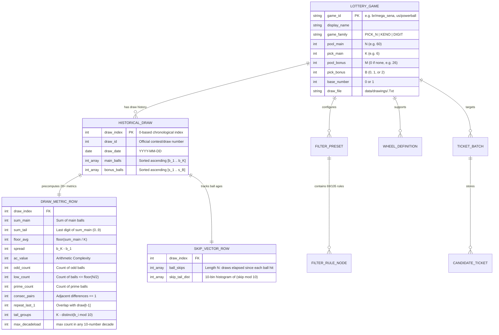

# 14 — Comprehensive Data Structures & Storage Reference

> **Purpose**: Complete clean-room reference mapping every data structure, on-disk file format, relational database table, serialized wire format, and in-memory analytical tensor used by a full-featured Lottery Analysis & Wheeling Studio.

---

## 1. High-Level Data Architecture & Entity-Relationship Map



---

## 2. File System & Directory Layout

A clean-room Lottery Analysis Studio separates static game catalogs, public historical draw archives, relational databases, and user presets into distinct storage layers:

```text
lottery/
├── data/
│   ├── registry.yaml                # Master catalog of 222+ global lottery definitions
│   ├── drawings/                    # Public-domain historical draw archives (*.Txt)
│   │   ├── Brazil_Mega-Sena.Txt     # Space/tab-delimited chronological draw records
│   │   ├── USA_Powerball.Txt
│   │   └── ... (299 regional draw files)
│   ├── wheels/                      # Abbreviated & full wheeling covering matrices
│   │   └── wheel_catalog.json       # C(V, K, T, M) covering design definitions
│   └── lottery.duckdb               # Embedded analytical columnar store (DuckDB)
├── engine/                          # Core Python analytical & combinatorial engine
├── cockpit/ & desktop/              # PySide6 / Qt6 multi-perspective desktop studio
└── docs/reference/                  # Clean-room specifications, manual, & guides
    ├── dynamic-portal.html          # Interactive single-page reference & sandbox
    ├── architecture/                # 14 architectural & data-structure specs
    ├── manual/                      # 61 functional manual chapters + boilerplate
    └── guides/                      # 33 strategy & mathematical filter guides
```

---

## 3. On-Disk File Formats & Wire Protocols

### 3.1 Master Game Catalog (`data/registry.yaml` & `GameList` Table)

Defines the structural parameters of every supported lottery across 3 canonical families (`pick_n`, `keno`, `digit`):

| Field | Type | Example (`br/mega_sena`) | Description |
| :--- | :--- | :--- | :--- |
| `id` | `str` | `"br/mega_sena"` | Canonical `<country>/<slug>` identifier |
| `name` | `str` | `"Brazil Mega-Sena"` | Human-readable display title |
| `pool_size` | `int` | `60` | Total main balls in drum ($N$) |
| `pick_count` | `int` | `6` | Main balls drawn per contest ($K$) |
| `bonus_pool_size` | `int` | `0` | Bonus drum size ($M$, `0` if no bonus drum) |
| `bonus_count` | `int` | `0` | Bonus balls drawn ($B$) |
| `drawn_count` | `int` | `6` | Total balls drawn per contest (differs from `pick_count` in Keno, e.g., pick 10 from 20 drawn out of 80) |
| `base_number` | `int` | `1` | Lowest valid ball (`1` for Lotto/Keno, `0` for Pick-3/Pick-4) |
| `draw_file` | `str` | `"data/drawings/Brazil_Mega-Sena.Txt"` | Path to historical flat-file archive |

---

### 3.2 Flat Historical Draw Files (`data/drawings/*.Txt`)

Plain-text UTF-8/ASCII files where each line represents one historical drawing.

**Format Grammar**:
```text
<MM/DD/YYYY or YYYY-MM-DD><TAB or SPACES><B1> <B2> ... <BK> [<Bonus1> ... <BonusB>]
```

**Concrete Examples**:
```text
# Standard 6/60 Lotto (no bonus)
05/02/2026	04 15 23 38 42 59

# 5/69 + 1/26 Double-Drum Lotto (Powerball style)
05/02/2026	07 11 21 53 61 02

# Pick-3 Digit Game (0-based, order/duplicates preserved)
05/02/2026	0 4 4
```

---

### 3.3 Serialized Filter Rule Wire Format (`||$[[][][]]` Grammar)

In classical lottery studio preset files (`.flt` / `.ini`), a filter pipeline is persisted as a single deterministic text string using hierarchical delimiters:

```text
<Group1>||<Group2>||...||<GroupM>
```

Each `<Group>` encodes its category header and rule list:
```text
<GroupID>:<Enabled>:<GroupMinPass>:<GroupMaxPass>$[<Rule_1>][<Rule_2>]...[<Rule_R>]
```

Each `<Rule_i>` inside brackets `[...]` encodes:
```text
<FilterTag>,<EnabledFlag>,<ActionMode>,<MinBound>,<MaxBound>,<PosMask>,<SetPayload>
```

| Token | Type | Meaning |
| :--- | :--- | :--- |
| `FilterTag` | `int (1..105)` | Unique numeric identifier of the filter algorithm (see `filters-catalog.csv`) |
| `EnabledFlag` | `0 \| 1` | `1` if active in current funnel execution, `0` if bypassed |
| `ActionMode` | `0 \| 1` | `0 = Accept` (keep if within `[Min, Max]`), `1 = Reject` (discard if within `[Min, Max]`) |
| `MinBound` | `int` | Lower inclusive bound for the filter metric |
| `MaxBound` | `int` | Upper inclusive bound for the filter metric |
| `PosMask` | `str` | Bitmask of active ball positions (e.g., `"111111"` for all 6 positions) |
| `SetPayload` | `str` | Semicolon-separated ball list for Custom Number Set filters (e.g., `"01;05;12;19;23"`) |

---

### 3.4 Ticket Exchange Formats (`.txt`, `.csv`, `.slk` SYLK)

1. **Space-Delimited Ticket File (`.txt`)**:
   ```text
   01 08 14 27 33 49
   02 11 19 25 41 58
   ```
2. **Annotated CSV Spreadsheet (`.csv`)**:
   ```csv
   ticket_id,b1,b2,b3,b4,b5,b6,bonus,sum,ac_value,odd_even
   1,1,8,14,27,33,49,,132,9,3:3
   ```
3. **Symbolic Link Spreadsheet (`.slk` / SYLK)**:
   ```text
   ID;PLOTTERY_STUDIO
   C;Y1;X1;K1
   C;Y1;X2;K8
   C;Y1;X3;K14
   C;Y1;X4;K27
   C;Y1;X5;K33
   C;Y1;X6;K49
   E
   ```

---

## 4. Relational Database Schema (DuckDB / SQLite)

```sql
-- 1. Registered Games Table
CREATE TABLE IF NOT EXISTS lottery_games (
    game_id         VARCHAR PRIMARY KEY,
    display_name    VARCHAR NOT NULL,
    game_family     VARCHAR NOT NULL DEFAULT 'PICK_N',
    pool_main       INTEGER NOT NULL,
    pick_main       INTEGER NOT NULL,
    pool_bonus      INTEGER NOT NULL DEFAULT 0,
    pick_bonus      INTEGER NOT NULL DEFAULT 0,
    base_number     INTEGER NOT NULL DEFAULT 1,
    draw_file       VARCHAR
);

-- 2. Historical Drawings Table
CREATE TABLE IF NOT EXISTS draws (
    game_id         VARCHAR NOT NULL,
    draw_id         INTEGER NOT NULL,
    draw_date       DATE NOT NULL,
    numbers         INTEGER[] NOT NULL,
    bonus_numbers   INTEGER[],
    PRIMARY KEY (game_id, draw_id)
);

-- 3. Precomputed Draw Structural Metrics Table (28 Core Columns)
CREATE TABLE IF NOT EXISTS draw_metrics (
    game_id             VARCHAR NOT NULL,
    draw_id             INTEGER NOT NULL,
    sum_main            INTEGER NOT NULL,
    sum_tail            INTEGER NOT NULL,
    floor_avg           INTEGER NOT NULL,
    spread              INTEGER NOT NULL,
    ac_value            INTEGER NOT NULL,
    odd_count           INTEGER NOT NULL,
    even_count          INTEGER NOT NULL,
    low_count           INTEGER NOT NULL,
    high_count          INTEGER NOT NULL,
    prime_count         INTEGER NOT NULL,
    consec_pairs        INTEGER NOT NULL,
    consec_runs         INTEGER NOT NULL,
    repeat_prev_1       INTEGER NOT NULL,
    repeat_prev_2       INTEGER NOT NULL,
    repeat_prev_3       INTEGER NOT NULL,
    adjacent_prev_1     INTEGER NOT NULL,
    tail_group_repeats  INTEGER NOT NULL,
    max_same_tail       INTEGER NOT NULL,
    max_decade_load     INTEGER NOT NULL,
    PRIMARY KEY (game_id, draw_id)
);

-- 4. Saved Filter Presets & Fault-Tolerance Configuration
CREATE TABLE IF NOT EXISTS filter_presets (
    preset_id       VARCHAR PRIMARY KEY,
    game_id         VARCHAR NOT NULL,
    preset_name     VARCHAR NOT NULL,
    min_rules_pass  INTEGER NOT NULL,
    max_rules_pass  INTEGER NOT NULL,
    wire_payload    TEXT NOT NULL,
    updated_at      TIMESTAMP DEFAULT CURRENT_TIMESTAMP
);
```

---

## 5. In-Memory Data Structures & Tensor Shapes (Python Boilerplate)

During high-throughput ticket generation, filtering ($>500,000\text{ tickets/sec}$), and skip-matrix computation, data is held in contiguous NumPy arrays and typed dataclasses:

```python
from __future__ import annotations
from dataclasses import dataclass, field
from datetime import date
from typing import Dict, List, Optional, Tuple
import numpy as np


@dataclass(frozen=True)
class GameSpec:
    """Immutable descriptor for any Pick-N, Keno, or Digit lottery game."""
    game_id: str
    name: str
    pool_main: int          # N: e.g. 60 for Mega-Sena, 69 for Powerball
    pick_main: int          # K: e.g. 6 for Mega-Sena, 5 for Powerball
    pool_bonus: int = 0     # M: e.g. 26 for Powerball, 0 if none
    pick_bonus: int = 0     # B: e.g. 1 for Powerball, 0 if none
    base_number: int = 1    # 1 for standard Lotto, 0 for Pick-3/4


@dataclass(frozen=True)
class DrawRecord:
    """Single historical drawing record."""
    draw_id: int
    draw_date: date
    main_balls: Tuple[int, ...]
    bonus_balls: Tuple[int, ...] = ()


@dataclass
classFilterConditionNode:
    """Single node in the 69/105-vector combinatorial filter graph."""
    tag_id: int
    name: str
    category: str
    enabled: bool = True
    reject_mode: bool = False
    min_val: int = 0
    max_val: int = 999
    position_mask: Tuple[bool, ...] = field(default_factory=lambda: (True,) * 6)
    custom_set: Tuple[int, ...] = ()


@dataclass
class AnalyticalMatrixBundle:
    """
    Contiguous in-memory tensors used by the analysis, skips, and filter engines.
    Let T = number of historical draws, K = pick_main, N = pool_main, C = candidate tickets.
    """
    # Shape: (T, K), dtype=int16 — sorted ascending main numbers per draw
    draws_matrix: np.ndarray

    # Shape: (T, N + 1), dtype=bool — 1-hot incidence matrix (incidence[t, b] == True if ball b hit in draw t)
    incidence_matrix: np.ndarray

    # Shape: (T, N + 1), dtype=int16 — Actual Skips matrix (draws elapsed since ball b last hit at draw t)
    actual_skips_matrix: np.ndarray

    # Shape: (T, 28), dtype=int32 — Precomputed 28 structural metrics per historical draw
    metrics_matrix: np.ndarray

    # Shape: (C, K), dtype=int16 — Candidate ticket pool in Ticket Store for vectorized filtering
    candidate_tickets: Optional[np.ndarray] = None

    @classmethod
    def from_draws(cls, draws: List[DrawRecord], spec: GameSpec) -> "AnalyticalMatrixBundle":
        t_count = len(draws)
        k = spec.pick_main
        n = spec.pool_main

        draws_mat = np.zeros((t_count, k), dtype=np.int16)
        incidence = np.zeros((t_count, n + 1), dtype=bool)
        skips = np.zeros((t_count, n + 1), dtype=np.int16)

        running_age = np.zeros(n + 1, dtype=np.int16)
        for t, d in enumerate(draws):
            row = sorted(d.main_balls)
            draws_mat[t, :] = row
            incidence[t, row] = True
            skips[t, :] = running_age
            running_age += 1
            running_age[row] = 0

        metrics = np.zeros((t_count, 28), dtype=np.int32)
        if t_count > 0:
            # Column 0: Sum, Column 1: Sum Tail, Column 2: Floor Avg, Column 3: Spread
            metrics[:, 0] = draws_mat.sum(axis=1)
            metrics[:, 1] = metrics[:, 0] % 10
            metrics[:, 2] = metrics[:, 0] // k
            metrics[:, 3] = draws_mat[:, -1] - draws_mat[:, 0]
            # Column 4: Odd count
            metrics[:, 4] = (draws_mat % 2 == 1).sum(axis=1)

        return cls(
            draws_matrix=draws_mat,
            incidence_matrix=incidence,
            actual_skips_matrix=skips,
            metrics_matrix=metrics,
        )
```

---

## 6. Filter Catalog Vector Map (Tags `01` – `69`)

| Tag Range | Category | Key Data Structures Operated On |
| :--- | :--- | :--- |
| **`01` – `15`** | **Base Numeric Counts** | `candidate_tickets` $\cap$ static sets (`ODD`, `EVEN`, `LOW`, `HIGH`, `PRIME`, `COMPOSITE`, `FAVORITE`, `INCLUDED`, `EXCLUDED`) |
| **`016` – `31`** | **Summary & Arithmetic** | Row reductions over `candidate_tickets`: `sum`, `sum % 10`, `sum // K`, `spread`, `AC value`, `tail_groups`, `consec_pairs`, `consec_runs` |
| **`32` – `39`** | **Historical & Positional** | Cross-draw comparisons against `draws_matrix[-1:-10]` (`repeat_prev_k`, `adjacent_prev_1`, positional `[min, max]` bounds, historical jackpot match) |
| **`40` – `52`** | **Skip & Gap Dynamics** | Lookups into `actual_skips_matrix[-1, ticket]`: skip sum, max skip, min skip, skip tail distribution (`0..9`), and decade load buckets |
| **`53` – `69`** | **Custom Sets & Matrix Masks** | User-defined groups $S_1 \dots S_{12}$ (`SetPayload` bitmasks), pairwise difference bounds, and modulo residue classes |

---

## 7. Classical Studio Per-Game State & Binary File Map

A classical desktop lottery studio persists global and per-game workspace state across two relational database containers (`MainData.db` / `FiltersData.db`), global `.ini` files, per-game workspace folders, and binary wheeling catalogs:

### 7.1 Workspace & Per-Game Directory Structure

```text
<StudioRoot>/
├── Lottery_Set.ini                  # Active game descriptor & catalog cursor
├── Current_Set.ini                  # Global UI, grid typography, & session state
├── Data/
│   ├── MainData.db                  # Master game catalog, active drawing table, & statistical caches
│   ├── FiltersData.db               # 69-vector filter catalog metadata & user filter presets
│   └── Tickets.Txt                  # Default scratchpad ticket buffer
├── Formula/
│   └── <KK>-<VV>-<T>-<M>.Wheels     # Binary covering designs (8-byte blocks per wheel line)
└── <GameName>/                      # Per-game workspace directory (e.g., "Brazil Mega Sena/")
    ├── Current_Set.ini              # Game-specific UI cursor, draw range, & predictor settings
    ├── Tickets.Txt                  # Active generated/filtered tickets for this game
    ├── search_list.sl               # Pre-enumerated k-tuple search combinations (e.g. C(60,3) = 34,220 lines)
    └── Num_Dis_Next.nxt             # ASCII report buffer for next-draw follower/distance distribution
```

---

### 7.2 Configuration & State INI Schemas

#### `Lottery_Set.ini` (Active Game Pointer)
```ini
[PlayLottery]
LotteryName=Brazil Mega Sena
From=60                              ; Pool size (N)
Match=6                              ; Pick count (K)
Bouns=0                              ; Bonus pool size (M)
LotteryFile=Brazil_Mega-Sena.Txt     ; Source flat file in Drawings/
BounsCount=0                         ; Bonus balls drawn (B)
BounsName=                           ; Label for bonus ball (e.g. "Powerball")

[SelectForm]
Group=1                              ; Game category (1=Lotto, 2=Keno, 3=Digit)
State=7                              ; Country/Region group index
RecNo=1                              ; Cursor row in GameList table
```

#### `<GameName>/Current_Set.ini` (Per-Game Session State)
| Section | Key | Type | Purpose |
| :--- | :--- | :--- | :--- |
| `[LotteryParam]` | `DraingsIndex` | `int` | Latest draw row index in active history |
| `[LotteryParam]` | `DraingsIndex1` / `DraingsIndex2` | `int` | Start and end draw indices for statistical window (e.g. `2983..3002` = 20 draws) |
| `[LotteryParam]` | `FormulaIndex` / `ForWIndex` | `int` | Selected wheeling matrix index and wheeling mode |
| `[LotteryParam]` | `RightCountValue` | `str` | Logical operator across filter groups (`"AND"` or `"OR"`) |
| `[LotteryParam]` | `algorithmRzComboBox` | `int` | Selected prediction algorithm (`0..2` = Markov, Distance, Interval) |
| `[LotteryParam]` | `formulaComboBox` | `int` | Selected prediction formula (`0..5` = Formulas 1..6) |
| `[LotteryParam]` | `deepRzComboBox` / `Run` | `int` | Historical lookback depth and backtest verification horizon |
| `[LotteryParam]` | `searchOPCheckGroup` / `fromOPCheckGroup` / `toOPCheckGroup` | `int` | Ticket Optimizer (TopForm) overlap reduction bounds |
| `[GenActivePageIndex]` | `PageIndex` | `int` | Active generator tab (`0=Full/Filtered`, `1=Wheeling`, `2=Position`, `3=Random`) |
| `[Position]` | `Position 1` .. `Position 8` | `str` | Space-separated candidate balls per sorted ticket position |
| `[bounCheckBox]` | `bounposCheckBox` / `ranbouCheckBox` | `0\|1` | Bonus ball attachment mode (`all`, `random`, or `included`) |
| `[Multi-Number Combination of Stat]` | `nsRadioButton1..3` / `onlyCheckBox` | `0\|1` | Multi-number tuple size (`Pairs=2`, `Triplets=3`, `Quads=4`) |
| `[AddSelect]` / `[Select]` | `AddNumbers` / `SelectNumbers` | `str` | Space-separated favorite/selected pool balls |
| `[Search]` | `SearchIndex` / `SearchIndexFrom` / `SearchIndexTo` | `int` | Pattern Search (`nsSearch`) match threshold and draw range |

---

### 7.3 Auxiliary Per-Game Files (`search_list.sl`, `Num_Dis_Next.nxt`, `*.Wheels`)

1. **`<GameName>/search_list.sl` (Enumerated $m$-Tuple Lookup Buffer)**
   - Fixed-width ASCII lines (`\r\n` terminated) storing all $\binom{N}{m}$ combinations for Multi-Number Statistics (`nsStat`).
   - Example for $N=60, m=3$: $\binom{60}{3} = 34,220$ lines $\times 10\text{ bytes} = 342,200\text{ bytes}$:
     ```text
     01 02 03\r\n
     01 02 04\r\n
     ...
     58 59 60\r\n
     ```

2. **`Formula/<KK>-<VV>-<T>-<M>.Wheels` (Abbreviated Covering Matrix Files)**
   - Filename grammar:
     - `KK`: Ticket size $K$ (`02` to `10`)
     - `VV`: Wheeled pool size $V$ (`03` to `38`)
     - `T`: Minimum guaranteed prize match $T$ (`2` to `7`)
     - `M`: Minimum drawn winners in pool $M$ (`1` to `7`)
   - Record layout: Each covering ticket template is stored as an **8-byte block** (`file_size / 8 = total wheel lines`). For example, `06-08-4-4.Wheels` is `64 bytes` $= 8$ covering tickets of 6 indices drawn from an 8-number pool $\{1 \dots 8\}$.

3. **`Data/MainData.db` & `Data/FiltersData.db` Relational Tables**

| Container | Table Name | Key Columns | Purpose |
| :--- | :--- | :--- | :--- |
| `MainData.db` | `GameList` | `ID`, `GroupID`, `Country`, `LotteryName`, `TotalBalls`, `PickBalls`, `BonusBalls`, `BonusCount`, `FileName` | Master catalog of 222+ supported lotteries |
| `MainData.db` | `Drawings` | `IndexNo`, `DrawDate`, `N1..N20`, `B1..B2`, `Sum`, `Avg`, `OddEven`, `LowHigh`, `AC`, `Spread`, `Repeat1..3` | Active game historical draws + 28 precomputed metrics |
| `MainData.db` | `ActualSkips` | `IndexNo`, `DrawDate`, `Ball_01 .. Ball_80`, `SkipSum`, `SkipAvg`, `SkipTail0..9` | Full skip matrix across all balls in the active pool |
| `FiltersData.db` | `FilterCatalog` | `FilterTag (1..69)`, `CategoryID`, `FilterName`, `DefaultMin`, `DefaultMax`, `SupportsPosMask` | Static metadata for the 69-vector filter engine |
| `FiltersData.db` | `SavedFilterSets` | `SetID`, `LotteryName`, `SetName`, `SerializedRules` (`||$[[][][]]`) | User-saved filter configurations per lottery |

