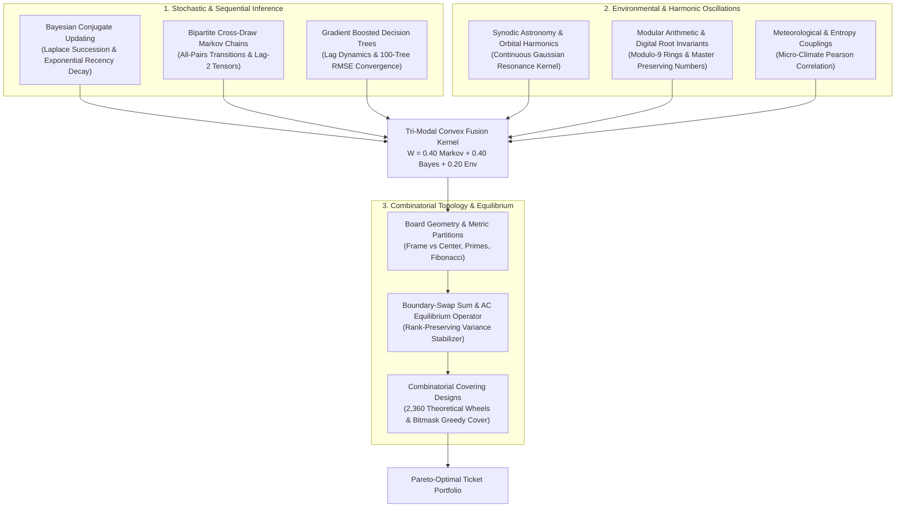
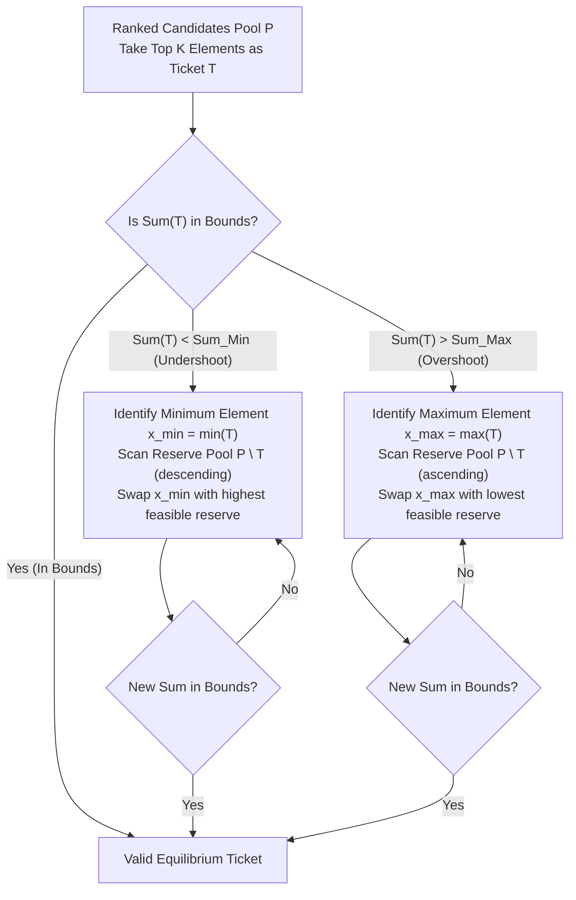

# 15 — Multi-Modal Prediction Mechanics & Frontier Synthesis

> **Scope**: Foundational mathematical models, physical and astronomical resonances, Bayesian sequential inference, higher-order bipartite Markov dynamics, board geometry equilibrium operators, combinatorial covering design bounds, and unexplored cross-disciplinary frontiers for predictive lottery intelligence.

---

## 1. Overview of Multi-Modal Predictive Synthesis

Lottery draw events are traditionally analyzed in isolation through basic frequency tallies or static combinatorial filters. However, modern stochastic analysis and complex-systems modeling reveal that historical drawing corpora can be projected across multiple complementary dimensional spaces:

---

## 2. Mathematical Formulations & Component Mechanics

### 2.1 Synodic Lunar Phase & Continuous Harmonic Resonance

Astronomical bodies exhibit precise orbital periodicities that offer a natural, deterministic, high-entropy reference cycle. The lunar synodic cycle governs tidal gravitational dynamics and has a well-defined mean synodic period:

$$L_{\text{syn}} = 29.530588853 \text{ solar days}$$

Given an astronomical reference epoch $t_0$ (e.g., J2000 New Moon at `2000-01-06 18:14:00 UTC`), the continuous phase fraction $\phi(t) \in [0, 1)$ for any draw timestamp $t$ is:

$$\phi(t) = \frac{(t - t_0) \bmod L_{\text{syn}}}{L_{\text{syn}}}$$

#### Discretized Octant Classification vs. Continuous Circular Kernel
While discrete models partition the lunar cycle into eight 45° sectors:
- $\phi \in [0.00, 0.06) \cup [0.94, 1.00) \implies \text{New Moon}$
- $\phi \in [0.06, 0.19) \implies \text{Waxing Crescent}$
- $\phi \in [0.19, 0.31) \implies \text{First Quarter}$
- $\phi \in [0.31, 0.44) \implies \text{Waxing Gibbous}$
- $\phi \in [0.44, 0.56) \implies \text{Full Moon}$
- $\phi \in [0.56, 0.69) \implies \text{Waning Gibbous}$
- $\phi \in [0.69, 0.81) \implies \text{Last Quarter}$
- $\phi \in [0.81, 0.94) \implies \text{Waning Crescent}$

The **continuous harmonic resonance kernel** eliminates artificial step discontinuities at octant boundaries by projecting the lunar elongation distance $d_{\text{moon}}(\phi) = 1 - 2|\phi - 0.5| \in [0, 1]$ directly onto the normalized ball pool positions $\rho_i = \frac{i}{N}$:

$$W_{\text{harmonic}}(i, \phi) = 1.0 + \Delta_{\text{step}} \cdot \mathbb{I}(|\rho_i - d_{\text{moon}}| < \delta) + \alpha_{\text{smooth}} \exp\left(-\frac{(\rho_i - d_{\text{moon}})^2}{2\sigma_{\text{orbit}}^2}\right)$$

where $\delta = 0.20$, $\Delta_{\text{step}} = 0.30$, $\alpha_{\text{smooth}} = 0.15$, and $\sigma_{\text{orbit}} = 0.18$.

---

### 2.2 Laplace-Smoothed Bayesian Tracking & Non-Stationary Decay

For a pool of $N$ candidate numbers across a historical sequence of $T$ drawings $\mathcal{H}_T = \{D_1, D_2, \dots, D_T\}$, the frequency of appearance of candidate ball $i$ is $c_i = \sum_{t=1}^{T} \mathbb{I}(i \in D_t)$.

Under a symmetric Beta-Binomial conjugate framework with uniform prior ($\alpha = 1.0$), the standard Laplace Rule of Succession yields:

$$P_{\text{Laplace}}(i \mid \mathcal{H}_T) = \frac{c_i + \alpha}{T + 2\alpha}$$

#### Non-Stationary Adaptation: Exponential Recency Decay
Physical drawing mechanisms, ball-set wear, and air-mixing dynamics can experience subtle parameter drifts over long time horizons. To balance global sample depth against recent mechanical states, historical counts can be discounted by an exponential forgetting factor $\gamma \in (0, 1]$:

$$\tilde{c}_i(T) = \sum_{t=1}^{T} \gamma^{T - t} \mathbb{I}(i \in D_t), \qquad \tilde{T} = \sum_{t=1}^{T} \gamma^{T - t} = \frac{1 - \gamma^T}{1 - \gamma}$$

$$P_{\gamma}(i \mid \mathcal{H}_T) = \frac{\tilde{c}_i(T) + \alpha}{\tilde{T} + 2\alpha}$$

When $\gamma = 1.0$, the formulation simplifies to classical Laplace succession. When $\gamma \approx 0.95$, the effective observation window has a half-life of $t_{1/2} = \frac{\ln(0.5)}{\ln(\gamma)} \approx 13.5$ draws, granting heightened responsiveness to emerging hot/cold streaks.

---

### 2.3 Higher-Order Bipartite Cross-Draw Markov Dynamics

Standard Markov models often evaluate draw sequences strictly on positional order, which is artificially dictated by sorted ball indexes. In contrast, the **all-pairs bipartite Markov chain** models the cross-presence of ball $u \in D_t$ and ball $v \in D_{t+1}$ across adjacent draws:

$$C_{u \to v}^{(1)} = \sum_{t=1}^{T-1} \mathbb{I}(u \in D_t \land v \in D_{t+1})$$

The 1st-order empirical transition kernel is:

$$P^{(1)}(v \mid u) = \frac{C_{u \to v}^{(1)}}{\sum_{w=1}^{N} C_{u \to w}^{(1)}}$$

Given the observed draw $D_T$, the aggregate 1st-order Markov propensity score for candidate $v$ is the sum of conditional probabilities across all numbers in the preceding draw:

$$S_1(v \mid D_T) = \sum_{u \in D_T} P^{(1)}(v \mid u)$$

#### Second-Order Lag-2 Tensor Blending
Physical ball chambers and return-drop trays frequently retain residual clustering over a two-draw horizon ($D_{T-1} \to D_{T+1}$). Incorporating a 2nd-order lag-2 tensor $C_{u \to v}^{(2)} = \sum_{t=1}^{T-2} \mathbb{I}(u \in D_t \land v \in D_{t+2})$ with convex blending parameter $\lambda \in [0, 1]$ yields:

$$S_{\text{Markov}}(v \mid D_T, D_{T-1}) = (1 - \lambda) \sum_{u \in D_T} P^{(1)}(v \mid u) + \lambda \sum_{u \in D_{T-1}} P^{(2)}(v \mid u)$$

---

### 2.4 Modular Arithmetic & Master-Preserving Digital Roots

Numerological reduction maps arbitrary multi-digit chronological identifiers (such as draw dates `YYYY-MM-DD` or drawing sequence indexes) into cyclic ring invariants. 

The Master-Preserving Digital Root $\operatorname{DR}_{\text{master}}(x)$ reduces an integer by iteratively summing its decimal digits while preserving the Pythagorean Master Numbers $\{11, 22, 33\}$:

$$\operatorname{DR}_{\text{master}}(x) = \begin{cases} 
x & \text{if } x < 10 \text{ or } x \in \{11, 22, 33\} \\
\operatorname{DR}_{\text{master}}\left(\sum_{d \in \text{digits}(x)} d\right) & \text{otherwise}
\end{cases}$$

#### Dual Resonance Scoring
For a target date with life path $L = \operatorname{DR}_{\text{master}}(\text{Date})$:
1. **Modulo-9 Congruence Ring**: Every ball $i \in \{1, \dots, N\}$ satisfying $i \equiv L \pmod 9$ receives a baseline resonance boost $\Delta_{\text{mod}} = +0.50$.
2. **Glyph Inclusion & Master Match**: Balls whose decimal representation contains the digit sequence of $L$, or which exactly equal $L$, receive an additional affinity boost $\Delta_{\text{id}} = +0.25$.

---

### 2.5 Board Geometry & Metric Partitioning

In games such as 25-ball lotteries arranged on a $5 \times 5$ Cartesian grid:

$$\begin{pmatrix}
1 & 2 & 3 & 4 & 5 \\
6 & 7 & 8 & 9 & 10 \\
11 & 12 & 13 & 14 & 15 \\
16 & 17 & 18 & 19 & 20 \\
21 & 22 & 23 & 24 & 25
\end{pmatrix}$$

The numbers naturally divide into topological and number-theoretic partitions:
- **Frame / Perimeter ($\mathcal{F}$, 16 cells)**: Numbers residing on the outer boundary ($r \in \{1, 5\}$ or $c \in \{1, 5\}$).
- **Center / Core ($\mathcal{C}$, 9 cells)**: Numbers residing in the interior $3 \times 3$ submatrix $\{7, 8, 9, 12, 13, 14, 17, 18, 19\}$.
- **Primes ($\mathcal{P}$, 9 numbers)**: $\{2, 3, 5, 7, 11, 13, 17, 19, 23\}$.
- **Fibonacci ($\mathcal{B}$, 7 numbers)**: $\{1, 2, 3, 5, 8, 13, 21\}$.

#### Arithmetic Complexity (AC Value)
For any $k$-ball candidate ticket $T = (x_1 < x_2 < \dots < x_k)$, the Arithmetic Complexity measures the diversity of absolute pairwise differences:

$$\Delta(T) = \{|x_j - x_i| : 1 \le i < j \le k\}$$

$$\text{AC}(T) = |\Delta(T)| - (k - 1)$$

Maximum AC value corresponds to maximally dispersed, non-arithmetic combinations with high entropy, while degenerate patterns (e.g., long arithmetic progressions) exhibit depressed AC values.

---

### 2.6 Boundary-Swap Sum & AC Equilibrium Operator

When sampling candidate tickets from high-ranked probabilistic pools, the resulting tickets frequently violate empirical sum distribution bands (e.g., $\Sigma(T) \notin [\Sigma_{\min}, \Sigma_{\max}]$).

The **Rank-Preserving Boundary-Swap Sum Balancer** stabilizes variance while preserving the maximal probabilistic mass of the ranked candidate sequence:

This operator guarantees strict conformance to the historical empirical sum envelope without discarding the entire candidate ticket, drastically reducing generation rejection rates.

---

## 3. Combinatorial Covering Designs: The 2,360-Wheel Catalog

A combinatorial covering design (or abbreviated wheel) $C(v, k, t, m) = b$ guarantees that for any pool of $v$ numbers, any drawn subset of $m$ winning numbers will share at least $t$ numbers with at least one ticket in the family of $b$ tickets ($k$ numbers per ticket):

$$C(v, k, t, m) \implies \forall M \subset V, |M| = m : \exists T \in \mathcal{B}, |T| = k \text{ such that } |M \cap T| \ge t$$

### Mathematical Properties of the 2,360 Catalog
The catalog encapsulates 2,360 verified parameter tuples across all standard pick configurations:
- **Pick Sizes**: $k \in \{3, 4, 5, 6, 7\}$
- **Pool Sizes**: $v \in [4, 55]$
- **Guarantee Levels**: $t \in [2, 7]$ with condition $m \in [2, 7]$
- **Combinatorial Reduction Ratio**:
  $$R = 1.0 - \frac{b}{\binom{v}{k}}$$
  Standard abbreviated wheels achieve reduction ratios exceeding $95\%$ to $99.9\%$, enabling broad pool coverage at a fraction of full-combination costs.

---

## 4. Unexplored Frontier Ideas & Cross-Disciplinary Innovations

To evolve lottery intelligence beyond traditional static heuristics, several advanced cross-disciplinary paradigms present immediate research and implementation opportunities:

### 4.1 Quantum-Inspired QUBO / Ising Formulations for Ticket Portfolio Selection
Instead of selecting tickets independently, ticket portfolio optimization can be cast as a Quadratic Unconstrained Binary Optimization (QUBO) problem:

$$\min_{\mathbf{x} \in \{0, 1\}^M} \quad -\sum_{i=1}^{M} w_i x_i + \lambda_{\text{cov}} \sum_{i < j} \sigma(T_i, T_j) x_i x_j + \mu \left(\sum_{i=1}^{M} c_i x_i - B\right)^2$$

where:
- $w_i$ is the multi-modal ensemble score of ticket $T_i$.
- $\sigma(T_i, T_j) = |T_i \cap T_j|$ penalizes redundant overlap between selected tickets, enforcing maximal combinatorial diversity.
- $B$ is the player's total budget, and $\mu$ enforces the cost constraint.
- This formulation maps directly to Simulated Annealing or Quantum Annealing hardware (e.g., D-Wave Leap).

---

### 4.2 Graph Neural Network (GNN) Ball Co-Occurrence Embeddings
Historical lottery drawings can be represented as a weighted hypergraph where nodes are lottery numbers $\{1, \dots, N\}$ and each draw is a hyperedge connecting $k$ nodes. 

By applying Node2Vec or Hypergraph Convolutional Networks (HGCN), each ball $i$ receives a continuous dense embedding vector $\mathbf{z}_i \in \mathbb{R}^d$. The affinity of a candidate ticket $T = \{x_1, \dots, x_k\}$ is then measured by the hyper-volume or cosine dispersion of its constituent vectors:

$$\mathcal{D}(T) = \frac{1}{\binom{k}{2}} \sum_{i < j} \cos(\mathbf{z}_{x_i}, \mathbf{z}_{x_j})$$

Tickets with optimal dispersion balance strong co-occurrence history against over-clustering.

---

### 4.3 Information-Theoretic Mutual Information Filtering (Information Bottleneck)
Traditional filtering approaches apply dozens of filters sequentially without measuring inter-filter redundancy. Using Shannon's Mutual Information:

$$I(F_a; F_b) = \sum_{x \in F_a} \sum_{y \in F_b} p(x, y) \log \frac{p(x, y)}{p(x)p(y)}$$

An Information Bottleneck filter selector ranks and prunes filters to retain maximal predictive mutual information $I(F_i; \text{Winning Draw})$ while minimizing inter-filter redundancy $I(F_i; F_j)$. This prevents filter overfitting and eliminates contradictory constraints.

---

### 4.4 Non-Stationary Dirichlet-Multinomial Bayesian Priors & Thompson Sampling
Replacing independent Beta-Binomial models with a unified Dirichlet-Multinomial distribution allows the engine to capture the negative covariance inherent in drawing without replacement:

$$\mathbf{p} \sim \operatorname{Dirichlet}(\boldsymbol{\alpha}_t), \qquad \boldsymbol{\alpha}_{t+1} = \gamma \boldsymbol{\alpha}_t + \mathbb{I}_{D_t}$$

By drawing posterior samples $\mathbf{p}^* \sim \operatorname{Dirichlet}(\boldsymbol{\alpha})$ and selecting tickets according to Thompson Sampling, the generation engine autonomously balances **exploitation** (favoring high-probability historical modes) and **exploration** (covering overdue long-tail configurations).

---

### 4.5 Dynamic Kelly Criterion & Pareto Multi-Objective Bankroll Optimization
Lottery prizes feature highly asymmetric payoff structures (jackpots vs. minor division tier matches). Treating ticket selection under the fractional Kelly Criterion:

$$f^* = \frac{b \cdot p - q}{b} = p - \frac{1 - p}{b}$$

coupled with Pareto Multi-Objective Evolutionary Algorithms (NSGA-II) enables players to generate ticket sets that optimize along the Pareto frontier of:
1. Expected Tier Match Return $\mathbb{E}[R]$.
2. Downside Risk / Variance $\operatorname{Var}[R]$.
3. Maximum Combinatorial Coverage $C(v, k, t, m)$.
