# 16 — Cross-Disciplinary Frontier Sciences & Complex Systems

> **Scope**: Advanced scientific models for lottery intelligence derived from statistical physics, algebraic topology, quantum information theory, algorithmic complexity, chaotic dynamical systems, evolutionary genetics, and pari-mutuel behavioral game theory.

---

## 1. Map of Scientific Disciplines & Interdisciplinary Bridges

Lottery drawing systems are physical, mechanical, combinatorial, and human-social phenomena. Restricting analysis solely to naive empirical frequency leaves major structural principles unaddressed:

```mermaid
flowchart TD
    subgraph Physics ["1. Statistical Physics & Dynamics"]
        P1["Ising Spin-Glass Model<br/>(Coupled Spins & Ground-State Annealing)"]
        P2["Takens' Phase Space Reconstruction<br/>(Lyapunov Exponents & Correlation Dimension)"]
        P3["Pneumatic Fluid Mixing & Convection<br/>(Dissipative Systems & Entropy Production)"]
    end

    subgraph Topology ["2. Mathematics & Geometry"]
        T1["Topological Data Analysis (TDA)<br/>(Persistent Homology & Vietoris-Rips Betti Curves)"]
        T2["Discrete Quantum Walks<br/>(Continuous-Time Cayley Graph Propagation)"]
        T3["Combinatorial Covering Topologies<br/>(Schöning Bounds & Hypergraph Packings)"]
    end

    subgraph Information ["3. Information Theory & Complexity"]
        I1["Kolmogorov Complexity & NCD<br/>(Algorithmic Incompressibility Metric)"]
        I2["Transfer Entropy<br/>(Directed Non-Linear Information Flow)"]
        I3["Information Bottleneck<br/>(Optimal Compression of Multi-Filter Funnels)"]
    end

    subgraph GameTheory ["4. Evolutionary Biology & Game Theory"]
        G1["Linkage Disequilibrium Matrix<br/>(Genetic Epistasis across Ball Cohorts)"]
        G2["Pari-Mutuel Equity Maximizer<br/>(Anti-Popular Subspace Optimization)"]
        G3["Co-Evolutionary Predator-Prey Search<br/>(Competitive Ticket-Filter Arms Race)"]
    end

    P1 & P2 & T1 & T2 & I1 & I2 & G1 & G2 --> Core["p4lottery Unified Scientific Synthesis Engine"]
```

---

## 2. Statistical Physics & Thermodynamics

### 2.1 The Ising Spin-Glass Representation of Lottery Combinations
Every lottery combination of $k$ numbers chosen from a pool of $N$ balls can be isomorphically mapped to an **Ising spin configuration** $\boldsymbol{\sigma} = (\sigma_1, \sigma_2, \dots, \sigma_N) \in \{-1, +1\}^N$, where:
$$\sigma_i = \begin{cases} +1 & \text{if ball } i \text{ is selected in the ticket} \\ -1 & \text{if ball } i \text{ is absent} \end{cases}$$

Subject to the fixed magnetization constraint:
$$M(\boldsymbol{\sigma}) = \sum_{i=1}^{N} \sigma_i = k - (N - k) = 2k - N$$

The total physical Hamiltonian of candidate ticket $\boldsymbol{\sigma}$ is:
$$\mathcal{H}(\boldsymbol{\sigma}) = -\sum_{1 \le i < j \le N} J_{ij} \sigma_i \sigma_j - \sum_{i=1}^{N} h_i \sigma_i$$

where:
- $J_{ij}$ is the pairwise interaction tensor derived from historical Pearson correlation or empirical co-occurrence:
  $$J_{ij} = \frac{1}{T}\sum_{t=1}^{T} \sigma_i^{(t)} \sigma_j^{(t)} - \langle \sigma_i \rangle \langle \sigma_j \rangle$$
- $h_i$ is an external magnetic field representing single-ball momentum (Laplace Bayesian posterior, skip overdue pressure, or lunar harmonic resonance).

#### Ground-State Search via Simulated Annealing
Finding optimal candidate portfolios corresponds to finding low-energy spin glass states $\min \mathcal{H}(\boldsymbol{\sigma})$ at critical temperature $T_{\text{anneal}} \to 0$ without violating the magnetization constraint $M(\boldsymbol{\sigma}) = 2k - N$.

---

### 2.2 Takens' Embedding Theorem & Phase Space Reconstruction
To determine whether historical lottery metrics (such as the drawing sum sequence $S_t = \sum_{x \in D_t} x$) exhibit low-dimensional chaotic dynamics or pure Gaussian white noise, we apply **Takens' Delay Embedding Theorem**.

Given a scalar time series $\{S_1, S_2, \dots, S_T\}$, we reconstruct the $m$-dimensional phase space vector trajectory:
$$\mathbf{X}_t = \big(S_t, S_{t+\tau}, S_{t+2\tau}, \dots, S_{t+(m-1)\tau}\big) \in \mathbb{R}^m$$

where:
- $\tau$ is the optimal delay determined by the first zero-crossing of the autocorrelation function or first minimum of the Mutual Information:
  $$\tau^* = \arg\min_{\tau} I(S_t; S_{t+\tau})$$
- $m \ge 2d + 1$ is the embedding dimension estimated via the **False Nearest Neighbors (FNN)** algorithm.

#### Invariants of the Reconstructed Attractor:
1. **Correlation Dimension ($D_2$)**:
   $$C(r) = \lim_{M \to \infty} \frac{2}{M(M-1)} \sum_{i < j} \Theta\big(r - \|\mathbf{X}_i - \mathbf{X}_j\|\big), \qquad D_2 = \lim_{r \to 0} \frac{\ln C(r)}{\ln r}$$
   If $D_2$ saturates at a finite fractional value as $m$ increases, the system contains an underlying low-dimensional strange attractor. If $D_2 \propto m$ indefinitely, the sequence is purely stochastic.
2. **Largest Lyapunov Exponent ($\lambda_{\max}$)**:
   $$d(t) = C e^{\lambda_{\max} t} \implies \lambda_{\max} = \lim_{t \to \infty} \frac{1}{t} \ln \frac{\|\mathbf{X}_{t} - \mathbf{X}'_t\|}{\|\mathbf{X}_0 - \mathbf{X}'_0\|}$$
   $\lambda_{\max} > 0$ indicates sensitive dependence on initial conditions (deterministic chaos).

---

## 3. Algebraic Topology & Topological Data Analysis (TDA)

### 3.1 Persistent Homology on the Draw Point Cloud
Each draw $D_t = (x_1 < x_2 < \dots < x_k)$ can be embedded as a point in the normalized $k$-dimensional hypercube $[0, 1]^k$ by setting $p_{t, j} = \frac{x_j - 1}{N - 1}$.

Using the **Vietoris-Rips filtration**, we construct a continuous family of simplicial complexes $\mathcal{VR}(X, \epsilon)$ parameterized by distance threshold $\epsilon > 0$:
- A $0$-simplex (vertex) is added for each draw $\mathbf{p}_t$.
- A $1$-simplex (edge) connects $\mathbf{p}_a$ and $\mathbf{p}_b$ if $\|\mathbf{p}_a - \mathbf{p}_b\|_2 \le \epsilon$.
- An $n$-simplex is formed whenever all $\binom{n+1}{2}$ pairwise distances between vertices are $\le \epsilon$.

#### Persistence Diagrams & Betti Invariants
As $\epsilon$ increases from $0 \to \infty$, topological features are born and die:
- $\beta_0(\epsilon)$: Number of connected clusters (measuring clustering regimes across historical draws).
- $\beta_1(\epsilon)$: Number of 1-dimensional topological loops/holes (detecting cyclical drawing orbits).
- $\beta_2(\epsilon)$: Number of 2-dimensional enclosed voids (detecting forbidden combinatorial cavities).

Topological features with long persistence lifetimes $|d_i - b_i| \gg 0$ represent fundamental structural invariants of the drawing system, robust against local noise.

---

## 4. Quantum Information Theory & Continuous-Time Quantum Walks

### 4.1 Quantum Walks on Combinatorial Cayley Graphs
Classical random walk search explores graph vertices with diffusion variance $\sigma^2 \propto t$. In contrast, a **Continuous-Time Quantum Walk (CTQW)** evolves via unitary Schrödinger evolution:
$$|\psi(t)\rangle = e^{-i \hat{\mathcal{H}} t} |\psi(0)\rangle, \qquad \hat{\mathcal{H}} = \gamma \mathcal{L}$$

where $\mathcal{L} = \mathcal{D} - \mathcal{A}$ is the graph Laplacian matrix of the combinatorial transition graph.

On Cayley graphs where each vertex is a valid $k$-combination and edges represent 1-ball substitutions, the quantum walk propagates quadratically faster:
$$\sigma_{\text{quantum}}^2 \propto t^2$$

This quadratic speedup allows the prediction engine to explore the vast combinatorial manifold $\binom{N}{k}$ and identify high-centrality, high-coherence ticket nodes in $O(\sqrt{M})$ steps rather than classical $O(M)$ time.

---

## 5. Algorithmic Information & Complexity Theory

### 5.1 Kolmogorov Complexity & Normalized Compression Distance (NCD)
A candidate ticket $T = (x_1, \dots, x_k)$ is truly random if and only if it is **incompressible** in the sense of Kolmogorov complexity $K(T) \approx |T| + O(1)$.

Using real-world dictionary and entropy compressors $C(\cdot)$ (such as LZMA, Zstandard, or Deflate), the **Normalized Compression Distance** between ticket $T_a$ and ticket $T_b$ is:
$$\operatorname{NCD}(T_a, T_b) = \frac{C(T_a \circ T_b) - \min\big(C(T_a), C(T_b)\big)}{\max\big(C(T_a), C(T_b)\big)}$$

#### Practical Engineering Applications:
1. **Compressibility Filtering**: Discard candidates whose compression ratio $r = \frac{C(T)}{|T|} < 0.65$. Human bettors disproportionately pick compressible patterns (e.g., $5, 10, 15, 20, 25, 30$ or $1, 2, 3, 4, 5, 6$).
2. **Algorithmic Distance Clustering**: NCD defines a quasi-metric on combinations that detects hidden algorithmic similarities without requiring handcrafted geometric formulas.

---

## 6. Evolutionary Genetics & Co-Evolutionary Dynamics

### 6.1 Linkage Disequilibrium in Lottery Draw Cohorts
In population genetics, when two alleles at different loci are inherited non-independently, they exhibit **Linkage Disequilibrium (LD)**:
$$D_{ij} = p_{ij} - p_i p_j$$
$$r^2_{ij} = \frac{D_{ij}^2}{p_i (1 - p_i) p_j (1 - p_j)}$$

Treating each historical draw as an individual organism and each ball position as a genetic locus:
- Strongly linked pairs ($r^2_{ij} > \tau_{\text{link}}$) act as combinatorial "supergenes" that traverse generations together.
- Epistatic selection pressures identify groups of numbers whose joint probability significantly exceeds their independent marginals, informing multi-ball bank generation in wheels.

---

## 7. Behavioral Game Theory & Pari-Mutuel Entropy Optimization

### 7.1 Exploiting Human Cognitive Biases to Maximize Expected Return
In lotteries with pari-mutuel prize distribution (such as Mega-Sena, Powerball, and EuroMillions), **the jackpot is split equally among all winning tickets**:
$$\mathbb{E}[\text{Payout} \mid T \text{ wins}] = \frac{J}{1 + N_{\text{rival}}(T)}$$

where $J$ is the jackpot pool and $N_{\text{rival}}(T)$ is the number of other tickets identical to $T$ played by the general public.

Human players suffer from well-documented cognitive biases:
1. **Calendar Bias**: Over-selection of numbers $1 \le x \le 31$ (birthdays and anniversaries).
2. **Lucky Numbers**: Systematic over-selection of $7, 3, 11, 13$.
3. **Geometric Striping**: Selecting numbers that form diagonal lines or cross patterns on physical play slips.
4. **Arithmetic Sequences**: Thousands of players consistently play $1, 2, 3, 4, 5, 6$ or $10, 20, 30, 40, 50, 60$.

#### The Anti-Popular Objective Function
The optimal ticket set for a rational player does **not** maximize the raw probability of winning (which is fixed at $1/\binom{N}{k}$ for fair draws), but rather maximizes **Expected Dollar Value**:
$$\max_{T \in \mathcal{B}} \quad \mathbb{E}[V(T)] = P(T) \cdot \mathbb{E}[\text{Payout} \mid T] - \text{Cost}(T)$$

By directing the `p4lottery` engine to select candidates from the **Anti-Popular Subspace** (numbers $> 31$, arithmetic complexity $\text{AC} \ge 8$, high Kolmogorov incompressibility), $N_{\text{rival}}(T) \to 0$. If the ticket wins, the player claims $100\%$ of the jackpot without division, multiplying expected return by a factor of $3\times$ to $20\times$.
