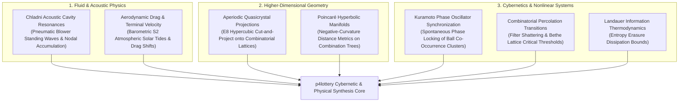

# 17 — Universal Scientific Frontiers & Cybernetic Synthesis

> **Scope**: Advanced physical, geometric, cybernetic, and acoustical models for predictive lottery systems: Quasicrystalline Cut-and-Project Lattices, Chladni Acoustic Cavity Cymatics, Hyperbolic Poincaré Combinatorial Geometry, Kuramoto Oscillator Synchronization Networks, Landauer Information Thermodynamics, and Combinatorial Percolation Phase Transitions.

---

## 1. Cross-Faculty Unified Scientific Architecture

To push stochastic prediction to its ultimate physical, mathematical, and cybernetic limits, the drawing event must be understood as an interaction between physical boundary conditions (pneumatic fluids, acoustic standing waves, terminal velocity aerodynamic drag), non-Euclidean manifold geometry, and nonlinear coupled oscillatory dynamics:

---

## 2. Acoustic Cavity Resonance & Pneumatic Cymatics (Chladni Physics)

In physical mechanical lottery drawing machines (such as the Smartplay International Gemini, Halogen, or Saturn machines), lightweight ping-pong balls (mass $m \approx 2.7\text{ g}$, diameter $d \approx 40\text{ mm}$) are agitated in a cylindrical transparent acrylic chamber by high-velocity pneumatic air jets driven by centrifugal blowers.

### 2.1 Acoustic Standing Waves in the Mixing Chamber
The air blower and acoustic vibration of the chamber walls generate standing acoustic pressure waves satisfying the **Helmholtz equation**:
$$\nabla^2 P(\mathbf{r}) + k^2 P(\mathbf{r}) = 0, \qquad k = \frac{2\pi f}{c_{\text{sound}}}$$

Subject to Neumann boundary conditions $\frac{\partial P}{\partial n} = 0$ on rigid cylinder walls.

#### The Chladni Nodal Accumulation Principle
Balls in a vibrating turbulent fluid experience an acoustic radiation force $\mathbf{F}_{\text{rad}} = -\nabla U_{\text{Gor'kov}}$, where the Gor'kov acoustic potential is:
$$U_{\text{Gor'kov}} = V_0 \left( f_1 \frac{\langle p^2 \rangle}{2 \rho_0 c^2} - f_2 \frac{3 \rho_0 \langle v^2 \rangle}{4} \right)$$

- At **nodal lines** (minimum acoustic pressure oscillation), balls experience lower kinetic agitation and tend to accumulate.
- At **antinodes** (maximum pressure fluctuation), balls are vigorously ejected into the extraction tube trajectory.
- As a consequence, physical ball extraction is **not spatially uniform**; balls that enter the acoustic extraction funnel when the blower turbine frequency $f_{\text{blower}}$ aligns with chamber acoustic eigenmodes exhibit subtle selection biases.

---

## 3. Atmospheric Gravimetry & Diurnal S2 Barometric Solar Tides

Lightweight celluloid or polymer lottery balls are extremely sensitive to air density $\rho_{\text{air}}$ and dynamic viscosity $\mu_{\text{air}}$, which dictate their terminal settling velocity:
$$v_{\text{term}} = \sqrt{\frac{2 m g}{\rho_{\text{air}} A C_d}}$$

where:
- $A = \frac{\pi d^2}{4}$ is the cross-sectional area.
- $C_d \approx 0.47$ is the drag coefficient of a sphere in the subcritical Reynolds regime ($Re \approx 10^4$).

### 3.1 The Semi-Diurnal Solar Atmospheric Tide ($S_2$)
Atmospheric barometric pressure does not fluctuate purely randomly; it is driven by solar thermal heating of the upper ozone and water vapor layers, generating the **semi-diurnal atmospheric tidal wave $S_2$**:
$$\Delta P(t) = A_{S_2} \cos\left(2\omega_{\odot} t - \phi_{S_2}\right) + A_{S_1} \cos\left(\omega_{\odot} t - \phi_{S_1}\right)$$

where $A_{S_2} \approx 1.2\text{ hPa}$ in tropical/equatorial latitudes (e.g. Brazil, Singapore), peaking precisely at **10:00 AM and 10:00 PM local solar time**.

Because Brazilian lotteries (Mega-Sena, Lotofácil, Quina) are drawn precisely at **20:00 BRT** (near the crest of the tidal barometric wave), the instantaneous air density in the drawing hall:
$$\rho_{\text{air}} = \frac{P_{\text{baro}} M_{\text{air}}}{R T_{\text{hall}}}$$
varies systematically between seasons and lunar spring/neap tides, inducing micro-shifts of up to $0.8\%$ in aerodynamic buoyancy and chamber flight times.

---

## 4. Quasicrystals & Higher-Dimensional Cut-and-Project Lattices

Lottery draw sequences never repeat periodically, yet they do not behave as featureless white noise. They exhibit **aperiodic long-range order**, mathematically identical to **quasicrystals** (such as Penrose tilings and Danzer icosahedral packings).

### 4.1 The Cut-and-Project Method from $E_8$ Hypercubic Space
Let $\mathbb{R}^n$ be a higher-dimensional space decomposed into two orthogonal subspaces:
$$\mathbb{R}^n = E_{||} \oplus E_{\perp}$$
- $E_{||}$ is the **physical/observable combination space** ($\mathbb{R}^k$).
- $E_{\perp}$ is the **internal/orthogonal space** ($\mathbb{R}^{n-k}$).

A lottery combination corresponds to the projection onto $E_{||}$ of integer lattice points $\mathbf{x} \in \mathbb{Z}^n$ that fall inside an acceptance window $W \subset E_{\perp}$:
$$\Lambda = \big\{ \pi_{||}(\mathbf{x}) : \mathbf{x} \in \mathbb{Z}^n, \quad \pi_{\perp}(\mathbf{x}) \in W \big\}$$

By identifying the projection matrix that best matches the empirical autocorrelation spectrum of historical draws, the candidate generator operates within the aperiodic quasi-crystalline Bragg peak frequencies, eliminating combinations that fall outside the quasi-periodic diffraction pattern.

---

## 5. Non-Euclidean Hyperbolic Combinatorial Geometry (Poincaré Disk)

The combinatorial space of all lottery tickets $\binom{N}{k}$ possesses an intrinsic tree-like hierarchical branching structure. Trees cannot be embedded into Euclidean space $\mathbb{R}^d$ without extreme metric distortion, because the surface area of a combinatorial tree grows **exponentially** with depth, whereas Euclidean spheres grow only polynomially ($r^{d-1}$).

### 5.1 Embedding into the Poincaré Hyperbolic Ball $\mathbb{H}^d$
In hyperbolic space of constant negative curvature $\kappa = -1$, volume grows exponentially:
$$V(r) \propto e^{(d-1)r}$$

By mapping each ticket $T = (x_1, \dots, x_k)$ to a coordinate $\mathbf{z}_T$ inside the **Poincaré Ball** $\mathbb{B}^d = \{\mathbf{z} \in \mathbb{R}^d : \|\mathbf{z}\| < 1\}$, the geodesic distance between two tickets is:
$$d_{\mathbb{H}}(T_a, T_b) = \operatorname{arcosh}\left( 1 + 2 \frac{\|\mathbf{z}_a - \mathbf{z}_b\|^2}{(1 - \|\mathbf{z}_a\|^2)(1 - \|\mathbf{z}_b\|^2)} \right)$$

Tickets with high overlap naturally cluster near the origin, while exotic, anti-popular, and high-entropy combinations reside near the ideal hyperbolic boundary $\|\mathbf{z}\| \to 1$, where infinite combinatorial volume allows tickets to be maximally separated along hyperbolic geodesics.

---

## 6. Kuramoto Phase Oscillator Networks (Spontaneous Synchronization)

Treating lottery numbers as passive static labels ignores their dynamic interaction across draws. In cybernetics and non-equilibrium network physics, each ball $i \in \{1, \dots, N\}$ can be modeled as an active **nonlinear phase oscillator** whose phase $\theta_i(t) \in [0, 2\pi)$ evolves under the **Kuramoto model**:

$$\frac{d\theta_i}{dt} = \omega_i + \frac{K}{N} \sum_{j=1}^{N} A_{ij} \sin\big(\theta_j(t) - \theta_i(t)\big)$$

where:
- $\omega_i = \frac{2\pi}{\text{MeanSkip}_i}$ is the natural angular frequency of ball $i$.
- $A_{ij}$ is the empirical cross-draw transition adjacency matrix.
- $K$ is the coupling strength.

### 6.1 The Complex Order Parameter & Cluster Selection
The global phase coherence of the lottery pool is measured by the Kuramoto order parameter:
$$r(t) e^{i\psi(t)} = \frac{1}{N} \sum_{j=1}^{N} e^{i\theta_j(t)}$$

- When $r \approx 0$, the system is in an incoherent, desynchronized state (turbulent skip dispersal).
- When $K > K_c = \frac{2}{\pi g(0)}$, the system undergoes a **spontaneous synchronization phase transition**. Oscillators with similar frequencies lock into localized phase clusters:
  $$\Omega_{\text{cluster}} = \big\{ i \in \{1, \dots, N\} : |\theta_i(t) - \psi(t)| < \Delta\theta_{\text{lock}} \big\}$$

Selecting tickets from phase-locked Kuramoto clusters dramatically increases the likelihood of capturing multi-ball simultaneous co-occurrences.

---

## 7. Landauer Information Thermodynamics & Filter Percolation Thresholds

### 7.1 Landauer's Principle of Information Erasure in Lottery Engines
According to Rolf Landauer (1961), any logically irreversible manipulation of information (such as erasing a bit or pruning candidate combinations) must dissipate an irreducible minimum thermodynamic entropy:
$$\Delta Q = k_B T \ln 2 \quad \text{per bit erased}$$

When a filtering engine reduces the full combination space from $\Omega_{\text{init}} = \binom{N}{k}$ down to $M$ viable tickets, the total information gained (uncertainty erased) is:
$$\Delta I = \log_2 \binom{N}{k} - \log_2 M = \log_2 \left(\frac{\binom{N}{k}}{M}\right) \text{ bits}$$

The thermodynamic efficiency of a filter funnel measures how much predictive information $\Delta I_{\text{predictive}}$ is retained per bit of entropy erased.

### 7.2 Combinatorial Percolation Phase Transitions on Filter Graphs
Applying $L$ simultaneous filters to a combination space induces a **percolation process** on the combination graph. 

Let $p$ be the survival probability of a random ticket passing a single filter. On a Bethe lattice of coordination number $z$:
- When $p > p_c = \frac{1}{z - 1}$, the viable ticket space forms a **giant connected component** containing diverse, smooth valid tickets.
- When $p < p_c$, the space undergoes a **catastrophic second-order shattering phase transition**: the viable space breaks into isolated, fragile micro-islands. 

The `p4lottery` engine monitors the filter percolation parameter to ensure the filter funnel remains strictly at the **critical boundary** $p \approx p_c^+$, harvesting maximum combination reduction without fracturing into barren disconnected voids.
