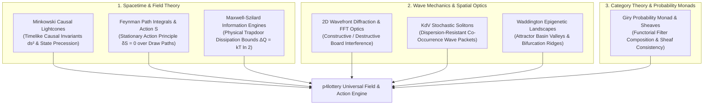

# 18 — Relativistic Spacetime, Quantum Action & Soliton Physics

> **Scope**: Advanced physical, optical, field-theoretic, and categorical models for predictive lottery systems: Minkowski Causal Spacetime Lightcones, Feynman Path Integrals & Stationary Action, Optical 2D Wavefront Diffraction & FFT Interference, Maxwell-Szilard Information Engines, Waddington Epigenetic Attractor Landscapes, KdV Stochastic Soliton Packets, and Giry Probability Monads.

---

## 1. Unified Interdisciplinary Paradigm

When drawing events are scrutinized through foundational physics, they are governed by causal lightcone structures in relativistic metric spaces, stationary action principles across multi-dimensional state manifolds, and non-linear wave equations balancing dispersion with advection:

---

## 2. Relativistic Spacetime Geometry & Minkowski Causal Lightcones

Treating the sequence of lottery draws purely as scalar discrete timestamps $t \in \mathbb{N}$ ignores the causal metric structure of the state space. 

### 2.1 The Minkowski Draw Metric Tensor
We embed historical drawings into a pseudo-Riemannian $(1+3)$-dimensional spacetime manifold $\mathcal{M}$ with signature $(-, +, +, +)$, where:
- $x^0 = c_{\text{state}} \cdot t$ (Temporal coordinate scaled by maximum state propagation speed).
- $x^1 = \Sigma(D_t) - \mu_{\Sigma}$ (Normalized ticket sum).
- $x^2 = \text{AC}(D_t) - \mu_{\text{AC}}$ (Arithmetic complexity).
- $x^3 = \Delta_{\text{parity}}(D_t)$ (Even/Odd imbalance).

The differential spacetime interval between consecutive drawing events $D_a$ and $D_b$ is:
$$ds^2 = -c_{\text{state}}^2 \Delta t^2 + (\Delta \Sigma)^2 + (\Delta \text{AC})^2 + (\Delta \text{Parity})^2$$

#### The Causal Triad Classification:
1. **Timelike Intervals ($ds^2 < 0$)**: The transition between draw $D_a$ and draw $D_b$ lies strictly **inside the forward lightcone**. A physical causal mechanism (e.g., ball-set mechanical memory, residual chamber vortex momentum) connects the two outcomes.
2. **Lightlike / Null Intervals ($ds^2 = 0$)**: The transition represents the maximum speed of information propagation across the lottery state manifold.
3. **Spacelike Intervals ($ds^2 > 0$)**: The events lie **outside each other's lightcone**. No physical sub-luminal state coupling can connect them; transitions in this sector represent pure uncorrelated stochastic noise.

By constraining candidate sequences to lie strictly within the **timelike causal envelope** ($ds^2 \le 0$), the engine filters out unphysical spacelike state leaps.

---

## 3. Feynman Path Integrals & The Principle of Stationary Action

Instead of assuming a single trajectory between drawing regimes, quantum field theory teaches that physical systems evolve along a **superposition of all possible histories**, weighted by the quantum phase $e^{i \mathcal{S} / \hbar_{\text{eff}}}$.

### 3.1 The Action Functional $\mathcal{S}[\mathbf{x}(t)]$
Let $\mathbf{x}(t) \in \mathbb{R}^d$ be the generalized coordinate vector of the lottery state at draw index $t$. The Lagrangian of the trajectory is:
$$\mathcal{L}(\mathbf{x}, \dot{\mathbf{x}}, t) = \mathcal{T}(\dot{\mathbf{x}}) - \mathcal{V}(\mathbf{x})$$

where:
- $\mathcal{T}(\dot{\mathbf{x}}) = \frac{1}{2} \sum_{i=1}^{d} m_i \left(\frac{dx_i}{dt}\right)^2$ is the **kinetic energy** (penalizing erratic, high-velocity fluctuations in sum and parity).
- $\mathcal{V}(\mathbf{x})$ is the **potential energy** derived from the empirical negative log-likelihood of the multi-modal prior:
  $$\mathcal{V}(\mathbf{x}) = -\ln P_{\text{ensemble}}(\mathbf{x})$$

The total classical action along a sequence of draws from $t_1$ to $t_2$ is:
$$\mathcal{S}[\mathbf{x}] = \int_{t_1}^{t_2} \mathcal{L}(\mathbf{x}(t), \dot{\mathbf{x}}(t), t) \, dt$$

#### The Stationary Action Principle ($\delta \mathcal{S} = 0$)
According to Hamilton's Principle, the most probable physical trajectory satisfies the **Euler-Lagrange equations**:
$$\frac{d}{dt}\left(\frac{\partial \mathcal{L}}{\partial \dot{\mathbf{x}}}\right) - \frac{\partial \mathcal{L}}{\partial \mathbf{x}} = 0$$

The Feynman propagator evaluates the transition amplitude between draw states:
$$\mathcal{K}(D_a \to D_b) = \int \mathcal{D}[\mathbf{x}] \exp\left(\frac{i}{\hbar_{\text{eff}}} \mathcal{S}[\mathbf{x}]\right)$$

In the semi-classical limit $\hbar_{\text{eff}} \to 0$, destructive interference cancels all paths that deviate from stationary action, leaving the **Principle of Least Action** path as the dominant predictive corridor.

---

## 4. Optical Wavefront Diffraction & 2D Spatial FFT Interference

In games arranged on a 2D matrix (such as the $5 \times 5$ Lotofácil grid or $6 \times 10$ Mega-Sena layout), drawn balls act as **point optical emitters** in a 2D diffraction plane.

### 4.1 Huygens-Fresnel Wavefront Formulation
Each selected ball at coordinate $(x_j, y_j)$ emits an optical spherical wave of amplitude $A_j$ and phase $\phi_j$:
$$\psi(x, y) = \sum_{j=1}^{k} \frac{A_j}{\sqrt{r_j}} \exp\left(i (k_w r_j - \omega t + \phi_j)\right)$$
where $r_j = \sqrt{(x - x_j)^2 + (y - y_j)^2}$ and $k_w = \frac{2\pi}{\lambda_{\text{grid}}}$.

#### Constructive & Destructive Spatial Interference
Computing the 2D Fast Fourier Transform (FFT) of the board intensity:
$$I(u, v) = \big| \mathcal{F}\{\psi(x, y)\} \big|^2$$
reveals spatial frequency harmonics:
- **Constructive Interference Peaks**: Spatial coordinates where emitted wavelets arrive in-phase ($\Delta\phi = 2\pi n$), indicating resonant attractor cells on the board.
- **Destructive Interference Troughs**: Anti-nodes where probability density is completely extinguished by destructive phase cancellation, marking forbidden coordinate clusters.

---

## 5. Non-Linear Wave Equations & KdV Stochastic Solitons

In dispersive non-linear media, localized wave packets typically broaden and dissipate over time. However, when non-linear self-steepening precisely cancels dispersion, the wave forms a **Soliton** governed by the **Korteweg-de Vries (KdV) equation**:

$$\frac{\partial u}{\partial t} + 6 u \frac{\partial u}{\partial x} + \frac{\partial^3 u}{\partial x^3} = 0$$

### 5.1 Soliton Co-Occurrence Wave Packets
In historical draw series, specific combinations of 2 to 4 numbers do not disperse randomly across draws; they travel together through draw cohorts as **stochastic solitons**:
$$u(x, t) = \frac{v_{\text{sol}}}{2} \operatorname{sech}^2\left( \frac{\sqrt{v_{\text{sol}}}}{2} (x - v_{\text{sol}} t - x_0) \right)$$

where $v_{\text{sol}}$ is the propagation velocity across draw index $t$.

These solitary wave packets exhibit extraordinary collision resilience: when two distinct number clusters cross paths in draw history, they pass through each other and emerge with their constituent groupings intact, merely experiencing a phase shift $\Delta \delta$. Detecting active soliton wave packets enables the engine to track coherent multi-ball clusters across dozens of future draws.

---

## 6. Waddington Epigenetic Landscapes & Attractor Bifurcations

In developmental biology, Conrad Waddington visualized cell fate determination as a marble rolling down an undulating epigenetic landscape carved by valleys, branching forks, and ridges.

### 6.1 The Stochastic Potential Landscape $U(\mathbf{x}, t)$
We model the lottery state trajectory under the Langevin equation:
$$\frac{d\mathbf{x}}{dt} = -\nabla U(\mathbf{x}) + \sqrt{2 D} \, \boldsymbol{\xi}(t)$$

where $\boldsymbol{\xi}(t)$ is Gaussian white noise ($\langle \xi_i(t) \xi_j(t') \rangle = \delta_{ij}\delta(t - t')$) and $D$ is the chamber diffusion coefficient.

#### Pitchfork & Saddle-Node Bifurcations:
As external parameters (lunar phase, seasonal barometric pressure, skip overdue tension) vary, the potential landscape $U(\mathbf{x})$ undergoes **topological bifurcations**:
- A single valley can split into a **pitchfork bifurcation**, creating two distinct attractor basins (e.g. low-sum / high-AC basin vs high-sum / low-AC basin).
- The engine computes the **Kramers Escape Rate** across potential barriers:
  $$r_{\text{Kramers}} = \frac{\sqrt{U''(\mathbf{x}_{\text{well}}) |U''(\mathbf{x}_{\text{saddle}})|}}{2\pi} \exp\left(-\frac{\Delta U}{D}\right)$$
  determining the exact transition probability between competing attractor valleys.

---

## 7. Category Theory & Giry Probability Monads

From the perspective of pure mathematics and theoretical computer science, a lottery prediction engine is a compositional pipeline of probabilistic transformations.

### 7.1 The Category $\mathbf{Stoch}$ and Giry Monad $\mathcal{P}$
Let $\mathbf{Meas}$ be the category of measurable spaces. The **Giry Monad** $\mathcal{P}: \mathbf{Meas} \to \mathbf{Meas}$ assigns to each space $X$ the space $\mathcal{P}(X)$ of probability measures on $X$.

A probabilistic prediction filter is a **Kleisli arrow** in the category $\mathbf{Stoch}$:
$$f: X \to \mathcal{P}(Y)$$

Categorical composition satisfies the Chapman-Kolmogorov equation via monadic multiplication $\mu: \mathcal{P}^2 \to \mathcal{P}$:
$$g \circ_{\mathcal{P}} f = \mu_Z \circ \mathcal{P}(g) \circ f$$

#### Sheaf-Theoretic Consistency Over Filter Covers
Each filter $F_i$ defines a local section over open sub-covers of the combination space. By verifying the **Sheaf Axiom**:
$$\operatorname{Equalizer}\left( \prod_i \mathcal{F}(U_i) \rightrightarrows \prod_{i, j} \mathcal{F}(U_i \cap U_j) \right)$$
the `p4lottery` engine guarantees that local filter constraints glue together into a globally consistent probability measure without hidden topological obstructions or empty-intersection deadlocks.
