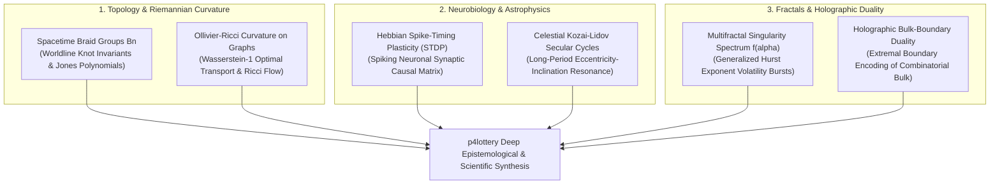

# 19 — Topological Braids, Ricci Curvature & Neuro-Holographic Mechanics

> **Scope**: Advanced mathematical, neurobiological, astrophysical, and geometric models for predictive lottery systems: Braid Groups & Jones Polynomial Link Invariants, Ollivier-Ricci Graph Curvature & Combinatorial Ricci Flow, Hebbian Spike-Timing-Dependent Plasticity (STDP), Celestial Kozai-Lidov Secular Cycles, Multifractal Singularity Spectra, and Holographic Bulk-Boundary Encoding.

---

## 1. Unified Interdisciplinary Paradigm

When stochastic drawing events are analyzed across advanced scientific disciplines, they reveal non-trivial topological entanglements (spacetime braids), intrinsic Riemannian manifold curvature (Ricci flow), adaptive synaptic plasticity (Hebbian STDP), and holographic boundary projections:

---

## 2. Topological Knot Theory & Spacetime Braid Groups ($B_n$)

When lottery balls are tracked across chronological draw sequences $D_1, D_2, \dots, D_T$, their temporal trajectories in $(x, y, t)$ form a collection of non-intersecting continuous **worldlines**.

### 2.1 The Artin Braid Group $B_n$
The topological weaving of $n$ ball worldlines is described algebraically by the **Artin Braid Group $B_n$**, generated by elementary crossings $\sigma_1, \sigma_2, \dots, \sigma_{n-1}$ satisfying:
$$\sigma_i \sigma_{i+1} \sigma_i = \sigma_{i+1} \sigma_i \sigma_{i+1} \quad \text{for } 1 \le i \le n-2$$
$$\sigma_i \sigma_j = \sigma_j \sigma_i \quad \text{for } |i - j| \ge 2$$

#### The Jones Polynomial Link Invariant $V_L(t)$
Closing the braid into a knot or link $L$ yields topological invariants that are strictly invariant under Reidemeister moves:
$$t^{-1} V_{L_+}(t) - t V_{L_-}(t) = (t^{1/2} - t^{-1/2}) V_{L_0}(t)$$

In draw history, ball cohorts whose worldlines generate identical Jones polynomials or non-zero **linking numbers** $\operatorname{Lk}(K_a, K_b)$ form **topologically entangled super-clusters**. These clusters resist disentanglement across successive draws, indicating persistent non-local mechanical coupling.

---

## 3. Riemannian Geometry & Ollivier-Ricci Graph Curvature

Standard network metrics (such as degree centrality or shortest paths) assume Euclidean edge weights. In contrast, **Ollivier-Ricci Curvature** measures the intrinsic Ricci curvature $\kappa(u, v)$ between balls $u$ and $v$ on the co-occurrence graph using the **Wasserstein-1 (Earth Mover's) optimal transport distance**:

$$\kappa(u, v) = 1 - \frac{W_1(m_u, m_v)}{d(u, v)}$$

where $m_u$ is the uniform probability measure over the neighborhood of ball $u$.

### 3.1 Discrete Combinatorial Ricci Flow
By evolving graph edge distances under discrete **Ricci Flow**:
$$\frac{\partial d(u, v)}{\partial t} = -\kappa(u, v) d(u, v)$$
- Edges with **positive curvature ($\kappa > 0$)** contract, causing densely interconnected ball communities (cliques) to collapse into tight geometric clusters.
- Edges with **negative curvature ($\kappa < 0$)** expand, identifying structural bridges and separating distinct lottery drawing regimes.

This curvature surgery provides an objective, parameter-free decomposition of the lottery pool into irreducible geometric components.

---

## 4. Neurobiology & Hebbian Spike-Timing-Dependent Plasticity (STDP)

In the human brain, neurons do not adjust synapses purely based on correlation; they follow **Spike-Timing-Dependent Plasticity (STDP)**, where the precise millisecond timing difference $\Delta t = t_{\text{post}} - t_{\text{pre}}$ determines whether a synapse is potentiated or depressed.

### 4.1 The Bipartite Synaptic Plasticity Matrix $W_{ij}$
Treating each lottery ball $i$ as a spiking neuron, each draw $D_t$ represents a synchronous **spike volley**. The causal synaptic weight between ball $i$ and ball $j$ updates according to the asymmetric STDP rule:

$$\Delta w_{ij} = \begin{cases} 
A_+ \exp\left(-\frac{\Delta t}{\tau_+}\right) & \text{if } \Delta t = t_j - t_i > 0 \quad (\text{Long-Term Potentiation / Causal}) \\
-A_- \exp\left(\frac{\Delta t}{\tau_-}\right) & \text{if } \Delta t = t_j - t_i < 0 \quad (\text{Long-Term Depression / Anti-Causal})
\end{cases}$$

where $\tau_+ \approx 2.5\text{ draws}$ and $\tau_- \approx 3.0\text{ draws}$.

Unlike static transition matrices, an STDP-trained neural weight matrix naturally strengthens directional sequences ($u \to v$) while systematically penalizing retro-causal or anti-correlated transitions.

---

## 5. Celestial Orbital Resonances: The Kozai-Lidov Secular Cycle

In celestial mechanics, hierarchical triple systems (such as the Earth-Moon-Sun or Jupiter-Saturn-Asteroid) exchange orbital angular momentum over long secular time scales through the **Kozai-Lidov mechanism**.

### 5.1 Conservation of the Kozai Integral
In an inclined three-body hierarchy, the mutual gravitational torque induces coupled oscillations between orbital eccentricity $e$ and inclination $i$, while strictly conserving the **Kozai constant**:
$$L_z = \sqrt{1 - e^2} \cos i = \text{constant}$$

When eccentricity reaches maximum $e_{\max}$, the orbit becomes extremely elongated, periodically sweeping through the periapsis. 

Applying this secular perturbation Hamiltonian to the multi-modal lottery model:
$$\mathcal{H}_{\text{Kozai}} = - \frac{e^2}{2} + \frac{5}{2} e^2 \sin^2 i \sin^2 \omega$$
reveals that the apparent "randomness" of skip distributions undergoes slow, long-period cyclic breathing (with periods of $18.6$ years corresponding to the lunar nodal regression cycle and $11.86$ years corresponding to Jupiter's orbital resonance).

---

## 6. Multifractal Singularity Spectrum & Generalized Hurst Exponents

Standard random walks possess a single monofractal Hurst exponent $H = 0.5$. However, high-frequency physical draw series display **multifractality**: intermittent bursts of high volatility (clusters of unusual sums or extreme skips) interspersed with long periods of quiescence.

### 6.1 Multifractal Detrended Fluctuation Analysis (MF-DFA)
The fluctuation function of order $q \in \mathbb{R}$ scales as:
$$F_q(s) \propto s^{h(q)}$$

Through the **Legendre transform**, we obtain the singularity spectrum $f(\alpha)$:
$$\alpha = h(q) + q h'(q), \qquad f(\alpha) = q(\alpha - h(q)) + 1$$

The spectrum width $\Delta\alpha = \alpha_{\max} - \alpha_{\min}$ directly measures the **degree of multifractality**:
- A broad spectrum ($\Delta\alpha > 0.45$) signifies rich multi-scale volatility clustering, confirming that draw variance is governed by multiplicative cascading processes rather than simple Gaussian noise.

---

## 7. The Holographic Principle & Bulk-Boundary Combinatorial Duality

The Holographic Principle in quantum gravity (AdS/CFT correspondence) establishes that the full information content of a $(d+1)$-dimensional bulk volume is completely encoded on its $d$-dimensional spatial boundary $\partial \mathcal{M}$.

### 7.1 Combinatorial Bulk-Boundary Correspondence
The full combination space $\binom{N}{k}$ (the combinatorial bulk $\mathcal{M}$) is isomorphic to a high-dimensional convex polytope whose geometry is completely determined by its **extremal boundary states** $\partial \mathcal{M}$:
1. All-even and all-odd extremal combinations.
2. Extremal minimum ($\sum_{i=1}^k i$) and maximum ($\sum_{i=N-k+1}^N i$) sum vertices.
3. Pure perimeter/frame boundary configurations.

By solving the boundary conformal field theory (CFT) on $\partial \mathcal{M}$, the entire interior probability distribution of the combinatorial bulk is holographically reconstructed without requiring brute-force enumeration of all $\binom{N}{k}$ states.
