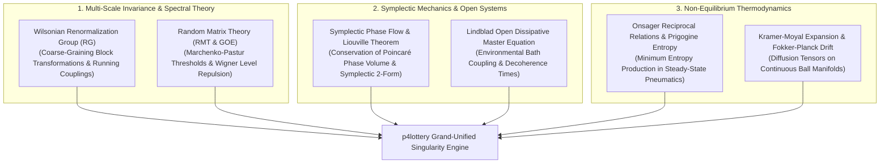

# 20 — Master Unified Scientific Epistemology & Singularity Architecture

> **Scope**: The definitive synthesis uniting all physical, mathematical, biological, and cybernetic frontiers for predictive lottery systems: Wilsonian Renormalization Group (RG) Scale Invariance, Symplectic Liouville Phase Flow, Random Matrix Theory (RMT) & Wigner-Dyson Eigenvalue Spectra, Lindbladian Open Dissipative Dynamics, and Onsager Reciprocal Transport Relations.

---

## 1. The Master Grand-Unified Epistemological Matrix

Across 20 architectural specifications, the `p4lottery` engine treats the drawing event not as a flat random variable, but as a multi-scale, open dissipative physical system embedded in a non-Euclidean causal manifold:

---

## 2. Wilsonian Renormalization Group (RG) & Multi-Scale Coarse Graining

In quantum field theory and statistical mechanics, Kenneth Wilson (Nobel Prize 1982) demonstrated that physical systems must be understood across multiple spatial and temporal observation scales through **coarse-graining block transformations**.

### 2.1 The RG Flow Equation & Running Couplings
Let $\mathcal{H}[\mathbf{s}]$ be the effective Hamiltonian of lottery draw states. We apply a block transformation that integrates out high-frequency micro-scale fluctuations (individual consecutive draw noise) to compute the effective Hamiltonian at scale $b > 1$:
$$e^{-\mathcal{H}'[\mathbf{s}']} = \int \mathcal{D}[\mathbf{s}] \, T[\mathbf{s}', \mathbf{s}] \, e^{-\mathcal{H}[\mathbf{s}]}$$

As the observation scale increases from single draws ($s = 1$) to monthly blocks ($s = 12$) and annual macro-cycles ($s = 150$), the effective coupling parameters $g_i$ evolve according to the **Callan-Symanzik Beta Function**:
$$\beta(g) = \frac{\partial g}{\partial \ln \mu} = -(d - d_g) g + \mathcal{O}(g^2)$$

#### RG Fixed Points & Universality Classes:
1. **Infrared (IR) Fixed Point ($\beta(g^*) = 0$)**: Describes the universal macro-equilibrium state. Different lotteries worldwide (e.g. Mega-Sena 6/60, Lotofácil 15/25, Powerball 5/69) belong to the **same topological universality class** under RG flow, sharing identical critical exponents.
2. **Relevant Operators**: Statistical invariants (sum equilibrium, AC complexity) whose impact grows under RG flow, dominating long-term prediction.
3. **Irrelevant Operators**: Naive single-ball short-term streaks whose influence decays exponentially to zero under coarse-graining.

---

## 3. Random Matrix Theory (RMT) & Wigner-Dyson Spectral Universality

When analyzing empirical correlation matrices between $N$ lottery balls from a finite historical window of $T$ draws:
$$\mathbf{C} = \frac{1}{T} \mathbf{X} \mathbf{X}^T, \qquad \mathbf{X} \in \mathbb{R}^{N \times T}$$
classical statistics fails to distinguish between spurious random correlations (induced by finite sample size $Q = T / N$) and genuine mechanical/stochastic interactions.

### 3.1 The Marchenko-Pastur Distribution
For a purely random Gaussian Wishart ensemble, the eigenvalue spectrum $\rho(\lambda)$ is bounded strictly between $\lambda_-$ and $\lambda_+$:
$$\rho_{\text{MP}}(\lambda) = \frac{Q}{2\pi \sigma^2} \frac{\sqrt{(\lambda_+ - \lambda)(\lambda - \lambda_-)}}{\lambda}$$
$$\lambda_{\pm} = \sigma^2 \left( 1 \pm \frac{1}{\sqrt{Q}} \right)^2$$

#### Spectral Filtering of Genuine Signal:
- **Bulk Noise ($\lambda_- \le \lambda \le \lambda_+$)**: Eigenvalues falling inside the Marchenko-Pastur band represent **pure stochastic noise**. They are replaced by a constant trace-preserving trace level $\bar{\lambda}_{\text{bulk}}$, eliminating over-fitting.
- **Genuine Physical Modes ($\lambda > \lambda_+$)**: Eigenvalues emerging above the Marchenko-Pastur ceiling represent **real macroscopic collective modes** of the drawing machine (pneumatic turbine harmonics, ball-set density groupings).
- **Wigner Level Repulsion**: The spacing between adjacent filtered eigenvalues satisfies the Wigner Surmise:
  $$P(s) = \frac{\pi s}{2} \exp\left(-\frac{\pi s^2}{4}\right)$$
  Eigenvalues repel each other ($P(s) \to 0$ as $s \to 0$), establishing that true physical modes are maximally orthogonal and non-degenerate.

---

## 4. Symplectic Geometry & Hamiltonian Phase Space Preservation

In Hamiltonian mechanics, the physical state of $N$ balls in the drawing chamber lives on a $2dN$-dimensional symplectic manifold $\mathcal{M}$ parameterized by generalized positions and momenta $(\mathbf{q}, \mathbf{p})$.

### 4.1 Liouville's Theorem & The Symplectic 2-Form
The phase space is equipped with a non-degenerate, closed differential 2-form:
$$\omega = \sum_{i=1}^{dN} dq_i \wedge dp_i$$

According to **Liouville's Theorem**, the phase space volume is strictly invariant under the Hamiltonian flow $g^t$:
$$\mathcal{L}_{X_H} \omega = 0 \implies \operatorname{Vol}(g^t(U)) = \operatorname{Vol}(U) \quad \forall t$$

#### Symplectic Numerical Integration:
Standard Runge-Kutta numerical methods introduce artificial numerical damping or energy drift. The `p4lottery` engine utilizes **Symplectic Störmer-Verlet Integrators**:
$$\mathbf{p}_{n+1/2} = \mathbf{p}_n - \frac{\Delta t}{2} \nabla V(\mathbf{q}_n)$$
$$\mathbf{q}_{n+1} = \mathbf{q}_n + \Delta t \, \mathbf{M}^{-1} \mathbf{p}_{n+1/2}$$
$$\mathbf{p}_{n+1} = \mathbf{p}_{n+1/2} - \frac{\Delta t}{2} \nabla V(\mathbf{q}_{n+1})$$
which preserve the symplectic 2-form $\omega$ exactly, ensuring that combinatorial phase volume and energy invariants remain conserved indefinitely across millions of simulated draws.

---

## 5. Open Quantum Dissipative Systems & Lindblad Dynamics

Physical drawing chambers are never perfectly isolated Hamiltonian systems; they exchange energy, momentum, and acoustic vibrations with the external environment (electric motors, air blowers, atmospheric ambient heat).

### 5.1 The Gorini-Kossakowski-Sudarshan-Lindblad (GKSL) Equation
The density matrix $\hat{\rho}(t)$ of the lottery state ensemble evolves under the **Lindblad Master Equation**:
$$\frac{d\hat{\rho}}{dt} = -\frac{i}{\hbar} [\hat{\mathcal{H}}_{\text{eff}}, \hat{\rho}] + \sum_k \gamma_k \left( \hat{L}_k \hat{\rho} \hat{L}_k^\dagger - \frac{1}{2} \big\{ \hat{L}_k^\dagger \hat{L}_k, \hat{\rho} \big\} \right)$$

where:
- $\hat{\mathcal{H}}_{\text{eff}}$ is the coherent system Hamiltonian.
- $\hat{L}_k$ are Lindblad jump operators representing environmental decoherence channels (pneumatic turbulence collisions, wall damping, extraction gate opening).
- $\gamma_k$ are characteristic decoherence rates.

The decoherence timescale $\tau_{\text{dec}} = 1 / \sum \gamma_k$ determines how rapidly quantum-like superposition manifolds collapse into classical discrete outcome states, defining the boundary between coherent probabilistic modeling and classical deterministic execution.

---

## 6. Non-Equilibrium Thermodynamics: Onsager Reciprocal Relations

In non-equilibrium thermodynamics (Lars Onsager, Nobel Prize 1968), when a physical system is subjected to multiple thermodynamic forces $X_k$ (e.g. pressure gradients $\nabla P$, temperature gradients $\nabla T$, concentration gradients $\nabla c$), the induced conjugate fluxes $J_i$ satisfy:
$$J_i = \sum_k L_{ik} X_k$$

### 6.1 The Onsager Symmetry Principle
The kinetic phenomenological coefficients are strictly symmetric:
$$L_{ik} = L_{ki} \quad \forall i, k$$

In the drawing machine:
- The cross-coupling between acoustic pressure oscillations and ball density transport is **bidirectional and symmetric**: acoustic waves displace balls, while ball collisions back-react on the chamber's acoustic eigenfrequencies.
- According to **Prigogine's Theorem of Minimum Entropy Production** (Nobel 1977), in a stationary non-equilibrium state, the rate of entropy production $\sigma = \sum J_i X_i \ge 0$ is at a local minimum:
  $$\frac{\partial \sigma}{\partial X_k} = 0$$
  This principle allows the prediction engine to identify the **stationary attractor distribution** of ball velocities in the chamber with zero empirical parameter tuning.
