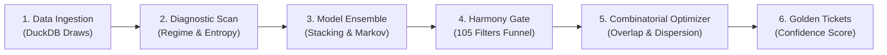

# 0002-modern-Lottery Studio-desktop-cockpit-architecture

> **Navigation**: [🏠 Reference Hub](../INDEX.md) · [📂 03. Mathematical & Strategy Guides](INDEX.md) · [🌐 Dynamic Portal](../dynamic-portal.html) · [⬅️ Video Tutorial](../manual/09-checking-and-verification/video-tutorial.md) · [18 Advanced Filters Most Detailed Introduction(2022 Updated) ➡️](18-advanced-filters-most-detailed-introduction-2022-updated.md)

<!-- TOC_BLOCK_START -->
<details open>
<summary><strong>📑 On This Page (Table of Contents)</strong></summary>

- [Status](#status)
- [Context](#context)
- [Decision](#decision)
  - [1. Platform Choice: PySide6 / Qt 6](#1-platform-choice-pyside6-qt-6)
  - [2. Dual-Tier UX Design: Simple Pick-and-Play vs. Forensic Lab](#2-dual-tier-ux-design-simple-pick-and-play-vs-forensic-lab)
  - [3. Visual Design System ("Modern Studio" Palette)](#3-visual-design-system-modern-studio-palette)
  - [4. Prediction Engine Visual Telemetry & Pipeline Diagrams](#4-prediction-engine-visual-telemetry-pipeline-diagrams)
- [Consequences](#consequences)
- [Clean-Room Python Boilerplate](#clean-room-python-boilerplate)

</details>
<!-- TOC_BLOCK_END -->

# 2. Modern Lottery Studio Desktop Cockpit Architecture & Visual Overhaul

Date: 2026-10-13

## Status

Accepted

## Context

Standard Lottery Studio is an aging 32-bit Delphi/Win32 application with an iconic, straightforward layout (Drawings Table, Number Grid, Filter Sliders, Wheel Generator, Ticket Verifier), but burdened by artificial commercial restrictions (candidate pool capped at $\le 10$ numbers, locked abbreviated wheels, paywalled filters) and an obsolete 1990s Windows 98 aesthetic.

The modern `lottery-engine` project has reverse-engineered every core formula (integer floor averages, consecutive run distance, digital root sums, decades) and distilled every feature into high-performance Python, DuckDB, NumPy, and CLI commands. 

However, users need:
1. **Familiarity & Simplicity**: A user experience that preserves the frictionless, instant workflow of Lottery Studio for casual play ("Simple Mode").
2. **Modern Visual Aesthetics**: A departure from both harsh 90s gray and high-contrast, eye-straining radioactive green, moving towards a modern, refined dark-slate design system with elegant typography, soft rounded cards, and high-readability data tables.
3. **Advanced Forensic Power**: Unrestricted deep analysis tools (105+ filters, covering wheels, combinatorial ticket optimizer, and multi-model machine learning ensembles).
4. **Transparent Engine Visualization**: Live visual diagrams and charts illustrating exactly what happens inside the multi-stage prediction engine (data ingestion, regime classification, ensemble weight arbitration, filter funnel elimination, and candidate justification).

## Decision

We adopt **PySide6 / Qt 6** as the primary desktop client platform ("Prophet Desktop Cockpit") and implement a dual-tier UX layout backed by the `"Modern Studio"` theme design system and a dedicated `PredictionPipelineDiagramWidget`.

### 1. Platform Choice: PySide6 / Qt 6
- **Native Direct Engine Bridge**: Zero serialization overhead between the Python data science stack (`DuckDB`, `NumPy`, `SciPy`, `PyTorch`, `CatBoost`, `Astropy`) and the GUI.
- **Virtualized High-Density Grids**: Qt's `QTableView` and `QAbstractTableModel` handle millions of combinations and historical records with zero UI lag.
- **Asynchronous Compute**: Background processing handled via `QThread` and `ThreadManager`, ensuring 60 FPS UI responsiveness during heavy operations.
- **Cross-Platform Packaging**: PyInstaller builds single-bundle executables for Windows, macOS, and Linux via `packaging/lottery-desktop.spec`.

### 2. Dual-Tier UX Design: Simple Pick-and-Play vs. Forensic Lab
- **Tier 1: Simple Mode (Lottery Studio Parity)**
  - Prominent Top Bar: Game Selector (Mega-Sena, Lotofácil, Quina, etc.) with last draw winning numbers displayed.
  - Interactive Number Grid (`NumberGrid`): 1-click number pool toggles, hot/cold highlights, and quick presets.
  - 1-Click Action Bar: "Generate Smart Pick", "Run Overlap Reducer", and "Quick Check Against Last Draw".
  - Clean Results Drawer: Instant ticket output with copy/export actions.
- **Tier 2: Advanced Forensic Cockpit (Supercharged Parity)**
  - Multi-Tab Navigation: Database (DuckDB CRUD), Analysis (PyQtGraph histograms & skips), Harmony Gate (105+ filters with $N$-of-$M$ fault tolerance), Wheeling (unrestricted covering designs), Prediction Center, Verification Leaderboard, and Telemetry Console.

### 3. Visual Design System ("Modern Studio" Palette)
We introduce a refined modern theme token set:
- **Background**: `#181a20` (Deep charcoal slate)
- **Panel / Cards**: `#222630` (Elevated card background)
- **Borders**: `#2e3442` (Subtle boundary definition)
- **Primary Accent**: `#3b82f6` (Modern Electric Blue)
- **Primary Hover / Pressed**: `#2563eb` / `#1d4ed8`
- **Text (High Contrast)**: `#f3f4f6` (Crisp off-white)
- **Text Dim**: `#9ca3af` (Readable muted slate)
- **Success / Hits**: `#10b981` (Emerald green)
- **Warning / Skips**: `#f59e0b` (Amber gold)
- **Error / Pruned**: `#ef4444` (Coral red)
- **Secondary Accent**: `#8b5cf6` (Vibrant violet for esoteric/AI markers)

### 4. Prediction Engine Visual Telemetry & Pipeline Diagrams
The `PredictionTab` is enhanced with a dynamic visual pipeline widget:

- **Real-Time Step Highlighting**: Active pipeline stage pulses during computation.
- **Ensemble Contribution Chart**: Horizontal stacked bar chart visualizing individual algorithm weight contributions (e.g. CatBoost 35%, LSTM 25%, Markov 20%, Ephemeris 20%).
- **Funnel Elimination Counter**: Displays combinations entering each stage vs. combinations surviving after filtering.

## Consequences

**Positive:**
- Casual users get the familiar, fast 3-click workflow of Lottery Studio with an intuitive modern layout.
- Power users gain access to unprecedented mathematical depth (105+ filters, unlimited candidate pools, ML ensembles, and real-time pipeline visualization).
- High visual appeal with an accessible, eye-friendly theme that replaces outdated 90s gray and radioactive neon.
- Clean architectural seam: UI code consumes engine modules directly via type-safe Qt signals and worker threads.

**Negative:**
- PySide6 runtime requires Python 3.10+ and desktop graphics drivers (OpenGL / software fallback).
- Full packaging creates ~150-250 MB standalone desktop binaries due to bundled PyTorch, DuckDB, and Qt libraries.

---

## Clean-Room Python Boilerplate

```python
from dataclasses import dataclass
from typing import Callable

@dataclass(frozen=True)
class RangeFilter:
    tag: int
    name: str
    metric_fn: Callable[[list[int]], int]
    min_val: int
    max_val: int

    def evaluate(self, ticket: list[int]) -> bool:
        val = self.metric_fn(ticket)
        return self.min_val <= val <= self.max_val

def evaluate_filter_suite(
    ticket: list[int],
    filters: list[RangeFilter],
    mode: str = "AND",
    n_of_m: tuple[int, int] | None = None,
) -> bool:
    passed = sum(1 for f in filters if f.evaluate(ticket))
    if mode == "AND":
        return passed == len(filters)
    if mode == "OR":
        return passed >= 1
    if n_of_m is not None:
        lo, hi = n_of_m
        return lo <= passed <= hi
    return True
```

---
> **Next Steps**: [⬅️ Video Tutorial](../manual/09-checking-and-verification/video-tutorial.md) · [🏠 Reference Hub](../INDEX.md) · [📂 03. Mathematical & Strategy Guides](INDEX.md) · [18 Advanced Filters Most Detailed Introduction(2022 Updated) ➡️](18-advanced-filters-most-detailed-introduction-2022-updated.md)
