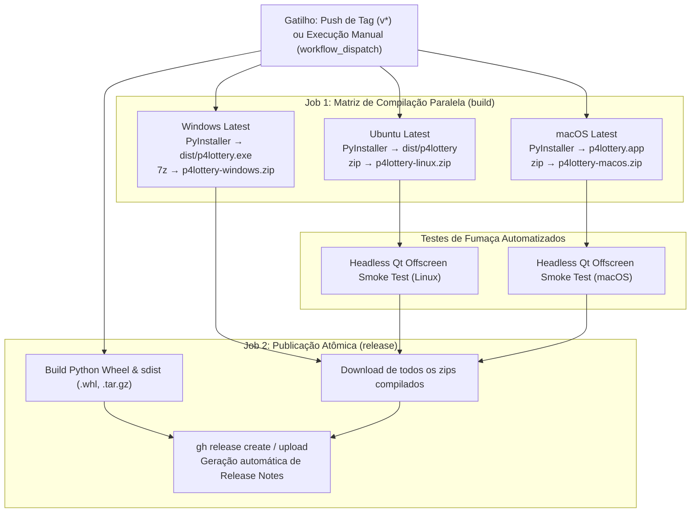

# 🚀 Release & Distribution Guide (`p4lottery`)

> Guia oficial de engenharia para empacotamento, compilação de binários nativos e distribuição automatizada do **p4lottery** via GitHub Releases.

---

## 🧭 Visão Geral

O projeto **p4lottery** disponibiliza duas frentes de uso para que usuários finais e operadores executem a aplicação **sem necessidade de clonar o código fonte ou configurar ambientes de desenvolvimento**:

1. **Executáveis Standalone (Desktop GUI / PySide6)**:
   - Empacotados com **PyInstaller** (`packaging/lottery-desktop.spec`).
   - Contêm interpretador Python embutido, interface gráfica Qt6, banco analítico DuckDB e todas as dependências pré-instaladas.
   - Binários nativos para **Windows** (`p4lottery.exe`), **Linux** e **macOS**.

2. **Pacotes Universais Python (CLI / Terminal)**:
   - Wheel (`.whl`) e Source Distribution (`.tar.gz`).
   - Permitem instalar globalmente o comando de terminal `p4lottery` via `pipx` ou `pip install`.

---

## 🏗️ Arquitetura do Pipeline de CI/CD

O fluxo de compilação e publicação é orquestrado pelo GitHub Actions em [`.github/workflows/build-desktop.yml`](../../.github/workflows/build-desktop.yml):



---

## 📋 Como Publicar uma Nova Versão (Passo a Passo)

### 1. Atualizar a Versão nos Arquivos do Projeto
Antes de criar a tag, garanta que a versão está alinhada nos seguintes arquivos:
- `pyproject.toml`:
  ```toml
  [project]
  version = "0.0.1"
  ```
- `engine/__init__.py`:
  ```python
  __version__ = "0.0.1"
  ```

### 2. Validar o Guardrail de PII (Obrigatório)
Execute a verificação de segurança estrita para garantir que nenhum dado pessoal está sendo versionado:
```bash
python3 scripts/check_no_pii.py
```

### 3. Commitar e Enviar para o Branch `main`
```bash
git add pyproject.toml engine/__init__.py packaging/lottery-desktop.spec .github/workflows/build-desktop.yml README.md docs/
git commit -m "chore(release): prepare release v0.0.1"
git push origin main
```

### 4. Criar e Publicar a Tag Git
```bash
# Criação da tag anotada ou simples
git tag v0.0.1

# Envio da tag ao repositório remoto
git push origin v0.0.1
```

> **Gatilho Automático**: O GitHub detectará a tag `v0.0.1`, acionará os 3 runners (Windows, Linux e macOS), fará o teste de fumaça headless, e anexará todos os arquivos `.zip` e `.whl` na Release oficial.

---

## 🎛️ Disparo Manual via Interface Web (Sem Tag Local)

Caso deseje compilar ou testar a release diretamente pela interface do GitHub:
1. Acesse o repositório no GitHub.
2. Navegue até a aba **Actions**.
3. Na lateral esquerda, clique em **Build and Release Desktop App**.
4. Clique no botão **Run workflow**:
   - Se informar uma tag (ex: `v0.0.1`), a Release será criada e os arquivos publicados.
   - Se deixar em branco, os binários serão gerados apenas como artefatos temporários de teste para download interno.

---

## 📦 Artefatos Gerados e Instruções para o Usuário Final

Cada release pública gera os seguintes arquivos na página de [GitHub Releases](https://github.com/OAL-Logic/prediction-engine-lottery/releases):

| Arquivo | Descrição | Instrução de Uso para o Usuário |
|---|---|---|
| `p4lottery-windows.zip` | Binário Windows Standalone | Extrair o arquivo zip e clicar duas vezes em `p4lottery.exe`. |
| `p4lottery-linux.zip` | Binário Linux Standalone | Extrair e executar `./p4lottery` via terminal ou lançador gráfico. |
| `p4lottery-macos.zip` | Pacote macOS App Bundle | Extrair e abrir o `p4lottery.app`. |
| `lottery_engine-*-py3-none-any.whl` | Pacote Universal Python | Instalar com `pipx install <url-do-whl>` ou `pip install <url-do-whl>`. |

---

## 🔧 Manutenção da Especificação PyInstaller

O arquivo de configuração do PyInstaller está localizado em:
[`packaging/lottery-desktop.spec`](../../packaging/lottery-desktop.spec)

Pontos críticos mantidos:
- **`datas`**: Carrega o diretório `data/` com os catálogos `registry.yaml`, bancos SQLite/DuckDB e tabelas astronômicas `astropy`.
- **`hiddenimports`**: Coleta dinamicamente todos os submódulos de `engine` e `desktop` para que comandos de CLI, estratégias e filtros não sofram exclusão acidental.
- **`console=False`**: Evita que janelas de terminal vazias fiquem abertas no Windows/macOS ao usar a interface gráfica.
