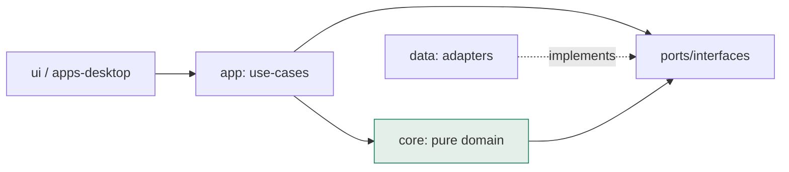

# 01 — Project Structure & Function Context

> **Navigation**: [🏠 Reference Hub](../INDEX.md) · [📂 04. Clean-Room Engineering Epics](INDEX.md) · [🌐 Dynamic Portal](../dynamic-portal.html) · [⬅️ Lottery Studio Rebuild — Build-Ready Specification](00-INDEX.md) · [02 — Conventions: the Prompt Template, Quality Gate & Definition of Done ➡️](02-conventions.md)

<!-- TOC_BLOCK_START -->
<details open>
<summary><strong>📑 On This Page (Table of Contents)</strong></summary>

- [Monorepo layout](#monorepo-layout)
- [Dependency rule (enforced)](#dependency-rule-enforced)
- [Context for every major function (deep-module map)](#context-for-every-major-function-deep-module-map)
- [Core value types (shared across modules)](#core-value-types-shared-across-modules)

</details>
<!-- TOC_BLOCK_END -->

The structure encodes the architecture from `../Documentation/07`: a **pure domain
core** wrapped by an application layer, fed by swappable data adapters, presented by
a desktop shell. Design vocabulary follows `/codebase-design`: we build **deep
modules** — a lot of behavior behind a small interface, testable through that
interface.

## Monorepo layout

```
Lottery Studio/
├── package.json                 # pnpm workspace root
├── pnpm-workspace.yaml
├── turbo.json
├── packages/
│   ├── core/                    # PURE domain — no I/O, no UI, no framework
│   │   ├── src/
│   │   │   ├── game/            # Game, DrawHistory, Combination value types
│   │   │   ├── stats/           # StatisticsEngine + SkipsEngine
│   │   │   ├── filters/         # FilterEngine + 69 filter definitions
│   │   │   ├── wheels/          # WheelLibrary (covering designs)
│   │   │   ├── generation/      # GenerationEngine
│   │   │   ├── predict/         # Predictor + Verifier
│   │   │   ├── tickets/         # TicketSet, Optimizer, Searcher, WinChecker
│   │   │   └── index.ts         # the package's public interface (barrel)
│   │   └── test/                # Vitest unit tests (mirror src/)
│   ├── app/                     # use-cases; orchestrates core + data ports
│   │   └── src/usecases/        # one file per user story action
│   ├── data/                    # adapters implementing core/app ports
│   │   └── src/
│   │       ├── results/         # ResultsRepository (txt/json/mdb-import)
│   │       ├── catalog/         # GameCatalog (games-catalog.csv seed)
│   │       ├── settings/        # SettingsStore
│   │       ├── update/          # OnlineUpdateClient
│   │       └── export/          # Exporters (txt/html/xlsx/print)
│   └── ui/                      # reusable presentation components (React)
│       └── src/components/      # NumberGrid, FrequencyChart, TrendChart, ...
├── apps/
│   └── desktop/                 # Tauri + React shell; wires ui → app → data
│       ├── src-tauri/           # Rust shell (file dialogs, fs, window)
│       └── src/                 # React routes = screens S01..S47
└── fixtures/                    # seed data + validation fixtures
    ├── games-catalog.csv        # from ../Documentation/
    ├── filters-catalog.csv
    └── drawings/                # sample Drawings/*.Txt
```

## Dependency rule (enforced)



- **core** depends on nothing but itself and port *interfaces*. It never imports
  `data`, `ui`, Node, or Tauri.
- **data** depends on core (for types/ports) and outside I/O. UI never imports data
  directly — only `app`.
- The **seam** between app and data is dependency-inverted: core/app declare ports
  (`ResultsRepository`, `SettingsStore`, `GameCatalog`, `Exporter`,
  `UpdateClient`); data supplies adapters. Two adapters make a real seam: a
  file-based repo and an in-memory fake for tests.

## Context for every major function (deep-module map)

Each row is a deep module: small interface, large hidden behavior. "Context" =
where its authoritative behavior spec lives.

| Module (interface) | Responsibility (hidden behavior) | Key interface (small) | Seam / deps | Context |
|---|---|---|---|---|
| **GameCatalog** | Know all games + their rules | `list()`, `get(id)`, `create(rules)` | port → data | Doc 09 §2.1; EPIC-1 |
| **DrawHistory** | Ordered results of one game; windowing | `all()`, `window(range)`, `add/insert/modify/delete`, `splitByWeekday()` | value + ResultsRepository port | Doc 07 §4.1; EPIC-1 |
| **SkipsEngine** | Actual/Average/Now skips of any tracked value | `skips(valuesOverHistory)` | pure | Doc 02 "Skips"; EPIC-2 |
| **StatisticsEngine** | 18 methods over a window + position scope | `analyze(method, {range,positions})` | pure, uses SkipsEngine | Doc 02; EPIC-2 |
| **GenerationEngine** | Random/positional/full/wheel/quick-pick | `generate(mode, pool, opts)` | pure, uses WheelLibrary | Doc 05 §A; EPIC-3 |
| **FilterEngine** | 69 predicates + AND/OR/N-of-M + auto-params + report | `run(pool, filters, logic)`, `defaults(filter, range)` | pure | Doc 03; EPIC-4 |
| **WheelLibrary** | Full + abbreviated covering designs + guarantee | `full(k,n)`, `abbreviated(k,n,guar)`, `instantiate(wheel,pool)` | pure | Doc 04; EPIC-5 |
| **Predictor** | Formula → recommended pool + eliminated | `predict(formula, {history,offset,depth})` | pure, uses SkipsEngine | Doc 05 §B, Doc 09 §2.4; EPIC-6 |
| **Verifier** | Replay formula → per-draw hit-rate | `verify(formula, range)` | pure, uses Predictor | Doc 05 §B3; EPIC-6 |
| **TicketSet** | Ticket store ops: sort/dedupe/tag/hits/combo-freq | `sortLines()`, `dedupe()`, `tag()`, `histogram()`, `comboFreq(size)` | pure | Doc 01 §F; EPIC-7 |
| **Optimizer** | Two cost-reduction strategies | `optimize(set, strategy, params)` | pure | Doc 05 §C; EPIC-7 |
| **Searcher** | 1/2/3-combo appear-count + skips over range | `search(combos, {range,positions})` | pure, uses SkipsEngine | Doc 05 §D; EPIC-7 |
| **WinChecker** | Match tickets vs a draw (=,>,<,≥,≤, bonus) | `check(set, draw, op, n, bonus?)` | pure | Doc 05 §E; EPIC-7 |
| **Entitlements** | Edition capability flags | `can(capability)` | pure config | Doc 00 matrix; EPIC-8 |
| **SettingsStore** (port) | Per-game + global persisted state | `load(scope)`, `save(scope, state)` | data adapter | Doc 07 §4.3; EPIC-8 |
| **Exporter** (port) | TXT/HTML/XLSX/print output | `export(rows, format)` | data adapter | Doc 01 §F13; EPIC-7 |
| **UpdateClient** (port) | Fetch latest draws per game | `fetch(game)` | data adapter | Doc 01 §A11; EPIC-1 |

## Core value types (shared across modules)

```ts
type GameId = string;
interface Game { id: GameId; name: string; pick: number; maxNumber: number;
  bonus?: { count: number; maxNumber: number }; region?: string; file?: string; }
interface Draw { date: string; mains: number[]; bonus?: number[] }
interface Combination { numbers: number[]; bonus?: number[] }
interface Ticket extends Combination { tag?: 'X' | '' }   // see CONTEXT.md decision
type Range = { kind: 'prevN'; n: number } | { kind: 'dates'; from: string; to: string } | { kind: 'all' };
interface Ctx { history: Draw[]; range: Range; positions: number[]; M: number; k: number; lastDraw?: Draw }
```

> The `Ctx` object is the single source of truth passed to every metric/filter —
> build it once per screen and thread it everywhere (Doc 02, Doc 03 contract).

---
> **Next Steps**: [⬅️ Lottery Studio Rebuild — Build-Ready Specification](00-INDEX.md) · [🏠 Reference Hub](../INDEX.md) · [📂 04. Clean-Room Engineering Epics](INDEX.md) · [02 — Conventions: the Prompt Template, Quality Gate & Definition of Done ➡️](02-conventions.md)
