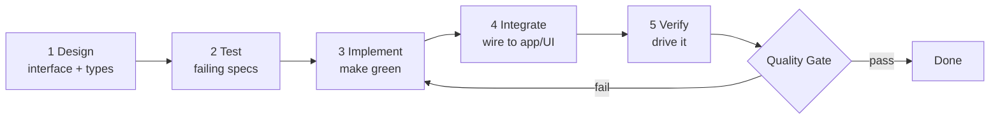

# 02 — Conventions: the Prompt Template, Quality Gate & Definition of Done

> **Navigation**: [🏠 Reference Hub](../INDEX.md) · [📂 04. Clean-Room Engineering Epics](INDEX.md) · [🌐 Dynamic Portal](../dynamic-portal.html) · [⬅️ 01 — Project Structure & Function Context](01-project-structure.md) · [90 — Build Order (start-to-finish sequence) ➡️](90-build-order.md)

<!-- TOC_BLOCK_START -->
<details open>
<summary><strong>📑 On This Page (Table of Contents)</strong></summary>

- [The five-stage workflow chain (every feature)](#the-five-stage-workflow-chain-every-feature)
- [PROMPT TEMPLATE — paste these, filling the `{{…}}` slots](#prompt-template-paste-these-filling-the-slots)
  - [Stage 1 — Design (interface + types)](#stage-1-design-interface-types)
  - [Stage 2 — Test (failing specs from fixtures)](#stage-2-test-failing-specs-from-fixtures)
  - [Stage 3 — Implement (make green)](#stage-3-implement-make-green)
  - [Stage 4 — Integrate (wire to app + UI)](#stage-4-integrate-wire-to-app-ui)
  - [Stage 5 — Verify (drive the real behavior)](#stage-5-verify-drive-the-real-behavior)
- [QUALITY GATE TEMPLATE — every chain ends here](#quality-gate-template-every-chain-ends-here)
- [Definition of Done (per feature)](#definition-of-done-per-feature)
- [Coding standards (brief)](#coding-standards-brief)
- [Test strategy](#test-strategy)
- [The per-feature build loop (how a day looks)](#the-per-feature-build-loop-how-a-day-looks)

</details>
<!-- TOC_BLOCK_END -->

Every feature in every epic is built by running a **workflow chain**. Each chain is
the same five stages, and each stage has an **exact prompt** you paste into your AI
coding agent. The chain ends with a **quality gate** that must pass before the
feature is "done." This file defines those reusable templates once; the epics fill
in the specifics.

---

## The five-stage workflow chain (every feature)



Rationale: test-first (Stage 2 before 3) gives locality and a safety net; the
interface is designed before the implementation so the module stays deep; Stage 5
drives the real behavior, not just unit tests.

---

## PROMPT TEMPLATE — paste these, filling the `{{…}}` slots

Each epic's feature gives you the filled values for `{{FEATURE}}`, `{{MODULE}}`,
`{{INTERFACE}}`, `{{BEHAVIOR}}`, `{{FIXTURES}}`, `{{ACCEPTANCE}}`. Keep the
surrounding instructions verbatim.

### Stage 1 — Design (interface + types)
```
You are building the {{MODULE}} module of the Lottery Studio core (packages/core, pure
TypeScript, strict, no I/O, no UI). Read spec/01-project-structure.md for the value
types and dependency rules.

Design the SMALL public interface for {{FEATURE}}:
{{INTERFACE}}

Rules:
- Deep module: hide {{BEHAVIOR}} behind this interface; expose nothing else.
- Pure functions: accept dependencies as args (the Ctx object), return results, no
  side effects, no globals, no Date.now()/Math.random() inside pure metrics.
- Export only through packages/core/src/index.ts.
Output ONLY: the TypeScript types + function signatures + doc comments. No
implementation bodies yet.
```

### Stage 2 — Test (failing specs from fixtures)
```
Write Vitest tests for {{FEATURE}} in packages/core/test/. Use ONLY these
verified fixtures (they come from the original app's own computed values, so they
are ground truth — do not invent expected values):
{{FIXTURES}}

Cover: the worked examples, the acceptance criteria {{ACCEPTANCE}}, and the edge
cases (empty/min-size input, bonus vs no-bonus, draw-order sensitivity where the
metric is order-dependent). The tests MUST fail now (no implementation yet). Do not
weaken a test to make it pass later.
```

### Stage 3 — Implement (make green)
```
Implement {{FEATURE}} to pass the Stage-2 tests without modifying the tests.
Follow the EXACT validated rules in {{BEHAVIOR}} (e.g. adjacency is computed in
DRAW ORDER not sorted; Average uses floor division; Root Sum is a single digit-sum
pass). Keep it inside the module; if you need a helper another module already owns
(e.g. SkipsEngine), import it — do not reimplement. Run `pnpm test` until green.
```

### Stage 4 — Integrate (wire to app + UI)
```
Expose {{FEATURE}} through a use-case in packages/app/src/usecases/ and, if it has
a screen, wire it into apps/desktop (screen {{SCREEN}}). The UI calls the use-case
only — never core internals. Add the port adapter in packages/data if persistence
or I/O is involved. Do not put domain logic in the UI or the use-case; they only
orchestrate.
```

### Stage 5 — Verify (drive the real behavior)
```
Drive {{FEATURE}} end-to-end and show it working: run the use-case against a real
fixture game (fixtures/drawings/) and print the output; if it has UI, launch the
app and exercise the flow from spec (screen {{SCREEN}}). Confirm the observed
behavior matches {{ACCEPTANCE}}. Report what you ran and the actual output — not a
claim that it "should" work.
```

---

## QUALITY GATE TEMPLATE — every chain ends here

A feature is **not done** until all gate checks pass. Paste this as the final step:

```
QUALITY GATE for {{FEATURE}} — all must be true; fix and re-run any that fail:
[ ] Behavior: every acceptance criterion {{ACCEPTANCE}} passes as an automated test.
[ ] Fidelity: outputs equal the verified fixtures {{FIXTURES}} exactly.
[ ] Purity: packages/core has no import of data/ui/node/tauri (grep to confirm).
[ ] Interface depth: the public surface is only {{INTERFACE}} — nothing leaked.
[ ] Tests: `pnpm test` green; coverage of this module ≥ 90% lines/branches.
[ ] Types: `pnpm typecheck` clean (strict); no `any` in the public interface.
[ ] Lint/format: `pnpm lint` clean.
[ ] Integration: the use-case runs from apps/desktop without touching core internals.
[ ] Docs: the module's doc comment links its Documentation/ source of truth.
[ ] Traceability: PR description links the feature id (e.g. F-2.3) and its epic.
Report the gate as a checked list with the command output that proves each item.
```

---

## Definition of Done (per feature)

1. Quality gate fully green.
2. Acceptance criteria (from `../Documentation/11-Acceptance-Criteria.md`) automated.
3. Merged behind a feature branch with a PR that links the epic + feature id.
4. `CONTEXT.md` updated if the feature introduced or sharpened a domain term.

## Coding standards (brief)

- TypeScript strict; no `any` at module interfaces; exhaustive `switch` on unions.
- Pure core: no I/O, no clock, no randomness inside metrics — randomness lives only
  in the generation adapter and is injected (`rng: () => number`) for deterministic tests.
- Numbers are zero-padded only at the presentation edge; the domain uses `number`.
- One module = one folder = one barrel export; tests mirror `src/`.
- Commits: `type(scope): summary` (e.g. `feat(stats): AC metric`). End commit
  messages with the Co-Authored-By trailer.

## Test strategy

- **Unit** (Vitest): every core metric/filter against verified fixtures.
- **Property** (fast-check): e.g. full-wheel size = C(n,k); filter AND ⊆ OR.
- **Integration**: use-cases against a fixture game with the in-memory repo adapter.
- **E2E** (Playwright): the core flows from `../Documentation/06`.
- **Golden fixtures**: `fixtures/` seeded from `../Documentation/` (validated values).

## The per-feature build loop (how a day looks)

1. Pick the next feature from `90-build-order.md`.
2. Run Stages 1→5 with that feature's prompts (in its epic file).
3. Pass the quality gate.
4. Merge. Update CONTEXT.md if needed. Next feature.

---
> **Next Steps**: [⬅️ 01 — Project Structure & Function Context](01-project-structure.md) · [🏠 Reference Hub](../INDEX.md) · [📂 04. Clean-Room Engineering Epics](INDEX.md) · [90 — Build Order (start-to-finish sequence) ➡️](90-build-order.md)
