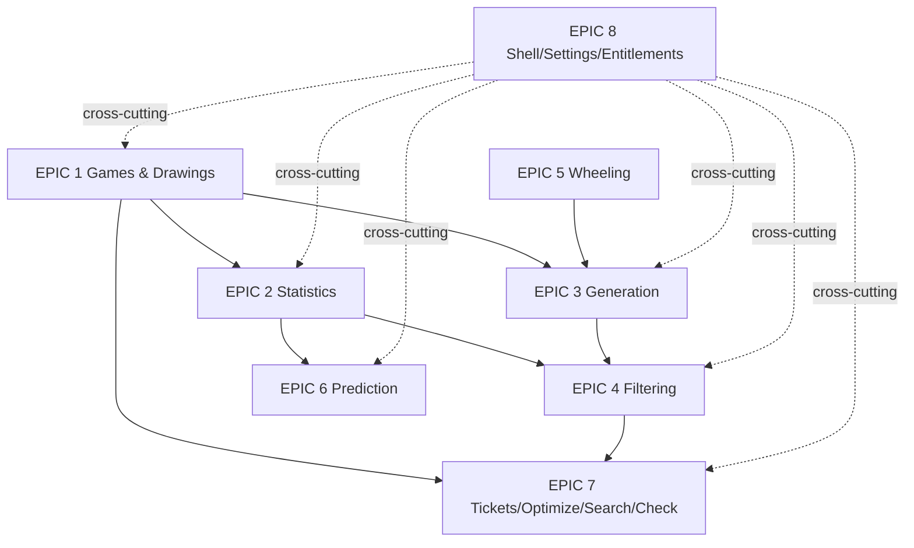

# 90 — Build Order (start-to-finish sequence)

> **Navigation**: [🏠 Reference Hub](../INDEX.md) · [📂 04. Clean-Room Engineering Epics](INDEX.md) · [🌐 Dynamic Portal](../dynamic-portal.html) · [⬅️ 02 — Conventions: the Prompt Template, Quality Gate & Definition of Done](02-conventions.md) · [99 — Weekly Maintenance Protocol ➡️](99-maintenance-protocol.md)

<!-- TOC_BLOCK_START -->

<strong>📑 On This Page (Table of Contents)</strong>

- [Dependency graph (epics)](#dependency-graph-epics)
- [Ordered checklist](#ordered-checklist)
- [Global exit criteria (the destination)](#global-exit-criteria-the-destination)

<!-- TOC_BLOCK_END -->

The exact order to implement, with dependencies and milestones. Each feature runs
its 5-stage chain (`02-conventions.md`) and must pass its quality gate before the
next. Build core-first, UI-per-epic-last, cross-cutting alongside.

## Dependency graph (epics)

## Ordered checklist

**Phase 0 — Scaffold (day 1)**
- [ ] pnpm workspace + Turborepo; `packages/{core,app,data,ui}`, `apps/desktop`.
- [ ] Vitest + Playwright + ESLint + tsconfig (strict) + CI (typecheck/lint/test).
- [ ] `fixtures/` seeded from `../Documentation/` (games-catalog.csv, filters-catalog.csv, sample drawings, `stats-golden.json`).
- [ ] Shell skeleton F8.1 + reusable components F8.4/F8.5 stubs.
- Stage-1 prompt: *"Scaffold the Lottery Studio monorepo per spec/01-project-structure.md: pnpm workspaces, packages core/app/data/ui, apps/desktop (Tauri+React+TS strict), Vitest+Playwright+ESLint, and a CI that runs typecheck/lint/test. Copy the fixtures from Documentation/. No feature code yet."*

**Phase 1 — Data foundation** → EPIC 1: F1.8 → F1.1 → F1.2 → F1.3 → F1.4 → F1.5 → F1.6 → F1.7. *Milestone M1:* open Mega-Sena, edit history, split to one weekday — all in the UI.

**Phase 2 — Statistics** → EPIC 2: F2.1 → F2.2 → F2.3 → F2.4 → F2.5 → F2.6 → F2.7 → F2.8 → F2.9 → F2.10 → F2.11 → F2.12. *Milestone M2:* every method green against golden fixtures (Units 100%); Statistics screen drives all methods.

**Phase 3 — Wheeling then Generation** → EPIC 5 (F5.1 → F5.2 → F5.3 → F5.4 → F5.5) then EPIC 3 (F3.1 → F3.2 → F3.3 → F3.4 → F3.5 → F3.6). *(Wheeling before Generation because F3.4 depends on it.)* *Milestone M3:* generate 924 by full, 7-line wheel with verified guarantee, quick-pick from hot numbers.

**Phase 4 — Filtering** → EPIC 4: F4.1 → F4.2 → F4.3 → F4.4 → F4.5 → F4.6 → F4.7. *Milestone M4:* Flow-4 (924→~60) with a reconciling report; N-of-M works.

**Phase 5 — Prediction** → EPIC 6: F6.1 → F6.2 → F6.3 → F6.4 → F6.5. *Milestone M5:* deterministic recommended pool; verifier reproduces `Validation` hit-rate semantics.

**Phase 6 — Tickets lifecycle** → EPIC 7: F7.1 → F7.2 → F7.3 → F7.4 → F7.5 → F7.6. *Milestone M6:* Flow-7 + Flow-8 (edit → play → check winnings) end-to-end.

**Phase 7 — Cross-cutting hardening** → EPIC 8: F8.2 settings, F8.3 entitlements, polish F8.4/F8.5. *Milestone M7 (release):* the whole play pipeline (Doc 06 Flow-0) works; Free/Pro matrix enforced; all acceptance criteria (Doc 11) automated in CI.

## Global exit criteria (the destination)
- [ ] Every feature's quality gate green.
- [ ] Every acceptance criterion in `../Documentation/11-Acceptance-Criteria.md` is an automated test.
- [ ] The verified fixtures (`../Documentation/10-Validation-Report.md`) pass in CI (statistics parity).
- [ ] The core package imports no I/O/UI (enforced by a lint rule).
- [ ] A user can run Flow-0 start to finish in the built app.

---
> **Next Steps**: [⬅️ 02 — Conventions: the Prompt Template, Quality Gate & Definition of Done](02-conventions.md) · [🏠 Reference Hub](../INDEX.md) · [📂 04. Clean-Room Engineering Epics](INDEX.md) · [99 — Weekly Maintenance Protocol ➡️](99-maintenance-protocol.md)
