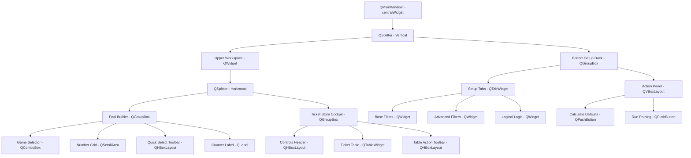

# MDR-103: Sleek Dark Theme and Layout Design

* **Status**: Accepted (Prototype and Design Complete)
* **Date**: 2026-08-22
* **Author**: Antigravity (AI Assistant)
* **Decides**: QSS visual tokens, split-pane layout hierarchy, responsive number grid wrapping, and interactive state styles for the consolidated cockpit.

---

## 1. Visual Theme Tokens (Sleek Dark Mode)

To achieve the premium dark-themed aesthetic requested by the user, we establish the following standardized HEX color tokens. These colors are integrated directly into `desktop/src/theme/manager.py` as `Sleek Dark Mode`:

| Token | Color Role | HEX Value | RGB Value | Purpose |
|---|---|---|---|---|
| `background` | Window Canvas | `#121214` | `(18, 18, 20)` | Deep matte grey main container background |
| `primary` | Neon Accent / Active | `#00F0FF` | `(0, 240, 255)` | Cyber cyan for borders, buttons, headers, combos |
| `primary_hover` | Interaction Hover | `#00D7E6` | `(0, 215, 230)` | Slightly darker cyan for mouse hover highlights |
| `primary_pressed`| Interaction Pressed | `#00C3CF` | `(0, 195, 207)` | Deep cyan for click-hold states |
| `accent` | Highlight / Alert | `#FF3366` | `(255, 51, 102)` | Neon active red for selected pool balls and runs |
| `success` | Positive Metric | `#39FF14` | `(57, 255, 20)` | Radioactive green for positive hits, pass rates |
| `warning` | Cautionary Status | `#FFEA00` | `(255, 234, 0)` | Gold for intermediate alerts and minor errors |
| `error` | Terminal Error | `#FF3366` | `(255, 51, 102)` | Neon active red for error popups, failures |
| `panel` | Secondary Widgets | `#1A1A1E` | `(26, 26, 30)` | Slate grey for inner panels and group boxes |
| `tab_bg` | Inactive Tabs | `#141418` | `(20, 20, 24)` | Dark slate for tab-bar header rails |
| `text` | Main Typography | `#E0E0E5` | `(224, 224, 229)` | High-contrast cool white for main content |
| `text_dim` | Subordinate Text | `#8A8A95` | `(138, 138, 149)` | Muted cool grey for disabled labels and logs |
| `border` | Divider Gridline | `#222226` | `(34, 34, 38)` | Thin slate borders for grid alignments |

---

## 2. Split-Pane Layout Hierarchy

To emulate the functional cockpit workflow of Lottery Studio, we consolidate the interface into a single high-density layout. The container layout is split both horizontally and vertically to enable fluid, user-controlled resizing.



### Layout Resizing Policy & Ratios
1. **Vertical Division (Workspace vs. Setup Dock)**: Managed by the outer `QSplitter` with initial size allocation of **65% top** (`550px`) and **35% bottom** (`300px`). The bottom dock can be collapsed downward by the user to expand table visibility.
2. **Horizontal Division (Pool Builder vs. Ticket Store)**: Managed by the inner `QSplitter` with initial size allocation of **30% left** (`380px`) and **70% right** (`820px`). The scroll area on the left preserves usability if the pane is shrunk.

---

## 3. Interactive NumberGrid States

The `NumberGrid` displays selectable balls from $1..M$ (depending on the game). Rather than hardcoded green/purple states, the grid changes dynamic visual states based on selections and rules:

1. **Default (Unselected) State**:
   - Background: `#1A1A1E`
   - Text / Border color: `#00F0FF` (accent cyan)
   - Border width: `1px solid #222226`
2. **Hover State**:
   - Background: `#222226`
   - Border: `1px solid #00F0FF`
   - Cursor: Pointing hand
3. **Active (Selected) State**:
   - Background: `#FF3366` (active neon red)
   - Text: `#FFFFFF`
   - Border: `2px solid #FF3366`
4. **Disabled (Out-of-Range) State**:
   - Background: `#121214`
   - Text / Border: `#222226`
   - Interactivity: Click disabled (`setEnabled(False)`)

### Responsive Button Grid Wrapping
The button buttons wrap automatically by mapping grid coordinates `(row, col)` from the sequence index:
$$\text{row} = (N - 1) \mathbin{/} \text{columns}, \quad \text{col} = (N - 1) \mathbin{\%} \text{columns}$$
Where `columns` is set to `5` for small pools ($M \le 30$) and `10` for large pools ($M > 30$) to preserve vertical readability.

---

## 4. Runable Layout Prototype

A complete, self-contained layout prototype incorporating this design and stylesheet has been implemented at [prototype_layout.py](file:///mnt/c/Users/ag/Documents/Obsidian/PKM/Workspace/(P) Prediction Engine/lottery/desktop/src/prototype_layout.py). 

Run the prototype from the repository root directory using:
```bash
.venv/bin/python desktop/src/prototype_layout.py
```
*(Requires PySide6 installed in the virtual environment. It renders a fully interactive layout mimicking the final Lottery Studio replacement cockpit.)*
