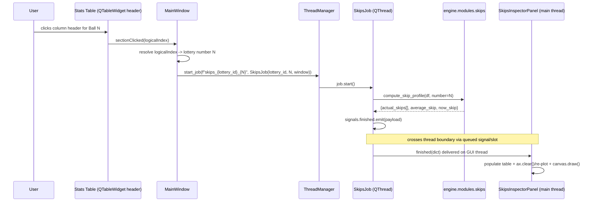
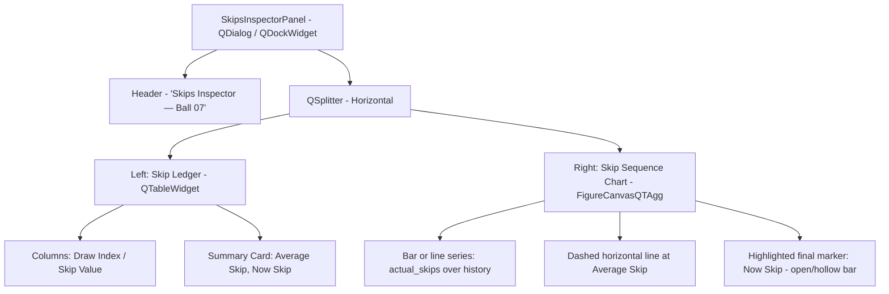

# MDR-104: Interactive Skips Chart — Plotting Library & Drill-down Design

* **Status**: Accepted (Research Complete)
* **Date**: 2026-08-22
* **Author**: Claude (Research Agent)
* **Decides**: Plotting library for all statistical graphs in the PySide6 cockpit (Statistical Cockpit tab, Drawings Distribution trend, filter-assistant frequency charts), and the interaction/threading design for a new "Skips Inspector" drill-down widget (Actual Skips sequence, Average Skip, Now Skip) triggered from a stats-table column header click.

---

## 1. Plotting Library Comparison

Three PySide6-compatible candidates were evaluated against the primary sources that own their APIs: **Matplotlib** (`matplotlib.backends.backend_qtagg.FigureCanvasQTAgg`), **pyqtgraph**, and **`PySide6.QtCharts`**.

| Criterion | Matplotlib (`QtAgg`) | pyqtgraph | `PySide6.QtCharts` |
|---|---|---|---|
| **PySide6 compatibility / maintenance** | First-party Qt backend (`FigureCanvasQTAgg`); actively maintained; already a declared dependency (`matplotlib>=3.9` in `pyproject.toml`'s `desktop` extra). | Explicitly supports PyQt5/PyQt6/PySide2/**PySide6**; requires Qt ≥5.15 or ≥6.2; actively released (0.13.x stable, 0.14.0dev on the `latest` docs channel).[^pg-pypi][^pg-gh] | Ships as part of the official **PySide6-Addons** wheel maintained by The Qt Company; `pip install PySide6` pulls in `PySide6-Essentials` **and** `PySide6-Addons` as one alias, so `QtCharts` is already present with the existing `PySide6>=6.7` dependency — zero new packages.[^pkg-details][^pkg-release] |
| **Rendering perf. under frequent updates** | Full `Figure.clear()` + redraw per update; pyqtgraph's own comparison reports Matplotlib at **~5–15 fps / ~200ms+ latency** for 10,000 continuously-updating points, vs. pyqtgraph's ~50–60 fps / <10ms.[^pg-blog] However, this app's chart updates are **discrete** (fires once per game-context switch or history-window change from a `finished(dict)` slot), not a continuous stream — redrawing a bar/line chart with tens of categories (≤ ~90 lottery numbers) is well under Matplotlib's own worst-case latency. | Built on `QGraphicsScene` with optional OpenGL acceleration; fastest of the three for genuinely continuous/streaming redraws.[^pg-site] Overkill for this app's discrete-update cadence, but not a liability. | `QGraphicsView`-based, GPU-composited via Qt's scene graph; fast enough for discrete bar/line/spline redraws of this size; no published streaming-fps benchmark from Qt was found. |
| **Dark-theme / custom color styling** | Fully granular via `rcParams`, `plt.style.use('dark_background')`, `Figure(facecolor=...)`, `Axes.set_facecolor()`, `Axes.tick_params(colors=...)`.[^mpl-customizing][^mpl-facecolor] Already proven in this repo — `desktop/src/tabs/analysis.py` already drives `Figure(facecolor=...)`, `ax.set_facecolor()`, and `tick_params(colors=...)` for a (currently green "Forensic Neon") theme. | Equally granular: `PlotWidget(background=...)` / `pg.setConfigOption('background', ...)`, and `AxisItem.setPen()` / `setTextPen()` / `setGrid()` accept any `mkPen()`-compatible color spec (hex, RGB tuple, `QPen`).[^pg-axisitem] | `QChart.setTheme(QChart.ChartTheme...)` gives a canned palette, not exact hex matching — real token matching means bypassing `setTheme` and hand-styling every element via `setBackgroundBrush()`, `setPlotAreaBackgroundBrush()`, and per-series `QPen`/`QBrush`.[^qtcharts-qchart] More verbose than the other two for pixel-exact tokens. |
| **Interactivity (hover / click-to-drill-down)** | `FigureCanvasQTAgg.mpl_connect('button_press_event' / 'pick_event', callback)` with `picker=True` on bar `Rectangle` artists gives clean click detection; hover tooltips need a manual `motion_notify_event` + `Axes.annotate()` handler (well-documented official pattern, no extra dependency).[^mpl-events] | `sigClicked` / `sigPointsClicked` work natively only on `PlotCurveItem`, `ScatterPlotItem`, `PlotDataItem`. **`BarGraphItem` has no built-in per-bar click signal** — the pyqtgraph maintainers' own guidance is to fall back to `scene().sigMouseClicked` plus manual hit-testing, or subclass and override `mousePressEvent`.[^pg-issue1679] This is a real gap for bar-heavy views (skips bars, frequency bars). | Purpose-built, turnkey signals: `QAbstractBarSeries.clicked(index, barset)` and `.hovered(status, index, barset)` fire per-bar with zero manual hit-testing — the cleanest API of the three for exactly "click a bar / hover a bar."[^qtcharts-barseries] |
| **Packaging / dependency weight** | Zero new cost — already a hard dependency (`matplotlib>=3.9`) alongside `seaborn>=0.13`. | New dependency not currently in `pyproject.toml`; pyqtgraph itself is a lightweight pure-Python package (its only hard runtime dependency is `numpy`, already required), so the marginal cost is small but non-zero. | Zero new cost — bundled inside the already-declared `PySide6>=6.7` dependency (`PySide6-Addons`).[^pkg-details] |
| **Chart-type coverage (generalizing beyond one widget)** | Full general-purpose 2D toolkit: bar, dual-bar, histogram + curve overlay (`Sum Range Bell Curve`), and **2D heatmap (`imshow`)** — all four already implemented for the "Statistical Cockpit" tab's four analysis views in `desktop/src/tabs/analysis.py`. | Also general-purpose: bar (`BarGraphItem`), line/scatter, and heatmaps via `ImageItem`/`pg.colormap`. Covers the same ground as Matplotlib. | **No native heatmap/2D density chart type.** `QtCharts` offers line, spline, scatter, bar, pie, area, boxplot, candlestick, polar — nothing analogous to `imshow`. The existing "Positional Matrix Heatmap" view has no direct `QtCharts` equivalent without faking it via a dense grid of bar sets. |

---

## 2. Recommendation: Matplotlib (`FigureCanvasQTAgg` / `QtAgg` backend)

**Keep Matplotlib as the single plotting library** for all statistical graphs in the cockpit — the Skips Inspector, the Drawings Distribution trend chart, and the filter-assistant frequency charts — rather than introducing `pyqtgraph` or switching to `PySide6.QtCharts`.

Rationale, tied directly to this app's constraints:

1. **Zero packaging cost, already the incumbent.** `matplotlib>=3.9` (and `seaborn>=0.13`) are already declared in `pyproject.toml`'s `desktop` extra, and `desktop/src/tabs/analysis.py` already implements four Matplotlib-driven analysis views — including one that already computes and renders skip statistics (`"Actual Skips Statistics"`, lines 158–207) and one that renders a 2D heatmap (`"Positional Matrix Heatmap"`, `imshow`, lines 244–282) that `QtCharts` structurally cannot reproduce. Standardizing on Matplotlib avoids fragmenting the cockpit across two charting stacks.
2. **The update pattern is discrete, not streaming.** pyqtgraph's fps/latency advantage is proven for continuously-updating series (10,000 points at high frequency).[^pg-blog] This app's charts update once per `finished(dict)` signal — a game-context swap or a history-window change (last 50 vs. last 100 draws) — over pool sizes that never exceed roughly 90 numbers. A full `Figure` clear-and-redraw at that cadence is imperceptible; the workload this app has does not stress the axis where pyqtgraph wins.
3. **Interactivity is fully achievable with official, documented APIs.** `FigureCanvasQTAgg.mpl_connect('pick_event', ...)` with `picker=True` set on bar `Rectangle` artists gives clean click detection for click-to-drill-down; hover tooltips are a standard `motion_notify_event` + `Axes.annotate()` pattern from Matplotlib's own event-handling guide.[^mpl-events] This is comparable in effort to pyqtgraph's manual `BarGraphItem` hit-testing workaround, and strictly less effort than porting the existing heatmap/bell-curve views to a library that can't natively express them.
4. **Styling exactly matches the Sleek Dark Mode tokens** (see §4) via `rcParams`, `Figure(facecolor=...)`, `Axes.set_facecolor()`, and `Axes.tick_params(colors=...)` — the same primitives `analysis.py` already uses, just retargeted from the legacy "Forensic Neon" hex values to the `#121214`/`#00F0FF`/`#FF3366`/`#39FF14`/`#FFEA00` token set from MDR-103.
5. **Threading fits cleanly.** All chart mutation already happens in main-thread slots (`AnalysisTab.set_lottery()`, `on_analysis_changed()`), matching the `JobSignals.finished(dict)` contract from MDR-101 — a worker thread computes the skip payload, emits `finished(dict)`, and a main-thread slot calls `self.ax.clear()` / re-plots / `self.canvas.draw()`. No canvas or figure object is ever touched off the GUI thread.

`pyqtgraph` remains the right call only if the roadmap later adds genuinely continuous/streaming visualizations (e.g. a live-updating spectral/resonance view redrawing many times per second); it is not justified for the drill-down widget described here. `QtCharts` is rejected primarily on the heatmap gap and the verbosity of pixel-exact token styling versus `rcParams`, despite its cleaner native `clicked`/`hovered` bar signals.

---

## 3. Skips-Inspector Interaction Design

### 3.1 Trigger → Compute → Render Flow



This is the same `JobSignals` contract already standardized in MDR-101 (`progress`, `new_log`, `finished(dict)`, `failed`) — no new signal schema is introduced. The worker never touches a widget; it only builds the plain-`dict` payload.

### 3.2 Engine-side Skips Calculation

The current inline logic in `desktop/src/tabs/analysis.py` (lines 158–182) computes skips for *all* numbers by iterating `df.iterrows()` per number — fine for a one-shot forensic bar chart of every number, but it should not be reused as-is for a single-number, on-click drill-down: it's O(pool_size × draws) and does the work inline inside a UI-adjacent module. For the drill-down, promote a single-number version into the engine layer (e.g. `engine/modules/skips.py`) so it's testable and reusable by both the desktop app and any future CLI command:

```python
# engine/modules/skips.py
from __future__ import annotations
import numpy as np
import pandas as pd

def compute_skip_profile(df: pd.DataFrame, number: int) -> dict:
    """
    df: draws ordered oldest -> newest, with a 'numbers' column of lists/arrays.
    Returns Actual Skips sequence, Average Skip, and Now Skip for `number`.
    """
    total_draws = len(df)
    hit_mask = df["numbers"].apply(lambda nums: number in nums).to_numpy()
    appearances = np.flatnonzero(hit_mask)

    if appearances.size == 0:
        return {
            "number": number,
            "actual_skips": [],
            "average_skip": float(total_draws),
            "now_skip": total_draws,
            "total_draws": total_draws,
        }

    gaps = np.diff(appearances) - 1  # skip between each consecutive hit
    now_skip = int(total_draws - 1 - appearances[-1])

    return {
        "number": number,
        "actual_skips": gaps.tolist(),           # chronological sequence, oldest gap first
        "average_skip": float(gaps.mean()) if gaps.size else 0.0,
        "now_skip": now_skip,                    # current open gap since last hit
        "total_draws": total_draws,
    }
```

`SkipsJob` (a `QThread` subclass following the `ForecastJob` template from MDR-101) calls `storage.load_draws(lottery_id, limit=window)` (already vectorizable — see `desktop/src/tabs/analysis.py:88`), then `compute_skip_profile()`, and emits the result dict via `JobSignals.finished`.

### 3.3 Inspector Panel Layout



* **Left pane (30%)** — a `QTableWidget` (two columns: `Draw Index`, `Skip Value`), most-recent-gap first, matching the read-only styling already used for `db_tab`/`verification_tab` (`QHeaderView.Stretch`, JetBrains Mono font). A small summary card above or below the table shows **Average Skip** (in `success` green `#39FF14`) and **Now Skip** (in `warning` gold `#FFEA00` if `now_skip <= average_skip`, or `accent` red `#FF3366` if `now_skip > average_skip` — i.e. the number is currently "overdue").
* **Right pane (70%)** — the actual-skips sequence rendered as a bar (or line) chart across history, `Figure(facecolor='#121214')`, with a dashed `success`-colored horizontal reference line at the average skip value, and the current open gap (`now_skip`) drawn as a distinct, un-filled/hatched final bar in `accent` red so it visually reads as "still counting" rather than a completed historical skip.
* **Panel host**: given the existing tab structure (`desktop/src/main.py` lines 58–74, no dockable panels today), the cleanest integration is a modal-less `QDialog` (or a `QDockWidget` if more persistent, always-visible inspection is desired later) launched from the "Statistical Cockpit" tab, so the user can keep the underlying stats table visible while inspecting a specific ball.
* **Stats-table trigger**: connect `QTableWidget.horizontalHeader().sectionClicked` (standard `QHeaderView` signal — no custom widget subclassing needed) to a slot that maps `logicalIndex` → lottery number and calls `ThreadManager.start_job(...)`.

---

## 4. QSS / Styling Hooks — Matplotlib to Sleek Dark Mode Tokens

Matplotlib exposes three cooperating levers, all cited from the official docs:

* **Global defaults**: `matplotlib.rcParams` (a dict-like global config, also settable via `plt.style.use(...)` / `plt.rcParams.update(...)`), including `axes.facecolor` and `figure.facecolor` keys.[^mpl-customizing]
* **Per-figure background**: `matplotlib.figure.Figure(facecolor=...)` at construction, or `Figure.set_facecolor(color)` after the fact.[^mpl-facecolor]
* **Per-axes background/foreground**: `Axes.set_facecolor(color)` for the plot-area fill, and `Axes.tick_params(colors=...)` for tick marks/labels — both already used in `desktop/src/tabs/analysis.py`.

Applied to the Sleek Dark Mode tokens from MDR-103:

```python
import matplotlib as mpl
from matplotlib.figure import Figure
from matplotlib.backends.backend_qtagg import FigureCanvasQTAgg as FigureCanvas

SLEEK_DARK = {
    "background": "#121214",
    "primary":    "#00F0FF",   # cyan gridlines / axes / primary series
    "accent":     "#FF3366",   # active-red: "now skip" / overdue markers
    "success":    "#39FF14",   # green: average-skip reference line
    "warning":    "#FFEA00",   # gold: cautionary skip state
    "panel":      "#1A1A1E",
    "border":     "#222226",
    "text":       "#E0E0E5",
    "text_dim":   "#8A8A95",
}

# 1. Global rcParams (applies to every Figure created after this call)
mpl.rcParams.update({
    "figure.facecolor": SLEEK_DARK["background"],
    "axes.facecolor":   SLEEK_DARK["panel"],
    "axes.edgecolor":   SLEEK_DARK["border"],
    "axes.labelcolor":  SLEEK_DARK["text_dim"],
    "xtick.color":      SLEEK_DARK["text_dim"],
    "ytick.color":      SLEEK_DARK["text_dim"],
    "grid.color":       SLEEK_DARK["border"],
    "text.color":       SLEEK_DARK["text"],
    "font.family":      "JetBrains Mono",
})

# 2. Per-figure / per-axes (mirrors the existing analysis.py pattern)
figure = Figure(figsize=(8, 4), facecolor=SLEEK_DARK["background"])
canvas = FigureCanvas(figure)
ax = figure.add_subplot(111)
ax.set_facecolor(SLEEK_DARK["panel"])
ax.tick_params(colors=SLEEK_DARK["text_dim"])
for spine in ax.spines.values():
    spine.set_color(SLEEK_DARK["border"])

# Series colors follow the semantic tokens directly:
ax.bar(x_vals, actual_skips, color=SLEEK_DARK["primary"], edgecolor=SLEEK_DARK["border"])
ax.axhline(average_skip, color=SLEEK_DARK["success"], linestyle="--", linewidth=1.5, label="Average Skip")
ax.bar([x_vals[-1] + 1], [now_skip], color=SLEEK_DARK["accent"], hatch="//", label="Now Skip")
ax.legend(facecolor=SLEEK_DARK["panel"], labelcolor=SLEEK_DARK["text"], edgecolor=SLEEK_DARK["border"])
```

### 4.1 Click / Hover Wiring for the Drill-down

```python
def on_pick(event):
    # event.artist is the Rectangle (bar) that was clicked; picker=True must be set on the artist.
    number = bar_index_to_number[event.artist.get_x()]
    launch_skips_inspector(number)

canvas.mpl_connect("pick_event", on_pick)

annotation = ax.annotate("", xy=(0, 0), xytext=(10, 10), textcoords="offset points",
                          bbox=dict(boxstyle="round", fc=SLEEK_DARK["panel"], ec=SLEEK_DARK["primary"]),
                          color=SLEEK_DARK["text"])
annotation.set_visible(False)

def on_hover(event):
    # standard motion_notify_event + annotate hover-tooltip pattern (matplotlib event-handling guide)
    ...

canvas.mpl_connect("motion_notify_event", on_hover)
```

`mpl_connect` / `pick_event` / `button_press_event` / `motion_notify_event` are documented in Matplotlib's official *Event handling and picking* guide.[^mpl-events]

---

## Sources

[^mpl-customizing]: Matplotlib — [Customizing Matplotlib with style sheets and rcParams](https://matplotlib.org/stable/users/explain/customizing.html) (`rcParams`, `axes.facecolor`, `figure.facecolor`, `dark_background` style).
[^mpl-facecolor]: Matplotlib API — [`matplotlib.figure.Figure.set_facecolor`](https://matplotlib.org/stable/api/_as_gen/matplotlib.figure.Figure.set_facecolor.html), [`matplotlib.axes.Axes.set_facecolor`](https://matplotlib.org/stable/api/_as_gen/matplotlib.axes.Axes.set_facecolor.html).
[^mpl-events]: Matplotlib — [Event handling and picking](https://matplotlib.org/stable/users/explain/figure/event_handling.html) (`mpl_connect`, `pick_event`, `button_press_event`, `motion_notify_event`).
[^pg-pypi]: [pyqtgraph on PyPI](https://pypi.org/project/pyqtgraph/) — PyQt5/PyQt6/PySide2/PySide6 support, Qt ≥5.15 or ≥6.2 requirement.
[^pg-gh]: [pyqtgraph/pyqtgraph on GitHub](https://github.com/pyqtgraph/pyqtgraph) — release activity and Qt-binding compatibility matrix.
[^pg-site]: [pyqtgraph.org](https://www.pyqtgraph.org/) / [pyqtgraph.com](https://pyqtgraph.com/) — "Fast 2D/3D Scientific Plotting" project description, `QGraphicsScene`-based architecture.
[^pg-blog]: pyqtgraph.com — ["Is PyQtGraph Better Than Matplotlib for Live Plots?"](https://pyqtgraph.com/is-pyqtgraph-better-than-matplotlib-for-live-plots/) (10,000-point continuous-update benchmark: ~50–60 fps / <10ms for pyqtgraph vs. ~5–15 fps / ~200ms+ for Matplotlib).
[^pg-axisitem]: [pyqtgraph `AxisItem` API reference](https://pyqtgraph.readthedocs.io/en/latest/api_reference/graphicsItems/axisitem.html) — `setPen()`, `setTextPen()`, `setTickPen()`, `setGrid()`.
[^pg-issue1679]: [pyqtgraph/pyqtgraph GitHub Issue #1679](https://github.com/pyqtgraph/pyqtgraph/issues/1679) — "How to make plot support mouseClick?"; confirms `sigClicked` is limited to `PlotCurveItem`/`ScatterPlotItem`/`PlotDataItem`, and `BarGraphItem` requires manual `scene().sigMouseClicked` hit-testing or subclassing.
[^qtcharts-qchart]: [`PySide6.QtCharts.QChart` — Qt for Python](https://doc.qt.io/qtforpython-6/PySide6/QtCharts/QChart.html) — `setTheme()`, `ChartTheme`, `setBackgroundBrush()`, `setBackgroundVisible()`, `setPlotAreaBackgroundBrush()`, `setPlotAreaBackgroundVisible()`.
[^qtcharts-barseries]: [`PySide6.QtCharts.QAbstractBarSeries` — Qt for Python](https://doc.qt.io/qtforpython-6.5/PySide6/QtCharts/QAbstractBarSeries.html) — `clicked(index, barset)` and `hovered(status, index, barset)` signals.
[^pkg-details]: [Qt for Python — Package Details](https://doc.qt.io/qtforpython-6/package_details.html) — `PySide6-Essentials` / `PySide6-Addons` wheel split.
[^pkg-release]: [Qt for Python — PySide6 Release Notes](https://doc.qt.io/qtforpython-6/release_notes/pyside6_release_notes.html) — confirms `pip install pyside6` installs both `PySide6-Essentials` and `PySide6-Addons` (which contains `QtCharts`).
